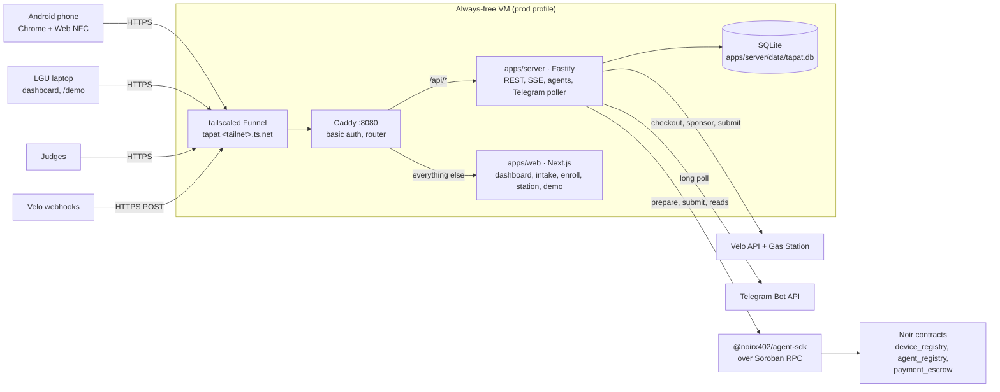

# TAPat

**TAPat lets an AI agent release, cap, and return fuel aid for tricycle drivers — Noir policies on Stellar, Velo for the budget and the fees.**

**Live website:** set at DEP2 as the Funnel URL (`https://tapat.<tailnet>.ts.net`, basic auth) — **not deployed yet**; the deployment is scheduled for Nov 6 ([`docs/deployment.md`](docs/deployment.md)).

**Demo video (2 min):** recorded at V1 on Nov 7 (the 2-minute cut, plus a full-length backup recording) — **not recorded yet**; both links are added at submission.

**Team:** Jim, Dev2, BegA, BegB — role tags, not real names ([`docs/build-schedule.md`](docs/build-schedule.md)); the names and Discord handles are registered through the Google Form at submission.

## Problem

The 2026 fuel subsidy showed the trade-off every aid program faces: safe and slow, or fast and leaky. Money moves as one lump sum with no rules attached and no way to recover it until an audit a year later.

| Statistic | Figure | Source |
|---|---|---|
| Drivers slated for the subsidy | 723,000 tricycle drivers at ₱5,000 each | Philippine News Agency (PNA), as cited in `TAPat Hackathon Build Plan.pdf` |
| Leakage at risk | ₱2.7B nearly lost to duplicate and ghost beneficiaries | DSWD, via Daily Tribune, as cited in the build plan |
| Money that never arrived | ₱709.88M in DOTr subsidies unpaid or expired, leftovers returned to the treasury after two years | COA, via Astig.ph and NET25, as cited in the build plan |
| Human cost | DSWD kept payouts in person to stop ghosts; drivers fainted in heat-exposed queues | Build plan, page 1 |

Once aid is disbursed, nothing stops an over-cap charge or a charge from a never-vetted station, unspent money is only discovered at audit time, ghosts are caught by caseworkers, and tranches arrive on a budget calendar instead of on the price shock that hurts drivers.

## Solution

An LGU officer uploads the masterlist they already have. A matching + conformal-risk-control pass removes ghosts and flags only the genuinely uncertain drivers for one Telegram evidence message. A driver is enrolled in a minute with an NFC card. From then on the money is programmed:

- **Fund** — a price-driven Tranche Agent releases a ₱1,500 escrow per card only when the DOE diesel price shift is real and inside a Velo-verified budget.
- **Refuse** — a per-card Noir policy caps, expires, and nonces every tap at any NFC Android phone; a Freeze Agent scores card-to-station tap edges with MIDAS-F and pauses anomalous stations (new taps refused, settlement held).
- **Return** — at program end the unspent escrow is swept back to the LGU wallet the same day, and one CSV gives the COA a tx hash behind every number.

Full feature specifications: [`docs/PRD.md`](docs/PRD.md). The demo script: [`docs/demo-runbook.md`](docs/demo-runbook.md).

## How the agentic payment works

The product is judged on three money decisions made by software, each inside limits the LGU signs:

| # | Decision | Agent | On-chain enforcement |
|---|---|---|---|
| G1 | **Fund** — release a tranche only when a price shift is real and above the LGU threshold, and only within verified budget | Tranche Agent | `payment_escrow.fund_escrow()` per card, signed by the Program Wallet |
| G2 | **Refuse** — reject an over-cap or expired payment, and freeze a station whose tap pattern is anomalous | Card agent (per-tap policy) + Freeze Agent | `agent_registry.register_agent()` policy (`max_amount`, `asset`, `expires_at`) enforced inside `payment_escrow.authorize()`; freeze holds `claim()` |
| G3 | **Return** — send unspent balances back to the LGU at program end, the same day | Sweep runner | `agent_registry.revoke_agent()` then `payment_escrow.sweep_on_revoke()` |

Before any tranche may be funded, the budget itself is ledger-verified: the LGU Budget Office pays one **Velo hosted checkout** intent, and a signed webhook (with a 3 s poller fallback) credits `budget_verified_stroops` exactly once.

A tap is a contract simulation, not a checkout: the station page posts the normalized card UID and the peso amount, the API prepares `payment_escrow.authorize(agent, device_hash, merchant=station, XLM SAC, amount, nonce)` through the Noir SDK, and the contract's own `check_payment` predicate decides. On `NoirContractError` code 3 (`AgentNotAuthorized`) the API re-reads the policy with the SDK's `checkPayment` and reports `EXPIRED`, `OVER_CAP`, or `POLICY_DENIED`; code 2 (`InsufficientBalance`) reports `INSUFFICIENT_ESCROW`. A rejected tap submits no transaction. Every accepted tap is fee-sponsored and gets a Telegram receipt.

## Architecture



- `apps/web` is presentation only and talks to `/api/*` (the Next.js rewrite locally, Caddy in prod). It holds no secret.
- `apps/server` owns every secret, every agent decision, every `chain_txs` row and SQLite; it calls every contract through `@tapat/agent`. The agents and the Telegram poller run in that one process, so the host must be always-on.
- `packages/agent` (`@tapat/agent`) is the chain module and the algorithms: `src/chain/**` (Noir SDK wrapper, Velo gas) and `src/algorithms/**`. It is pure — no env, no SQLite, no HTTP; `apps/server` passes config and clients in and persists `chain_txs`.
- The long version, including the money flow and the prod/dev env profiles: [`docs/system-design.md`](docs/system-design.md) §1–§3 and [`docs/deployment.md`](docs/deployment.md).

## Noir integration

**SDK:** `@noirx402/agent-sdk@0.3.0`, pinned exactly in [`packages/agent/package.json`](packages/agent/package.json). Noir is called **only** through this SDK — no direct contract invocation — and [`createNoirClient`](packages/agent/src/chain/noir.ts) refuses a config whose contract IDs or passphrase differ from the SDK's built-in `TESTNET`, because calling other contract IDs does not count. The chain spike [`apps/server/scripts/spike-authorize.ts`](apps/server/scripts/spike-authorize.ts) exercises the same path.

**Contracts called** (Stellar Testnet):

| Contract | Testnet ID |
|---|---|
| `device_registry` | `CAC4KOLHDLDYDWBOKXNKRN5KVHO56PLOIFXDLTBUWGVN6GVDEB7FQHU5` |
| `agent_registry` | `CCMZDSPTLX7IIJWCYEUM5DJUHOSOYSTHGK777S2TXZWEMC5ZZGPJ3EBV` |
| `payment_escrow` | `CC7EAW5FNJEDBS7THM5IT6XIOHO4AOYMLXT3KSZ3HWUIKEACTW7E5BFS` |

**SDK methods used** (proven end to end by the chain spike):

| Method | Used for | Where |
|---|---|---|
| `new NoirAgentClient({ network: 'testnet', rpcUrl })` | The single client for all reads and writes | `createNoirClient` in [`packages/agent/src/chain/noir.ts`](packages/agent/src/chain/noir.ts) |
| `noir.prepare(source, op)` | Builds and simulates the operation; returns unsigned XDR (one `invokeHostFunction` op, source = signer) | `signNoirCall` in [`noir.ts`](packages/agent/src/chain/noir.ts) |
| `keypairSigner(secret).signTransaction(...)` | Server-side signing of the prepared XDR | `signNoirCall` in [`noir.ts`](packages/agent/src/chain/noir.ts) |
| `noir.submit(signedXdr, op)` | Submits in direct mode and resolves once the network confirms | `submitDirect` in [`noir.ts`](packages/agent/src/chain/noir.ts) |
| `velo.gas.sponsor` → `submit` → `getStatus`/`waitForResult` | Sponsors every write; the status hand-off is recovered by identity, never resubmitted | `submitSponsored` in [`packages/agent/src/chain/gas.ts`](packages/agent/src/chain/gas.ts) |
| `noir.checkPayment({deviceHash, agent, asset, amount})` | The contract's own `check_payment` predicate, used to name a refusal reason | [`spike-authorize.ts`](apps/server/scripts/spike-authorize.ts) |
| `noir.getEscrowBalance(deviceHash)` | Escrow balance reads | [`spike-authorize.ts`](apps/server/scripts/spike-authorize.ts) |
| `TESTNET` | Assertion that the SDK's deployed IDs and passphrase equal ours | [`noir.ts`](packages/agent/src/chain/noir.ts) |

**Operations** (`NoirOperation` values): `registerDevice`, `registerAgent`, `fundEscrow`, `authorize`, `claim`, `revokeAgent`, `sweepOnRevoke`, `revokeDevice`, `defundEscrow`; the spike exercises `registerDevice`, `registerAgent`, `fundEscrow` and `authorize` in [spike-authorize.ts](apps/server/scripts/spike-authorize.ts).

The modules live in `packages/agent` (`@tapat/agent`): `src/chain/noir.ts` (`createNoirClient` and `signNoirCall`/`submitDirect`) and `src/chain/gas.ts` (`submitSponsored`: Velo sponsor → exactly one submit → status recovery). The package is pure — `apps/server` passes the config and clients in, and owns the `chain_txs` persistence and the 5 s reconciler. Remaining work is tracked as C1/C2 in [`docs/build-schedule.md`](docs/build-schedule.md). `@stellar/stellar-sdk` stays only for `Keypair`, `TransactionBuilder.fromXDR`, and signing.

## Velo integration

**SDK:** `@carts1024/velo-sdk@1.0.0`, pinned exactly in [`packages/agent/package.json`](packages/agent/package.json) — npm `latest` was published 2026-11-05, so the handbook's "use `@alpha`, latest is stale" advice no longer applies.

Velo does three jobs, each verified in [`docs/system-design.md`](docs/system-design.md):

1. **Verify the budget.** The LGU Budget Office pays one Velo hosted checkout intent; the API verifies the intent through the signed webhook and a poller before any tranche can be funded.
2. **Sponsor every Noir call through the Gas Station.** `velo.gas.sponsor(xdr, {idempotencyKey})` only reserves fee exposure; the hand-off is exactly one `velo.gas.submit({requestId, transactionHash, transactionXdr})`. A failure after hand-off is recovered by identity (`getStatus`) and never resubmitted ([`packages/agent/src/chain/gas.ts`](packages/agent/src/chain/gas.ts), exercised by [`spike-authorize.ts`](apps/server/scripts/spike-authorize.ts)).
3. **Deliver signed webhooks.** `POST /api/webhooks/velo` verifies `x-velo-signature` over the raw body, dedupes on `x-velo-delivery`, and answers a bad or missing signature with **400 `WEBHOOK_SIGNATURE_INVALID`**.

Velo does **not** verify per-tap payments: Velo marks an intent paid only for a classic `payment` to the project's receiver, which an escrow `authorize()`/`claim()` can never be. Per-tap enforcement is Noir's cap, expiry and escrow balance.

## Testnet proof

SPK chain spike via `@noirx402/agent-sdk`, Nov 5 — one throwaway card, registered through the SDK, each call on Stellar Testnet:

| Step | Transaction |
|---|---|
| `registerDevice` | https://stellar.expert/explorer/testnet/tx/37abcb4d681836e1992b835e9c3d0538f9c1dd44332f81b91446f19c6fb4d3d5 |
| `registerAgent` | https://stellar.expert/explorer/testnet/tx/8401ba4540b58d5878b7fb7f94dc993fc5071730c934a4d2ff1caa72f4fe7ca5 |
| `fundEscrow` | https://stellar.expert/explorer/testnet/tx/9486174c7a1b0f470d0453a78621a958d8b50c4edabb530ed2fa726c358f8ba1 |
| `authorize` | https://stellar.expert/explorer/testnet/tx/405c6e80e007043455be4e38b11ead94fb29317fce0dbacc1cfd1cb60990bf8b |

**Velo Gas Station sponsored registration (earlier pre-SDK spike run, Nov 5):** https://stellar.expert/explorer/testnet/tx/88bee2997eac568b47f02d79f1a80b844c355d213eac43765c37cd5b42b596cf — that fee-bump wrapped a raw `device_registry.register` contract call from the pre-SDK spike, not an XDR built by the Noir SDK.

**Velo Gas Station sponsorship of an SDK-built XDR (Nov 5):** https://stellar.expert/explorer/testnet/tx/546dc3227c2ef9b30389b61cc15e7dea83ff255b1a64d427b1ee29f636c714a0 — `registerDevice` built by `@noirx402/agent-sdk`, sponsored and submitted by the Velo Gas Station (`succeeded`, fee 58,832 stroops; RPC SUCCESS).

Velo's status endpoint sometimes lags behind the ledger: `registerAgent` https://stellar.expert/explorer/testnet/tx/8f21b54a90a0c8fd875332e2ea3e9dd60f5dcfbdaf65e3d25a0b7e1465017e89 was already SUCCESS on-chain while Velo still reported `submitted`, so the hand-off is recovered by identity and never resubmitted.

## Repo structure

```text
TAPat/
├─ apps/
│  ├─ server/     Fastify 5 + tsx: every secret, every contract write, the services, SQLite
│  │  ├─ src/     config.ts, server.ts, db/ (schema.sql + driver); services/, routes/ and
│  │  │           velo/ are being built in C1–C5
│  │  ├─ scripts/ bootstrap-accounts, spike-authorize, seed/reset-demo, fixture generators
│  │  └─ config/  midas.json (planned — calibrated MIDAS-F threshold, created by
│  │              calibrate-midas.ts in task MID)
│  └─ web/        Next.js App Router + Tailwind; / renders today, /intake, /enroll,
│                 /station/[id] and /demo land in UI1; lib/api.ts, lib/sse.ts and lib/nfc.ts
│                 are the only fetch, stream and NFC entry points (UI1–UI2)
├─ packages/
│  ├─ agent/      @tapat/agent: src/chain/ (noir.ts — Noir SDK client and signing;
│  │              gas.ts — Velo gas) and src/algorithms/ (names, matcher, crc, bocpd, cms,
│  │              midas — planned NM/MT/BOC/MIDAS); pure — no env, no SQLite, no HTTP
│  └─ shared/     @tapat/shared: types, zod schemas, money.ts, constants.ts (TS source)
├─ fixtures/      calibration, prices, taps — simulated/precomputed inputs, labelled as such
├─ deploy/        Caddyfile, systemd units, provision.sh, update.sh, wizard-aws-vercel.sh (protected: Jim only)
├─ docs/          every design document; start at docs/index.md
└─ .env.example   every variable in one place, no real values (server + web sections)
```

The full planned tree, file by file, is [`docs/index.md`](docs/index.md) §3.

## Run it locally

**Prerequisites:** Node **22.23.4 or a later v22** (`node --version`; the `@noirx402/agent-sdk` engines floor — the Velo SDK needs ≥ 22.6, which this covers), pnpm 9, and the accounts from [`docs/setup.md`](docs/setup.md). Beginners: follow [`docs/prerequisites.md`](docs/prerequisites.md) first.

1. `pnpm install` at the repo root.
2. Copy the env templates and fill them in (see the table below; the committed root `.env.example` lists every variable):
   - `Copy-Item apps/server/.env.example apps/server/.env`
   - `Copy-Item apps/web/.env.example apps/web/.env.local`
3. `pnpm dev` — the root script runs `pnpm -r --parallel --filter server --filter web dev`: the server (`127.0.0.1:4000`) and the web app (`127.0.0.1:3000`) in parallel. To run one side only: `pnpm --filter server dev` or `pnpm --filter web dev`.

Docs:

- [`docs/setup.md`](docs/setup.md) — one-time manual setup: accounts, Freighter, the Velo project and Gas Station key, the public HTTPS origin, the Telegram bot.
- [`docs/test-guide.md`](docs/test-guide.md) — run and test the app locally, step by step.
- [`docs/deployment.md`](docs/deployment.md) — the $0 deployment: one always-free VM under systemd, Caddy, Tailscale Funnel, and the fallback ladder.
- [`deploy/wizard-aws-vercel.sh`](deploy/wizard-aws-vercel.sh) — the interactive AWS EC2 + Vercel deploy (Jim; Git Bash, repo root: `bash deploy/wizard-aws-vercel.sh`). Design: [`docs/deployment.md`](docs/deployment.md) §6.4.
- [`docs/demo-runbook.md`](docs/demo-runbook.md) — the kit, the T-minus timeline, the 3-minute script, and the judge Q&A.
- [`docs/index.md`](docs/index.md) — the doc map and the glossary.

## For judges

Open the demo URL — the submission form has it. The site is public: browse freely, no password or login prompt to look around.

To act, press **Log in** in the top-right and use the **officer account**; its email and password are in the submission form. The officer unlocks every action: masterlist upload, evidence requests, enrollment, station taps, the agents, settlement, and end program. **Create an account** makes a **viewer**: read-only dashboards, and every action shows "Officer login required".

Honesty note: this is enforced by the API, not just the UI. Every write endpoint requires the officer's session — `401 UNAUTHORIZED` without one, `403 FORBIDDEN` for a viewer — while reads stay public; only `/api/auth/*` and the HMAC-signed Velo webhook bypass the check. UI-only gating would be a demo; the server rule is the real boundary.

The officer account is created on a fresh demo by the seed: `seed-demo.ts --officer-email=… --officer-password=…` prints `Officer login: <email> / <password>`. Without `--officer-password` it generates one and prints it once; accounts survive `reset-demo`. On an existing deployment that is already seeded, `create-officer.ts --officer-email=… [--officer-password=…]` creates or promotes the officer without reseeding or touching the chain, and prints the same `Officer login:` line.

## Environment variables

Three files: the committed root `.env.example` lists every variable with no real value (a server section and a web section); the per-app templates it mirrors are `apps/server/.env.example` and `apps/web/.env.example`. At runtime the values live in `apps/server/.env` (the server refuses to boot if one is missing and prints the names) and `apps/web/.env.local` — both git-ignored.

| Name | What it is | Where to get it |
|---|---|---|
| `PORT` | API port, default `4000` | `apps/server/.env.example` |
| `DATABASE_PATH` | SQLite file, default `./data/tapat.db` | `apps/server/.env.example` |
| `PUBLIC_BASE_URL` | Public HTTPS origin, used by Web NFC and Velo webhooks | [`setup.md`](docs/setup.md) stage 5 / [`deployment.md`](docs/deployment.md) §6.3 |
| `STELLAR_RPC_URL` | Soroban Testnet RPC endpoint | `apps/server/.env.example` |
| `STELLAR_NETWORK_PASSPHRASE` | `Test SDF Network ; September 2015` | `apps/server/.env.example` |
| `NOIR_DEVICE_REGISTRY_ID` | Noir `device_registry` contract ID | `apps/server/.env.example` (matches the SDK's `TESTNET`) |
| `NOIR_AGENT_REGISTRY_ID` | Noir `agent_registry` contract ID | `apps/server/.env.example` (matches the SDK's `TESTNET`) |
| `NOIR_PAYMENT_ESCROW_ID` | Noir `payment_escrow` contract ID | `apps/server/.env.example` (matches the SDK's `TESTNET`) |
| `XLM_SAC_ID` | Native XLM Stellar Asset Contract ID | `apps/server/.env.example` |
| `PROGRAM_WALLET_SECRET` | Program Wallet (LGU) secret key | [`setup.md`](docs/setup.md) stage 2, printed by `bootstrap-accounts.ts` |
| `STATION_A_SECRET`, `STATION_B_SECRET` | The two station accounts' secret keys | [`setup.md`](docs/setup.md) stage 2, printed by `bootstrap-accounts.ts` |
| `KEY_ENCRYPTION_SECRET` | 64 hex chars; encrypts card agent keys (AES-256-GCM) | Generate locally: `node -e "console.log(require('crypto').randomBytes(32).toString('hex'))"` |
| `GAS_MODE` | `velo` (sponsor every write) or `direct` | `apps/server/.env.example` |
| `GAS_FALLBACK_DIRECT` | `true` allows a direct send **before** hand-off | `apps/server/.env.example` |
| `VELO_GAS_BASE_URL` | Velo Gas Station base URL | `apps/server/.env.example` |
| `VELO_GAS_API_KEY` | Gas Station testnet key (`tg_test_…`) | Velo dashboard — [`setup.md`](docs/setup.md) stage 4 |
| `VELO_API_KEY` | Velo project API key (`tk_live_…`) for checkout + intents | Velo dashboard — [`setup.md`](docs/setup.md) stage 4 |
| `VELO_WEBHOOK_SECRET` | Webhook signing secret (min 16 chars) | Velo dashboard webhook endpoint — [`setup.md`](docs/setup.md) stage 5 |
| `TELEGRAM_BOT_TOKEN` | Bot token | @BotFather — [`setup.md`](docs/setup.md) stage 6 |
| `TELEGRAM_BOT_USERNAME` | Bot username, no leading `@` | @BotFather — [`setup.md`](docs/setup.md) stage 6 |
| `PHP_PER_XLM` | Display rate, default `10` (labelled "demo rate") | `apps/server/.env.example` |
| `PRICE_TICK_MS`, `FREEZE_TICK_MS` | Demo stream tick times, defaults `700` / `1000` | `apps/server/.env.example` |
| `API_ORIGIN` | Where Next.js rewrites `/api/:path*` (web) | `apps/web/.env.example` |
| `WEB_BASIC_AUTH` | Optional `user:password` basic auth (web, Vercel only) | [`deployment.md`](docs/deployment.md) §9 |

Boot rules and the full validation list: [`docs/api-and-data.md`](docs/api-and-data.md) §7. Never commit `.env` or `.env.local`.

## Screenshots

Not captured yet — taken at V1 on Nov 7 together with the 2-minute demo video, then added here and in the submission form.

## What's next

Deliberate demo limits, stated to judges rather than hidden: Testnet only; no real OCR or vision model (the CSV path is fully live); no PDAX cash-out; no clawback of held pending payments; custodial station and card-agent keys; simulated price/burst streams.

After the hackathon, in order of value: an adapter behind the precomputed OCR/vision path; non-custodial card agent keys (device or passkey custody); a merchant allow-list at the contract layer; a mainnet security audit; and fiat cash-out through PDAX. Details: [`docs/PRD.md`](docs/PRD.md) §6.

## Credits

Built with [Noir](https://noirx402.github.io/noir) (`@noirx402/agent-sdk`), [Velo](https://velo-build.dev) (`@carts1024/velo-sdk`), the [Stellar SDK](https://stellar.github.io/js-stellar-sdk/), [Next.js](https://nextjs.org), [Fastify](https://fastify.dev), [better-sqlite3](https://github.com/WiseLibs/better-sqlite3), and [zod](https://zod.dev). Stellar Testnet, and the [Stellar Expert](https://stellar.expert/explorer/testnet) explorer for every tx link.
