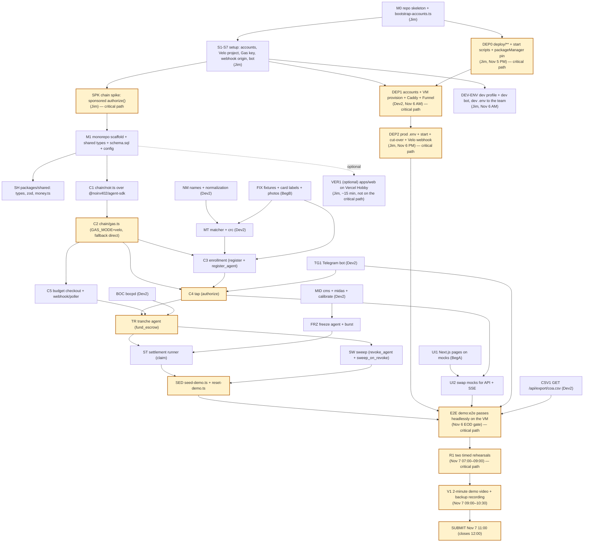

# TAPat Build Schedule — Nov 5 to Nov 8, 2026

Day-by-day build order that turns `docs/system-design.md`, `docs/api-and-data.md` and `docs/algorithms.md` into a demo-ready prototype by the Nov 7 09:00 feature freeze, with submission at Nov 7 11:00 (closing 12:00 noon, Philippine time) and the face-to-face pitch on Nov 8, 13:00–20:00.

Last updated: 2026-11-05

## 1. How to read this schedule

- **Owners** are role tags: **Jim** (expert, integration owner), **Dev2** (mid-level), **BegA** and **BegB** (beginners working through Antigravity AI). Tags only — swap in real names without changing anything else.
- **One task = one small PR** from this schedule. `pnpm test` must pass before pushing.
- **(critical path)** means the task blocks the demo. If a critical-path task slips, take time from a non-critical task the same day; do not push it to Nov 7.
- Every task has an **acceptance check** that someone else can run. A task is done when its check passes, not when the code is written.
- **Simulated / precomputed** labels are part of acceptance, not polish: the UI and the DB must both say which data is simulated (`price_points.simulated`, `taps.simulated`) or precomputed (`beneficiaries.source='ocr_precomputed'`).
- Read `docs/index.md` first, then the doc your task belongs to. Never add an endpoint, env var, error code or table that is not in `docs/api-and-data.md`.

## 2. Critical path graph

The yellow boxes are the critical path. Everything else can finish later in the day without moving the demo date. **VER1 is drawn dashed and stays off the critical path**: it is optional, can be skipped, and nothing in the demo, a gate, or the submission depends on it ([deployment.md §9](deployment.md)). Anyone who starts it and runs out of time simply does not switch it on.

## 3. Gates

| Gate | When | Pass condition | If it fails |
|---|---|---|---|
| **Bootstrap go/no-go** | Nov 5, **23:00** | One sponsored `authorize()` round trip succeeds end to end: enroll a throwaway card by script, fund 1 XLM, `authorize()` submitted **through Velo Gas Station** (`chain_txs.gas_mode='velo'`, status `succeeded`). | Set `GAS_MODE=direct` and continue. TAPat still uses Velo for the budget checkout and signed webhooks; say so plainly in the pitch. Do not spend Nov 6 debugging sponsorship. |
| **Hosting gate** | Nov 6, **18:00** | DEP2 green: `https://tapat.<tailnet>.ts.net/api/health` returns `ok:true` with `gasMode:"velo"`, the VM's `tapat-api`/`tapat-web` survive a `sudo reboot`, and the Velo test delivery returns `200`. Acceptance list: [deployment.md §13](deployment.md), DEP2 checks in [deployment.md §6.3](deployment.md). | Not green → demo from **Jim's laptop + Funnel** ([deployment.md §10](deployment.md) step 3) and keep building; do not spend Nov 7 debugging the VM. |
| **EOD Nov 6 demo gate** | Nov 6, end of day | `pnpm demo:e2e` passes **on the VM**: the 7 beats run headlessly through the API and the dashboard totals equal funded ₱4,500 / spent ₱350 / held ₱960 / returned ₱3,190. | Cut fixture variety (fewer masterlist rows), never a feature or a money decision. |
| **Feature freeze** | Nov 7, **09:00** | No new features merged after this time. Only bug fixes with a repro. Tag the commit: `git tag demo-ready`. | — |
| **Night-before handover** | Nov 7, **21:00** | **Only if we are in the top 10** (announced Nov 7 16:00): printed runbook, `.env` backup **on the USB stick**, the basic-auth credentials card, VM access (`ssh` key + Tailscale login) confirmed by a second person, the 2-minute demo video **and** the full-length backup recording, submission text printed. | — |
| **Submission** | Nov 7, **11:00** | Google Form submitted with **every required item**: repo link, the **2-minute demo video** link, the short write-up, **the live website URL (the Funnel URL, or `https://<project>.vercel.app` only if the optional VER1 passed its acceptance) plus the basic-auth user/password**, team names + Discord handles (all registered through the Google Form), and **at least one Testnet tx hash / Stellar Expert link**. | Submissions close **12:00 noon**; pitch Nov 8 13:00. Leave the 1-hour buffer. |

**Eligibility notes.** Submission requires an **agentic payment** built on Stellar Testnet, with **Noir called only through `@noirx402/agent-sdk`** on the deployed contract IDs (direct contract invocation does not count) and the **Velo SDK** for everything else (Builder Handbook, Nov 5). `C1`/`C2` below follow [system-design.md §4](system-design.md): `packages/agent/src/chain/noir.ts` wraps one `NoirAgentClient`, and `soroban.ts` is gone. The root `README.md` follows the handbook template in order (the `V1` tasks fill it), and the **live website must stay up and seeded from submission through judging** — no redeploys except a bug fix with a repro.

## 4. Nov 5 PM (today)

| ID | Owner | Task | Depends on | Acceptance check |
|---|---|---|---|---|
| PRE | BegA, BegB | **First thing, ~45 min:** install the laptop toolchain and create the accounts per [prerequisites.md](prerequisites.md) — Git, Node 22.23.4+ (the `@noirx402/agent-sdk` engine floor; v22.23.4 or a later v22), pnpm 9, Chrome, Antigravity, Git identity; GitHub invite, Telegram, Google sign-in. Nothing else. | — | prerequisites.md §5 final check passes in a new PowerShell window. |
| M0 | Jim | First commit: `pnpm-workspace.yaml` (with `"name": "server"` in `apps/server/package.json` and `"name": "web"` in `apps/web/package.json`, so every `--filter server` / `--filter web` resolves), root `package.json` scripts `dev` (`pnpm -r --parallel --filter server --filter web dev` — pnpm's built-in runner, no new dependency), `test` (`pnpm -r test`) and `demo:e2e`, `apps/server/package.json`, `.env.example`, `apps/server/scripts/bootstrap-accounts.ts`. Nothing else. | — | `pnpm --filter server tsx scripts/bootstrap-accounts.ts` runs and prints the four account secrets; `pnpm dev` starts both apps and `pnpm demo:e2e` is listed by `pnpm run`. |
| DEP0 | Jim | Author `deploy/**` per [deployment.md §5–§7](deployment.md) (`Caddyfile`, both `.service` units, `provision.sh`, `update.sh`), plus the `start` scripts in the two `package.json` files, the root `package.json` `"packageManager": "pnpm@9.12.0"`, the `listen({ host: '127.0.0.1' })` line, `apps/web/middleware.ts`, and the `/api/*` `no-store` hook. DEP1 has nothing to run without it. | M0 | Files exist and the Caddyfile and units match [deployment.md §5.1–§5.2](deployment.md) line for line. Shell check and adapt runs on the VM at DEP1, right after `provision.sh` — `shellcheck deploy/*.sh && sudo caddy validate --config /etc/caddy/Caddyfile && sudo systemd-analyze verify tapat-api.service tapat-web.service`. |
| S1–S7 | Jim | `docs/setup.md` stages 1–7: Node 22.23.4+ + pnpm + cloudflared, `bootstrap-accounts.ts` (the **prod** accounts), Freighter imports, Velo project + API key + Gas key + contract allow-list, the public HTTPS origin (`PUBLIC_BASE_URL`; on Nov 5 the prod `.env` carries the temporary value `https://localhost:3000`, which satisfies the `https:` boot rule, DEP2 replaces it with the Funnel URL, and the webhook endpoint is registered against the Funnel URL at DEP2), `TELEGRAM_BOT_TOKEN`. | M0 | Every captured value is in `apps/server/.env`; the Velo project shows the 3 Noir contracts linked; `GET /api/health` is checked in M1 once the API exists, and again over the Funnel URL at DEP2. |
| SPK | Jim | **Chain spike (critical path):** throwaway card → `register` → `register_agent` → `fund_escrow(1 XLM)` → `authorize()` submitted through the Velo Gas Station, from a script. | S1–S7 | The script prints the Gas Station status (`succeeded`) and the outer tx hash, and Stellar Expert shows the tx. The same call is later re-run through `gas.ts` in C2 to produce the `chain_txs` row. Record the go/no-go decision. |
| M1 | Jim | Monorepo scaffold per D8 (`pnpm-workspace.yaml`, `apps/web`, `apps/server`, `packages/shared` as **`@tapat/shared`** and `packages/agent` as **`@tapat/agent`**, with `"main": "./src/index.ts"` and `"workspace:*"` deps in the apps; `next.config.ts` with `transpilePackages: ['@tapat/shared']`), `schema.sql` (all 11 tables), zod config loader that refuses to boot on a missing env var and prints the names. | SPK | `pnpm install` at root succeeds; `import { formatPhp } from '@tapat/shared'` compiles in both apps; API boots with a full `.env` and exits with the missing names listed when one is deleted. |
| SH | Jim | `packages/shared` = **`@tapat/shared`** (TS source, `main: ./src/index.ts`, `src/index.ts` re-exports `money.ts`/`types.ts`/`schemas.ts`/`constants.ts`): types, zod schemas, `money.ts` (`phpToStroops`, `stroopsToPhp`, `formatPhp`, `stroopsToXlmString`, `STROOPS_PER_XLM`, `DEFAULT_PHP_PER_XLM` — the exact exports in `docs/api-and-data.md` §1.1), `constants.ts` (`TAP_REASON_LABELS`). **Must land by 18:00 today.** | M1 | A Vitest file in `packages/shared` converts 350 PHP → 350000000 stroops → "₱350.00"; both apps import it as `@tapat/shared` (web through `transpilePackages`, server through `tsx`). |
| NM | Dev2 | `packages/agent/src/algorithms/names.ts` + tests. | — | Dela Cruz / De la Cruz / Delacruz × Juan 1980-03-02 → p ≥ 0.9. |
| MT | Dev2 | `packages/agent/src/algorithms/matcher.ts` + `packages/agent/src/algorithms/crc.ts` + tests. | NM | On the calibration fixture, empirical wrongful-denial ≤ α (0.05) and ghost admission ≤ β (0.02); `GET /api/intake/calibration` numbers come from this code. |
| BOC | Dev2 | `packages/agent/src/algorithms/bocpd.ts` + tests against `fixtures/prices/doe-diesel-sim.json`. | — | Fires at index 33–36 and never at index 15. |
| UI1 | BegA | Next.js pages `/`, `/intake`, `/enroll`, `/station/[id]`, `/demo` per `docs/api-and-data.md` §5.2 #18 (page placement: `/` = budget badge + five tiles + invariant + station strip + card list + one merged activity feed; `/demo` = five buttons + price/tranche panel + edge chart + station strip + settlement result panel), rendered from `apps/web/mocks/` (§5.6) through **`apps/web/lib/api.ts`, the only module that fetches** (each function returns the `@tapat/shared` type). Tailwind, no auth. Starts with layout/shells today; wire money formatting once **SH lands (18:00)**. | SH, PRE | `pnpm --filter web dev` shows all five routes with plausible data, the station strip and settlement panel render from `dashboard.json`/`settlement-response.json`, and every money amount is formatted through `@tapat/shared`. |
| FIX1 | BegB | Review the generator outputs (`gen-prices.ts` seed 3, `gen-taps.ts` seed 7, `gen-calibration.ts` seed 42) and confirm the surprise/ghost counts. | PRE | `fixtures/prices/doe-diesel-sim.json` has 45 points, a day-15 spike to ₱66.0 and the step at day 31. |
| FIX2 | BegB | `fixtures/masterlist/scanned-list.png`: print `masterlist.csv` as a table, handwrite two corrections, photograph it. | FIX1 | PNG is legible when uploaded to `/intake`; `scanned-list.ocr.json.sha256` matches the PNG bytes. |
| FIX3 | BegB | `fixtures/enroll/d4-photo.jpg` + `.json`, `fixtures/orcr/*.jpg` + `.json`; link the team phone to the bot created in S1–S7 and confirm `/start` replies. | PRE | Each fixture has a `.json` with its `sha256` and expected parsed fields; the bot answers `/start`. |
| VER1 | Jim | **Optional, not on the critical path:** publish `apps/web` on Vercel Hobby per [deployment.md §9.2](deployment.md) (Root Directory `apps/web`, env `API_ORIGIN` + `WEB_BASIC_AUTH`). Any time from now to Nov 7; skip it if the day is short. `apps/web/middleware.ts` and the API's `no-store` rule ship regardless. | SH, UI1 | A preview URL renders the five routes on mocks behind basic auth; if switched on for the demo, [deployment.md §9.4](deployment.md) passes |

## 5. Nov 6

### AM

| ID | Owner | Task | Depends on | Acceptance check |
|---|---|---|---|---|
| DEP1 | Dev2 | **Hosting (critical path):** create the free accounts (Oracle A1, else GCP `e2-micro`; Tailscale) per [deployment.md §6.1](deployment.md); run `deploy/provision.sh <repo-url>` (Node 22.23.4+, pnpm, `tapat` user, `/opt/tapat` checkout, Caddy, Tailscale, units copied, nothing started); then `tailscale up --hostname=tapat`, `tailscale funnel --bg 8080`, `caddy hash-password` written with `sudo tee /etc/caddy/tapat-users` ([deployment.md §6.2](deployment.md)), `sudo systemctl enable caddy`, `sudo systemctl restart caddy`. Posts the `https://tapat.<tailnet>.ts.net` URL in the team chat. Holds **no secret**. | DEP0, S1–S7 | The DEP1 check in [deployment.md §6.2](deployment.md): `curl -s https://tapat.<tailnet>.ts.net/api/health` returns `502` from Caddy (the API is not up yet) and any other path returns `401`; after DEP2, `curl -u <user>:<password> https://tapat.<tailnet>.ts.net/` returns the app, not `401`. Also runs DEP0's deferred checks on the VM, right after `provision.sh`: `shellcheck deploy/*.sh && sudo caddy validate --config /etc/caddy/Caddyfile && sudo systemd-analyze verify tapat-api.service tapat-web.service`. |
| DEV-ENV | Jim | **Dev profile:** a **second** `bootstrap-accounts.ts` run in a **separate clone** (never in the prod checkout), a second bot from @BotFather (`@tapat_dev_bot`), `GAS_MODE=direct`, `PUBLIC_BASE_URL=https://localhost:3000`, and the **same** Velo keys; then send the dev `.env` to each teammate privately. | S1–S7 | A teammate's laptop boots on the dev `.env` and `GET /api/health` returns `gasMode:"direct"`; the demo bot's `getUpdates` shows no `409 Conflict` while that laptop runs. Profiles match [deployment.md §4](deployment.md). |
| C1 | Jim | `packages/agent/src/chain/noir.ts` over **`@noirx402/agent-sdk@0.3.0`** (pinned exactly): `createNoirClient` builds one `NoirAgentClient({ network: 'testnet', rpcUrl })` and throws when the SDK's `TESTNET.contracts`/`networkPassphrase` differ from `NOIR_*_ID`/`STELLAR_NETWORK_PASSPHRASE` (so `apps/server` refuses to boot on a mismatch), plus the reads and `checkPayment`. The package is pure — no env, no SQLite, no HTTP: callers pass the config in, and `apps/server` records every `chain_txs` row. `soroban.ts` is removed; `@stellar/stellar-sdk` stays for `Keypair`/`TransactionBuilder.fromXDR`/signing. Per [system-design.md §4](system-design.md). | M1, SPK | A throwaway `registerDevice` via the SDK succeeds; an over-cap `authorize` surfaces `NoirContractError` with `errorName: 'AgentNotAuthorized'` and `code: 3` on `payment_escrow`. |
| C2 | Jim | `packages/agent/src/chain/gas.ts` + `keys.ts` (pure: the caller passes the Velo client and config): `velo.gas.sponsor(xdr, {idempotencyKey})` retried only on `VeloProviderError` (same XDR, same key), then exactly one `velo.gas.submit(...)`; any failure after that recovers through `getStatus(identity)` and never resubmits. `submitSponsored` returns the final `GasSubmitResult`; `apps/server` persists `chain_txs`, maps `succeeded`/`failed` and hands non-terminal statuses to its `submission_unknown` reconciler (every 5 s, 2 min). Also `GAS_MODE=direct` → `noir.submit(signedXdr)`, `GAS_FALLBACK_DIRECT=true` only before hand-off, typed pre-dispatch fallback to direct RPC, AES-256-GCM key encryption, friendbot funding. | C1 | Spike tx is reproducible through `gas.ts`; forcing a `VeloValidationError` with `GAS_MODE=direct` still lands the same XDR. |
| C3 | Jim | Enrollment service + `POST /api/enroll` (photo check → `photoCheck`/`422 PHOTO_MISMATCH`, agent keypair, `register`, `register_agent`, `CARD_ALREADY_ENROLLED` on duplicate UID-in-program, retry of a `failed` card reusing the same row + keypair via `get_owner`). | C1, C2, MT | Enrolling D1 returns a card row `active` and a `chain_txs` pair `succeeded`; repeating the same UID returns 409 `CARD_ALREADY_ENROLLED`; a forced chain failure followed by a retry reuses the same `cards.id`. |
| C4 | Jim | Tap service + `POST /api/taps` incl. frozen refusal (423 `STATION_FROZEN`), `NoirContractError` code 3 → `checkPayment` reason mapping (`expired`→`EXPIRED`, `over_limit`→`OVER_CAP`, `no_agent`/`wrong_agent`/`wrong_asset`/`invalid_amount`→`POLICY_DENIED`), code 2 → `INSUFFICIENT_ESCROW`, any other code → `502 CHAIN_ERROR` with `reasonCode: null`, `TapResponse.message`, nonce persistence. | C2, C3 | ₱350 tap at Station A authorized; ₱800 → `OVER_CAP`; D3 → `EXPIRED`; every rejected tap has no chain tx. |
| MID | Dev2 | `packages/agent/src/algorithms/cms.ts`, `packages/agent/src/algorithms/midas.ts`, `apps/server/scripts/calibrate-midas.ts` → `apps/server/config/midas.json`. | MT, FIX1 | All honest seeds 1–50 stay below the threshold; `burst.json` crosses it within 30 edges. |
| TG1 | Dev2 | Telegram long-polling bot: `/start <link_code>`, receipt text, decline text, evidence request, OR/CR document match. | C4 | A ₱350 tap sends the receipt in < 10 s; an unlinked beneficiary's deep link opens the bot with the right `link_code`. |

### PM

| ID | Owner | Task | Depends on | Acceptance check |
|---|---|---|---|---|
| DEP2 | Jim | **Cut-over (critical path):** copy the prod `.env` to `/opt/tapat/apps/server/.env` (mode 600, owner `tapat`) with `PUBLIC_BASE_URL=https://tapat.<tailnet>.ts.net`; write `apps/web/.env.local` (`API_ORIGIN=http://127.0.0.1:4000`); `pnpm install --frozen-lockfile && pnpm --filter web build`; `systemctl enable --now tapat-api tapat-web`; **stop every other API on the prod `.env`** (including Jim's laptop, which switches to the dev profile); point the Velo webhook once at `https://tapat.<tailnet>.ts.net/api/webhooks/velo`. | DEP1, DEV-ENV | The DEP2 checks in [deployment.md §6.3](deployment.md): `/api/health` → `{ok:true, rpc:"ok", velo:"ok", telegram:"ok", gasMode:"velo"}`; a Velo test delivery → `200`; the phone reads a tag on `/station/A` over the Funnel URL; the laptop dashboard updates live over the Funnel URL (SSE through Funnel → Caddy). **Hosting gate at 18:00.** |
| C5 | Jim | `POST /api/program/budget-checkout`, `POST /api/webhooks/velo` (raw-body HMAC, `x-velo-delivery` dedupe), 3 s poller fallback, budget credit once per `paymentIntentId`. | C1, S1–S7 | Paying the intent credits `budget_verified_stroops` exactly once; replaying the same delivery does not double-credit. |
| TR | Jim | Tranche Agent service + `POST /api/agents/tranche/start`, `GET /api/agents/tranche/state`: price stream, BOCPD, eligibility (skip expired), `min(tranche, remaining)`, `BUDGET_EXHAUSTED`, one decision row, fires once; `409 INVALID_STATE` when there is no verified budget or it already fired; `state.points` carries the series. | C2, C5, BOC, SH | Starting the stream funds exactly three escrows (D1, D2, D5) and writes one `agent_decisions` row with price, segment mean, cp probability, MAP run length and three tx ids in `outputs.funded`. |
| SED | Jim | `seed-demo.ts` (program, D1/D2/D3/D5, D3 `expires_at = seed time + 600 s`, overridable with `--d3-expiry-offset=<seconds>` for the e2e run; the value must be > 0 because `register_agent` rejects a past expiry with `InvalidPolicy`) + `reset-demo.ts` (calls `device_registry.revoke`). | C3, TR | `reset-demo` then `seed-demo` is repeatable on the same physical cards without `AlreadyRegistered`; with `--d3-expiry-offset=30`, a D3 tap made 35 s later fails with `NoirContractError` `AgentNotAuthorized` #3 on `payment_escrow` → `checkPayment` reason `expired` → `EXPIRED`. |
| FRZ | Dev2 | Freeze Agent + `POST /api/agents/freeze/burst`: 60-tick honest replay, MIDAS scoring, `NEAR_CAP_STREAK`, `VOLUME_SPIKE`, freeze decision, SSE `freeze`; burst returns `409 INVALID_STATE` ("Tap D2 at Station B first") until at least one `authorized` Station-B tap exists (Read card or Simulate tap — `simulated` is irrelevant); writes `midasScore`/`tick` and re-emits `tap`. | MID, C4 | 2 taps of ₱480 (a Simulate-tap pair counts) + 30 simulated edges freeze Station B; Station A never freezes on the honest history; calling burst first returns the 409. |
| SET | Dev2 | Settlement runner + `POST /api/settlement/run`: frozen → `HELD` decision, else `claim`. | C4, FRZ, C2 | A claims once; B logs `HELD ₱960` with no tx. |
| CSV | Dev2 | `GET /api/export/coa.csv` with the exact nine columns. | C4, SET | The file opens in Excel with one row per money event and a tx hash on every on-chain row. |
| SSE | Dev2 | SSE bus + `GET /api/stream` emitting `price`, `tranche`, `enroll`, `tap`, `freeze`, `settlement`, `sweep`, `budget`, `chain_tx`, `intake`. | TR | Dashboard updates within 1 s of each event. |
| UI2 | BegA | Swap mocks for real API + SSE: replace each body in `apps/web/lib/api.ts` with `fetch('/api/...')` (the one-line change; pages untouched), add `apps/web/lib/sse.ts` `useStream(onEvent)` (`EventSource('/api/stream')`, upsert by `id`) and the manual `/?sse=direct` fallback; `apps/web/lib/nfc.ts` `readUid(opts?)` per SDD (resolves the normalized UID, rejects with `NFC_UNSUPPORTED`/`NFC_PERMISSION`/`NFC_TIMEOUT`/`NFC_READ_ERROR`); **Read card** on both `/enroll` and `/station/[id]` shows only `…` + last 4 and posts the normalized `uid`; **Read card** keeps the UID selected until another read or **Clear**; the collapsed **Simulate tap** picker below it lists `status='active'` cards only (D3 tagged `expired`) and expands automatically on a read error. | UI1, C4, SSE | The phone reads D1 and the dashboard shows the tap without a refresh; with NFC off, the picker expands and a simulated tap still posts and can satisfy the burst gate. |
| SW | Jim | Sweep: `POST /api/program/end` → per card: if the policy is still active → `revoke_agent`; if `balance_of(device_hash)` > 0 → `sweep_on_revoke`, else skip the tx (Noir would return 0; skipping saves a sponsored tx); card `swept`, `returned_stroops` recorded, program `ended`. | C2, SED | Returned total ₱3,190 for the scripted run; no `AgentStillActive`; D3 and D4 (zero escrow) are `swept` with 0 and no tx. |
| TP1 | BegB | Dry-run the `docs/test-plan.md` checklist feature by feature; log failures as issues for Jim. | C4, SET | Every checklist line is either ticked or filed as a bug with a repro. |
| DECK | BegB | Deck draft from `docs/PRD.md` (problem, loop, hackathon fit, demo beats, numbers). | — | 6–8 slides, one number per claim, and the Velo story told as budget verification + fee sponsorship + webhooks, not per-tap checkout. |

## 6. Nov 7

| Time | Owner | Task | Acceptance check |
|---|---|---|---|
| 07:00–09:00 | All | Two full rehearsals with a timer (target 3:00, hard ceiling 3:30) **on the public URL — the Funnel URL unless VER1 is green and [deployment.md §9.4](deployment.md) passed, in which case `https://<project>.vercel.app`** — from the VM's state: reset + seed over `ssh`, then the beats in the browser. Jim triages bugs only. | Two of two runs complete on testnet with the expected totals, and nothing was run on a laptop. |
| 09:00 | Jim | **Feature freeze.** Tag the commit that passed. | `git tag demo-ready` on the last green run. |
| 09:00–10:30 | Jim | **V1, the 2-minute demo video** (shows the agent making and requesting a payment) plus a full-length backup recording of the 3-minute run: screen recording + phone visible, hardware audio. | Both files play offline on the presentation laptop; the 2-minute cut is the one linked from the submission. |
| 09:00–10:30 | BegA | README (root) finalised **in the handbook template, sections in order**: title + one-line pitch, Live website, Demo video (2 min), Team, Problem, Solution, How the agentic payment works, Architecture, Noir integration, Velo integration, Testnet proof, Repo structure, Run it locally, Environment variables, Screenshots, What's next, Credits. Final UI label pass (simulated/precomputed badges). | A stranger can follow the README and `docs/setup.md` to a green `/api/health`; every template heading is present, in order, with no stale claim. |
| 09:00–10:30 | Dev2 | Short write-up + repo hygiene: no `.env` committed, no secrets in `apps/web`, `pnpm test` green. | `grep -ri "tk_test\|tg_test\|SECRET" apps/web` is empty; the write-up fits the form. |
| 10:30 | BegB | Print the runbook and the Q&A card; pack the kit (`docs/demo-runbook.md` §1). | Kit checklist signed off. |
| **11:00** | Jim | **Submit** (closes 12:00 noon): repo link, the 2-minute demo video link, the write-up, **the live website URL — the Funnel URL `https://tapat.<tailnet>.ts.net`, or `https://<project>.vercel.app` only if VER1 is green and its acceptance passed — plus the basic-auth user/password**, team names + Discord handles, and at least one Testnet tx hash / Stellar Expert link. Leave the instance reset and seeded with the budget verified, per [deployment.md §11](deployment.md). | The form is submitted with every item, ≥ 1 hour before close. |
| 16:00 | — | Top 10 announced. | — |
| 21:00 | Jim | **Handover, only if we are in the top 10:** printed runbook, prod `.env` backup on the USB stick, **the basic-auth credentials card, and VM access** (`ssh` key + Tailscale login, tested by a second person), the 2-minute video and the backup recording, submission text printed. | All artifacts in one folder on the laptop plus the USB stick. |

From 11:00 until judging, the live website must stay up and seeded: no redeploys except a bug fix with a repro.

## 7. Nov 8

| Time | Owner | Task |
|---|---|---|
| 13:00 (session 13:00–20:00) | Team | **Face-to-face pitch: 5 minutes with the live demo inside it, then 3 minutes of Q&A.** The 3-minute 7-beat script ([demo-runbook.md §3](demo-runbook.md)) is fitted inside the 5 minutes. Jim drives the demo, Dev2 answers algorithm questions, BegA/BegB handle the phone and the Q&A card. Bring the laptop with the demo running and the backup video. |
| Daily until results | Dev2 | `curl https://tapat.<tailnet>.ts.net/api/health` → `ok:true`; if not, follow [deployment.md §10](deployment.md) (Oracle may reclaim an idle Always Free instance). Judges keep using the URL after the pitch. Certificates are given after the winners are announced. |

## 8. Contingencies

| Trigger | Action |
|---|---|
| Gas Station sponsorship fails by Nov 5 23:00 | `GAS_MODE=direct`, continue. Keep the budget checkout + webhooks as the Velo story. |
| `register_agent` rejects D3's 600 s expiry (`InvalidPolicy`) | Use `expires_at = seed time + 900 s` and run the seed at T-20 instead of T-30. |
| VM provisioning fails, or DEP2 is not green by Nov 6 18:00 | Demo from Jim's laptop + Funnel ([deployment.md §10](deployment.md) step 3); keep the VM work off the critical path. |
| Oracle reclaims the Always Free instance, or Funnel breaks before the pitch | [deployment.md §10](deployment.md) ladder in order: SSH forward → laptop host + Funnel → laptop + quick tunnel (phone pages only) → backup video. |
| SSE buffers through the Next.js rewrite (**local dev only**) | Open `/?sse=direct` on the laptop — the dashboard then uses `http://localhost:4000/api/stream`. On the Funnel URL, production SSE goes Caddy → Fastify and does not need it. |
| `better-sqlite3` will not build on Windows | Switch the driver to `node:sqlite`; the `db/` interface stays the same. |
| A feature is not green by Nov 7 09:00 | Ship the fallback already in the runbook (simulated taps, direct gas mode, backup video), not a half-built feature. |
