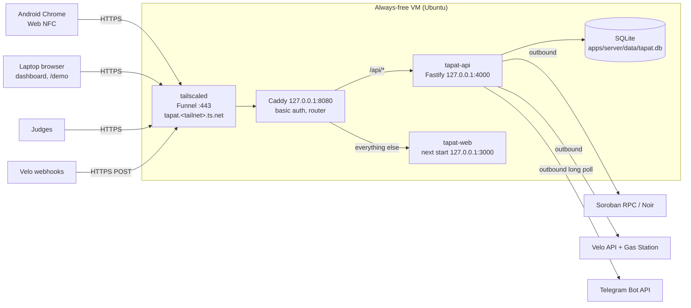

# TAPat Free Deployment Design

How TAPat runs at a stable public HTTPS URL for $0: for the phone (Web NFC), Velo webhooks, the stage demo, and judges after submission.
Last updated: 2026-11-05

Owner: **Jim** (prod `.env`, Velo, cut-over) · **Dev2** (VM provisioning, no secrets). Read with [system-design.md](system-design.md) §1 and [api-and-data.md](api-and-data.md) §7.

## 1. What the deployment must provide

| Need | Why | Consequence |
|---|---|---|
| One **always-on** Node process for the API | Tranche/Freeze ticks, the `submission_unknown` reconciler, the 3 s Velo poller, and Telegram long polling all live in the API process ([SDD §1](system-design.md)) | No serverless, no sleep-on-idle hosts |
| A **persistent local disk** | SQLite at `DATABASE_PATH` holds every tap, decision, and encrypted card key | No ephemeral-filesystem hosts |
| A **stable public HTTPS origin** | Web NFC needs HTTPS. Velo needs a fixed webhook URL, and judges need a link that keeps working | No URL that changes per session |
| **SSE end to end** | Dashboard and `/demo` update over `GET /api/stream` | No proxy that cannot stream or that cuts long requests |
| **$0, no domain purchase** | Hackathon budget | Free hostnames only |
| **No app-code change** | Docs-first build is already scheduled | Only the package scripts, the root `packageManager` pin, one listen-host line, `apps/web/middleware.ts`, the `/api/*` `no-store` hook, and `deploy/` files are added (all in §5) |

## 2. Decision

> **One always-free Linux VM runs both apps under systemd. A local Caddy routes `/api/*` straight to Fastify and everything else to Next.js, and adds basic auth. Tailscale Funnel publishes Caddy at a free, stable `https://tapat.<tailnet>.ts.net` URL. No domain is bought, no inbound port is opened, and no TLS is managed by us.**

| Layer | Choice | Fallback |
|---|---|---|
| Host | **Oracle Cloud Always Free**, Ampere A1 (Arm), Ubuntu 24.04, 2 OCPU / 12 GB, 50 GB boot volume | **Google Cloud** free `e2-micro` (1 GB RAM + 2 GB swap) in `us-west1`/`us-central1`/`us-east1`; then **Jim's laptop** (§10) |
| Host (AWS option) | **AWS EC2** in `ap-southeast-1`, Ubuntu 24.04, `t3.small` (else `t3.micro`, whichever is free-tier eligible), 30 GB gp3 — provisioned by `deploy/wizard-aws-vercel.sh` (§6.4); same Funnel/Caddy/systemd stack | as the row above |
| Public HTTPS | **Tailscale Funnel** (free plan, `*.ts.net` hostname, automatic certificate) | Cloudflare quick tunnel, phone pages only (§10) |
| Local routing + auth | **Caddy** on `127.0.0.1:8080` | — |
| Processes | **systemd**: `tapat-api`, `tapat-web`, `caddy`, `tailscaled` | — |
| Data | SQLite file on the VM boot volume, as today | — |

**Optional, off by default:** the team may additionally publish `apps/web` on Vercel Hobby at `https://<project>.vercel.app` (§9). Nothing in this section, the schedule, the demo, or the critical path depends on it, and prod `PUBLIC_BASE_URL` stays the Funnel URL even when the option is on (§9): only the browser's entry URL changes.

### Rejected alternatives (checked 2026-11-05)

| Option | Why not |
|---|---|
| Render free web service | Spins down after 15 min without traffic (~1 min to wake), ephemeral filesystem loses SQLite on every restart/spin-down, no persistent disk on Free ([render.com/docs/free](https://render.com/docs/free)). The agents and the Telegram poller would stop. |
| Vercel Hobby as the **whole** deployment | The API cannot run there — no always-on process, no persistent disk — so the in-process agents, the Telegram poller, and the SQLite file would have nowhere to live. Rejected as the whole deployment, **not** as an optional web host: §9 runs `apps/web` on Vercel in front of this same VM. Its 120 s origin timeout measures idle time between bytes, so SSE lives on the 15 s heartbeat ([Vercel changelog](https://vercel.com/changelog/cdn-origin-timeout-increased-to-two-minutes)). |
| Fly.io / Railway / Koyeb free | No lasting free always-on tier with a persistent volume [INFERENCE: Fly and Railway moved to paid/trial credit; Koyeb free instances scale to zero]. |
| Cloudflare **quick** tunnel as the public URL | Hostname changes every run, and quick tunnels **do not support Server-Sent Events** ([Cloudflare docs](https://developers.cloudflare.com/tunnel/get-started/quick-tunnels/)). A named tunnel needs a domain we don't own. |
| Public IP + `sslip.io`/`nip.io` + Caddy auto-HTTPS | Neither hostname is on the Public Suffix List, so all users share one Let's Encrypt rate-limit bucket. That bucket has been hit. Also needs ports 80/443 opened on the VM. |
| Public IP + DuckDNS + Caddy auto-HTTPS | Works (`duckdns.org` is on the PSL), but needs ports 80/443 opened in both the Oracle security list and the VM firewall, plus a DNS token. Funnel needs neither. Keep as the plan-B URL if Funnel is down. |

## 3. Topology



- Caddy sends `/api/*` **directly** to Fastify, so in production the Next.js `/api/:path*` rewrite is not on the request path. That removes the "rewrite buffers SSE" risk and the raw-body risk for the webhook. Caddy flushes `text/event-stream` responses immediately ([Caddy reverse_proxy docs](https://caddyserver.com/docs/caddyfile/directives/reverse_proxy)). The rewrite stays in `next.config` for local `pnpm dev`.
- Everything the browser loads is one origin, so CORS is not involved in production. The `@fastify/cors` rule for `http://localhost:3000` only serves the local `/?sse=direct` fallback.
- Funnel reaches the VM over an outbound connection. **No inbound port is opened**; SSH (22) stays the only open port.

## 4. Environments and profiles

Two things allow only **one live instance per set of credentials**:

- Telegram `getUpdates` accepts one poller per bot token; a second returns `409 Conflict`.
- Two API instances signing with the same Program Wallet or station accounts race on Stellar sequence numbers.

So TAPat has two **env profiles**. They use the same variable names ([api-and-data.md §7](api-and-data.md)) with different values:

| | **prod** | **dev** |
|---|---|---|
| Runs on | the VM (or Jim's laptop only in the §10 fallback) | every teammate laptop, Jim's laptop day to day |
| `apps/server/.env` holder | Jim only; one backup copy on USB | Jim sends it to teammates privately |
| Accounts | the setup.md stage 2 accounts (Program Wallet = Velo project owner) | a **second** `bootstrap-accounts.ts` run, made in a separate clone so it cannot overwrite prod |
| Telegram | the demo bot | a second bot from @BotFather, e.g. `@tapat_dev_bot` |
| `PUBLIC_BASE_URL` | `https://tapat.<tailnet>.ts.net` (set once, and never changed for the optional Vercel frontend, §9) | `https://localhost:3000`, which satisfies the `https:` rule. When testing the phone, use your own quick-tunnel URL. |
| `GAS_MODE` | `velo` | `direct` (keeps the Velo daily sponsorship limit for prod) |
| Velo keys | the project keys | the same project keys |
| Velo webhook | points at prod only | none: the 3 s poller credits the budget |

Two side effects of the dev profile, both harmless on testnet:

- A dev budget checkout pays the Velo project owner, which is the prod Program Wallet.
- Prod also receives that payment's webhook and ignores it, because the intent is unknown in its database ([api-and-data.md §5.5](api-and-data.md): "the intent is known").

**Rule:** never start an API with the prod `.env` while the VM's `tapat-api` is running.

## 5. Repository additions (created during the build, owned by Jim)

No changes to the money path or to any request/response shape. Only these files:

| Path | Content |
|---|---|
| root `package.json` | `"packageManager": "pnpm@9.12.0"`, so corepack and the units resolve a pinned pnpm rather than the newest release. The same file already carries the `dev`, `test` and `demo:e2e` scripts from M0 ([build-schedule.md](build-schedule.md) §4) |
| `apps/server/package.json` script | `"start": "tsx src/server.ts"` (same entry as `dev`, without watch) |
| `.env.example` (root) | Every variable, no real values: the server section (header "copy to `apps/server/.env`") and the web section (header "copy to `apps/web/.env.local`"). The per-app `apps/server/.env.example` and `apps/web/.env.example` stay — they are what the setup copies — and a test in `apps/server` keeps the three files in sync |
| `apps/web/package.json` scripts | `"dev": "next dev -H 127.0.0.1 -p 3000"`, `"build": "next build"`, `"start": "next start -H 127.0.0.1 -p 3000"` |
| `apps/server/src/server.ts` | `listen({ port: config.PORT, host: '127.0.0.1' })`. The API never listens on a LAN interface, locally or in prod |
| `apps/server/src/server.ts` + the `/api/*` route hooks | `Cache-Control: no-store` on every `/api/*` response except `/api/stream`, which keeps `no-cache` ([api-and-data.md §1](api-and-data.md)). Required because the optional Vercel rewrite (§9) honours upstream cache headers; harmless on the Funnel path |
| `apps/web/middleware.ts` | HTTP basic auth **only** when the optional web env var `WEB_BASIC_AUTH` is set: exempts `/api/webhooks/velo` and `/api/health`, constant-time compare, `401` with `WWW-Authenticate: Basic realm="TAPat"`. Unset (local dev, the VM's web behind Caddy) → no-op. Needed only for §9; Jim reviews changes |
| `deploy/Caddyfile` | §5.1 |
| `deploy/tapat-api.service`, `deploy/tapat-web.service` | §5.2 |
| `deploy/provision.sh` | §6, one-time VM setup |
| `deploy/update.sh` | §7, redeploy |
| `deploy/wizard-aws-vercel.sh` | §6.4, interactive AWS + Vercel deploy; state in git-ignored `deploy/.wizard.env` |

`deploy/**` is a protected path, like `.env*`: only Jim edits it ([AGENTS.md](../AGENTS.md)).

### 5.1 `deploy/Caddyfile`

```caddyfile
{
	admin off
	auto_https off
}

:8080 {
	bind 127.0.0.1

	# Velo must reach the webhook and uptime checks the health route without a password.
	@protected not path /api/webhooks/velo /api/health
	basic_auth @protected {
		import /etc/caddy/tapat-users
	}

	handle /api/* {
		reverse_proxy 127.0.0.1:4000
	}
	handle {
		reverse_proxy 127.0.0.1:3000
	}
}
```

`/etc/caddy/tapat-users` lives only on the VM and is never committed. It holds one line, `<user> <hash>`, where the hash comes from `caddy hash-password`. Basic auth keeps random visitors from pressing **End program** on a public URL. Phone, laptop, and judges log in once per browser. `EventSource` and `fetch` are same-origin, so the browser resends the credentials.

### 5.2 systemd units

```ini
# deploy/tapat-api.service
[Unit]
Description=TAPat API (Fastify + agents + Telegram poller)
After=network-online.target
Wants=network-online.target

[Service]
User=tapat
WorkingDirectory=/opt/tapat/apps/server
Environment=NODE_ENV=production
ExecStart=/usr/bin/env pnpm start
Restart=always
RestartSec=3

[Install]
WantedBy=multi-user.target
```

```ini
# deploy/tapat-web.service
[Unit]
Description=TAPat web (Next.js)
After=tapat-api.service

[Service]
User=tapat
WorkingDirectory=/opt/tapat/apps/web
Environment=NODE_ENV=production
ExecStart=/usr/bin/env pnpm start
Restart=always
RestartSec=3

[Install]
WantedBy=multi-user.target
```

The API reads `apps/server/.env` exactly as it does locally. `apps/server/src/server.ts` loads `apps/server/.env` itself (dotenv, unconditionally, before the zod parse); the units deliberately set no `EnvironmentFile=`. `DATABASE_PATH=./data/tapat.db` resolves to `/opt/tapat/apps/server/data/tapat.db`. A restart mid-transaction is covered by the existing `submission_unknown` reconciler ([SDD §4](system-design.md)).

## 6. One-time provisioning (`deploy/provision.sh`, ~45 min)

### 6.1 Accounts (Dev2, Nov 6 AM)

1. **Oracle Cloud** free account at https://www.oracle.com/cloud/free/. Pick the home region nearest Manila that offers A1 capacity (Singapore or Tokyo). The home region is permanent. Oracle verifies identity with a payment card and does not charge Always Free resources [INFERENCE: card verification at signup].
2. Create an instance: shape **VM.Standard.A1.Flex**, 2 OCPU / 12 GB, image **Ubuntu 24.04**, default 50 GB boot volume, public subnet, your SSH key.
   - "Out of host capacity" → retry another availability domain, or wait.
   - Still failing after 1 h → **GCP**: https://console.cloud.google.com/freetrial, `e2-micro`, region `us-west1`, Ubuntu 24.04, 30 GB standard disk. GCP also requires a payment method at signup.
   - No card available on the team → skip to §10 (laptop host).
3. **Tailscale** free account at https://login.tailscale.com (Google/GitHub login, no card). In the admin console, enable **MagicDNS** and **HTTPS certificates**.

### 6.2 Provision (Dev2, no secrets involved)

On the VM (`ssh <ssh-user>@<public-ip>`, where `<ssh-user>` is `ubuntu` on Oracle Cloud and your Google-account user on GCP):

```bash
git clone <repo-url> /tmp/tapat && sudo bash /tmp/tapat/deploy/provision.sh <repo-url>
```

The repo URL is passed a second time as the script's argument (`$1`): the script clones it into `/opt/tapat` as the `tapat` user, and has no other way to learn the URL.

`provision.sh` does, in order (idempotent):

1. `apt-get install -y build-essential python3 git sqlite3 curl debian-keyring debian-archive-keyring apt-transport-https`. The build tools are the fallback if `better-sqlite3` has no prebuilt binary for this CPU/Node pair.
2. If RAM < 2 GB (the GCP `e2-micro` case), create `/swapfile` (2 GB) with `fallocate -l 2G /swapfile`, `chmod 600 /swapfile`, `mkswap /swapfile`, `swapon /swapfile`, then append `/swapfile none swap sw 0 0` to `/etc/fstab` so it survives a reboot, and confirm with `swapon --show`. `next build` needs it.
3. Install Node 22 (≥ 22.23.4, the `@noirx402/agent-sdk` engine floor) from NodeSource, then `corepack enable && npm install -g pnpm@9` (a pinned pnpm on the image, not corepack's on-demand download).
4. Create the service user with a home, a login shell and its own group, then create the checkout root and clone into it: `useradd --system --create-home -U --shell /bin/bash tapat`, `install -d -o tapat -g tapat -m 755 /opt/tapat`, then `sudo -H -u tapat git clone "$1" /opt/tapat`, where `$1` is the repo URL passed to the script (`sudo bash /tmp/tapat/deploy/provision.sh <repo-url>`). The repo must be public, or add a read-only deploy key: `sudo install -d -o tapat -g tapat -m 700 /home/tapat/.ssh`, then `sudo -H -u tapat ssh-keygen -t ed25519 -N '' -f /home/tapat/.ssh/id_ed25519`, and register `/home/tapat/.ssh/id_ed25519.pub` on the repository. `/opt/tapat` ends up owned by `tapat`.
5. Install Caddy from its official apt repository. Copy `deploy/Caddyfile` to `/etc/caddy/Caddyfile`. Create an empty `/etc/caddy/tapat-users` with mode `640`, group `caddy`.
6. Install Tailscale: `curl -fsSL https://tailscale.com/install.sh | sh`.
7. Copy both units to `/etc/systemd/system/` and run `systemctl daemon-reload`. **Do not start them yet**: there is no `.env`.

Then, once, interactively:

```bash
sudo tailscale up --hostname=tapat          # opens a login URL; approve in the browser
sudo tailscale funnel --bg 8080             # prints https://tapat.<tailnet>.ts.net; if it says Funnel is not enabled, open the URL it prints and enable Funnel for the tailnet, then re-run
caddy hash-password                         # prints the hash; write it as the single line below (run as a sudo-er)
sudo tee /etc/caddy/tapat-users > /dev/null <<< '<user> <hash>'
sudo systemctl enable caddy
sudo systemctl restart caddy                # with `admin off`, only a restart re-adapts the users file
```

`--bg` keeps Funnel running across reboots ([Tailscale funnel CLI](https://tailscale.com/kb/1311/tailscale-funnel)). Dev2 posts the `https://tapat.<tailnet>.ts.net` URL in the team chat.

✅ DEP1 is done when `curl -s https://tapat.<tailnet>.ts.net/api/health` gets `502` from Caddy (the API isn't running yet) and any other path returns `401`. Once `tapat-api` and `tapat-web` are up (DEP2), `curl -u <user>:<password> https://tapat.<tailnet>.ts.net/` returns the app, not `401`.

### 6.3 Secrets and first start (Jim, Nov 6 PM)

1. Copy the **prod** `.env` onto the VM: `scp apps/server/.env <ssh-user>@<ip>:/tmp/api.env`. Then `sudo install -o tapat -m 600 /tmp/api.env /opt/tapat/apps/server/.env && rm /tmp/api.env`.
2. In that file, set `PUBLIC_BASE_URL=https://tapat.<tailnet>.ts.net` (edit it as `tapat`: `sudo -H -u tapat nano /opt/tapat/apps/server/.env`).
3. Write `/opt/tapat/apps/web/.env.local` with `API_ORIGIN=http://127.0.0.1:4000` (still required by the web build; [api-and-data.md §7.2](api-and-data.md)).
4. Install and build as the service user: `sudo -H -u tapat pnpm -C /opt/tapat install --frozen-lockfile && sudo -H -u tapat pnpm -C /opt/tapat --filter web build`.
5. Create the SQLite directory before the first start (SQLite creates the file, never its folder): `sudo install -d -o tapat -g tapat /opt/tapat/apps/server/data`.
6. `sudo systemctl enable --now tapat-api tapat-web`.
7. **Cut-over:** stop every other API using the prod `.env`, including Jim's laptop. In the Velo dashboard, set the webhook endpoint once to `https://tapat.<tailnet>.ts.net/api/webhooks/velo` (unverified — follow dashboard labels). From now on Jim's laptop uses the dev profile.

✅ DEP2 is done when:

- `https://tapat.<tailnet>.ts.net/api/health` returns `{ok:true, rpc:"ok", velo:"ok", telegram:"ok", gasMode:"velo"}`;
- a Velo test delivery returns `200`;
- the phone reads a tag on `/station/A` over the Funnel URL;
- the dashboard on the laptop updates live over the Funnel URL (proves SSE through Funnel → Caddy).

### 6.4 Wizard: AWS EC2 + Vercel (Jim)

`deploy/wizard-aws-vercel.sh` does §6.1–§6.3 and §9.2 with **AWS EC2** as the VM, in place of Oracle/GCP. Run it from the repo root in **Git Bash** (on Windows, `bash` from PowerShell is the WSL stub):

```bash
bash deploy/wizard-aws-vercel.sh
```

Laptop prerequisites: `aws` with working credentials, `gh` logged in with admin on the repo, OpenSSH, `curl`, `git`, and the prod `apps/server/.env` (Jim's USB backup).

| # | Stage | Does |
|---|---|---|
| 1 | Preflight | Checks tools and AWS/GitHub logins; asks the region (default `ap-southeast-1`) |
| 2 | Basic-auth credentials | One user + password for Caddy and Vercel's `WEB_BASIC_AUTH` |
| 3 | AWS: SSH key + firewall | Key pair `tapat-deploy`; security group `tapat-ssh` with SSH from the laptop's current IP `/32` only — every other IPv4 `tcp/22` source in the group is revoked; hand-added IPv6 or port-range rules are left alone (§3) |
| 4 | AWS: EC2 instance | Finds or launches `Name=tapat-api`: Ubuntu 24.04, 30 GB gp3, IMDSv2 only, termination protection |
| 5 | VM: deploy key + provision | Read-only GitHub deploy key for `tapat` (the repo is private, §6.2 step 4), then `provision.sh` |
| 6 | Tailscale Funnel | `tailscale up --hostname=tapat`, `tailscale funnel --bg 8080`, reads the Funnel URL |
| 7 | Caddy basic auth | Hashes the password over stdin into `/etc/caddy/tapat-users`, restarts Caddy, checks DEP1 (`401`) |
| 8 | Prod .env | Sets `PUBLIC_BASE_URL` to the Funnel URL in the prod `.env` (must have `GAS_MODE=velo`), in place |
| 9 | Velo webhook | Points the webhook at `<Funnel URL>/api/webhooks/velo`; stores a new signing secret if Velo shows one |
| 10 | Cut-over: upload .env, build, start | Confirms no other prod API runs (§4), uploads the `.env`, pulls, builds, restarts both units |
| 11 | Vercel: import project | `apps/web` with `API_ORIGIN` = Funnel URL and `WEB_BASIC_AUTH` (§9.2) |
| 12 | Vercel: deployment protection off | §9.1 |
| 13 | Verify | curl probes: Funnel `401`/health/`200`, Vercel `401`/`200`, and an `/api/*` call through Vercel that must reach Fastify |

- **Re-runs safely.** Each step checks existing state first (instance by tag, security group, key pair, deploy key). A re-run is also the redeploy (stage 10 pulls, builds and restarts) and the fix after a laptop IP change (stage 3 swaps in the new `/32`).
- **Keep `~/.ssh/tapat_aws_ed25519`.** The instance trusts only the key it was launched with. If the file is lost, stage 3 offers to replace the EC2 key pair, which helps only before the instance exists.
- **No Elastic IP.** The public IP can change after a stop/start; every run re-reads it. Only SSH uses it — the public URL is the Funnel URL.
- **Order:** Vercel comes last because `apps/web/next.config.ts` fails the build without `API_ORIGIN`, which is the Funnel URL.
- **`PUBLIC_BASE_URL` stays the Funnel URL**, so Velo webhooks and checkout redirects bypass Vercel (§9.1). The VM keeps serving `tapat-web` at the Funnel URL as the fallback (§9.3, §10).
- **State:** non-secret values plus the basic-auth password in `deploy/.wizard.env` (git-ignored; on Windows, Git Bash cannot set mode 600, so the clone folder's NTFS permissions protect it). The prod `.env` is edited in place and uploaded to `/opt/tapat/apps/server/.env` (owner `tapat`, mode 600). `provision.sh` is uploaded with CRs stripped, because a Windows checkout has CRLF and Ubuntu's bash rejects it.
- If stage 13 reports `vercel-auth-forward`, Vercel did not forward `Authorization`: apply the §9.1 `x-origin-secret` fallback (Caddyfile change, Jim). The Funnel URL stays the entry point meanwhile.

## 7. Redeploy and operations

`deploy/update.sh` (run by the ssh user `<ssh-user>`, which has sudo; the repo commands run as `tapat` — `-H` keeps `HOME=/home/tapat`, so pnpm's store and git's deploy key resolve):

```bash
sudo -H -u tapat git -C /opt/tapat pull --ff-only
sudo -H -u tapat pnpm -C /opt/tapat install --frozen-lockfile
sudo -H -u tapat pnpm -C /opt/tapat --filter web build
sudo systemctl restart tapat-api tapat-web
```

| Task | Command on the VM (as `<ssh-user>`; repo commands use `sudo -H -u tapat`) |
|---|---|
| Reset + seed for a demo run | `sudo -H -u tapat pnpm -C /opt/tapat --filter server tsx scripts/reset-demo.ts` then `sudo -H -u tapat pnpm -C /opt/tapat --filter server tsx scripts/seed-demo.ts` |
| Create/reset the officer login | `sudo -H -u tapat pnpm -C /opt/tapat --filter server tsx scripts/create-officer.ts --officer-email=<email> [--officer-password=<password>]` (creates or promotes the officer without reseeding or touching the chain) |
| Smoke test | `sudo -H -u tapat pnpm -C /opt/tapat --filter server tsx scripts/smoke-testnet.ts` |
| End-to-end gate | `sudo -H -u tapat pnpm -C /opt/tapat demo:e2e` |
| Logs | `sudo journalctl -u tapat-api -f`, `sudo journalctl -u tapat-web -f` |
| DB backup before the pitch | `sudo -H -u tapat sqlite3 /opt/tapat/apps/server/data/tapat.db ".backup /opt/tapat/apps/server/data/pre-pitch.db"` |
| Funnel status | `sudo tailscale funnel status` |
| Change basic-auth credentials | edit `/etc/caddy/tapat-users`, then `sudo systemctl restart caddy` |

- **No redeploys after the Nov 7 09:00 feature freeze**, except a bug fix with a repro ([build-schedule.md](build-schedule.md)). The site must stay live and seeded from submission (Nov 7 11:00) through judging.
- **The first API restart after this release migrates SQLite automatically:** schema `user_version` 1 → 2 adds the `users` and `sessions` tables; existing rows are untouched. Back up the DB first with the backup row's command above.
- Never restart `tapat-api` during a demo beat.

## 8. Security

| Concern | Control |
|---|---|
| Public URL with money buttons | Caddy basic auth on everything except `/api/webhooks/velo` (HMAC-verified) and `/api/health`. Credentials go to the team and, in the submission, to judges |
| Secrets | Only in `/opt/tapat/apps/server/.env` (mode 600, owner `tapat`) and Jim's USB backup. Never in the repo, `deploy/`, or `apps/web` — except the basic-auth password in the git-ignored `deploy/.wizard.env` on the laptop that runs the §6.4 wizard (never committed; protected by the clone folder's permissions) |
| Exposure | API and Next bind `127.0.0.1`. Caddy binds `127.0.0.1`. Only Funnel (outbound) publishes, and only port 8080. Inbound: SSH only |
| Cross-instance clashes | Prod and dev profiles (§4); one live API per profile |
| Card/agent keys | Unchanged: AES-256-GCM in SQLite under `KEY_ENCRYPTION_SECRET` ([SDD §9](system-design.md)) |

## 9. Optional: frontend on Vercel

**Off by default.** Everything above is the demo, the submission, and the critical path. This section is an add-on that may be switched on for a `vercel.app` link for judges, a CDN, and per-PR preview URLs (BegA's mock-first UI is viewable on Nov 5). Turning it on or off is configuration only — no code change.

| Question | Answer |
|---|---|
| What moves | `apps/web` only, on **Vercel Hobby** (free; non-commercial personal use only — [Hobby plan](https://vercel.com/docs/plans/hobby)), at `https://<project>.vercel.app` |
| What does not | The API stays on the VM: the in-process agents, the Telegram long poll, and the SQLite file need an always-on process and a persistent disk |
| Baseline | Unchanged. The VM keeps running `tapat-web`, so `https://tapat.<tailnet>.ts.net` always serves the full app. Prod `PUBLIC_BASE_URL` stays the Funnel URL, on or off |
| Code shipped either way | Two harmless always-on pieces: `apps/web/middleware.ts` (a no-op without `WEB_BASIC_AUTH`) and the API's `Cache-Control: no-store` rule (§5) |

### 9.1 How it works when on

- **Wiring:** browser → Vercel → Next.js rewrite `/api/:path*` → `API_ORIGIN` (the Vercel project's env value `https://tapat.<tailnet>.ts.net`, read at build time) → Funnel → Caddy `/api/*` → Fastify. One origin for the browser, so no CORS.
- **SSE survives the proxy.** Vercel holds an external request open while the origin sends a byte at least every 120 s ([Vercel changelog](https://vercel.com/changelog/cdn-origin-timeout-increased-to-two-minutes)); the 15 s `: ping` heartbeat covers the gap ([system-design.md §8](system-design.md)).
- **Auth:** the same user and password go in the Vercel project's `WEB_BASIC_AUTH` and in Caddy's `/etc/caddy/tapat-users`. The rewrite forwards the browser's `Authorization` header to Caddy [INFERENCE — §9.4 is the proof]. If it does not, use Vercel's documented secret-header transform (`vercel.json` `routes` → `request.headers` sets `x-origin-secret`) and have Caddy accept that header on `/api/*` ([rewrite origin restriction](https://vercel.com/docs/routing/rewrites#restricting-your-origin-to-vercel-traffic)).
- **Deployment Protection:** turn Vercel Authentication **off** for previews. Teammates cannot log in to a Hobby account, and the middleware is the protection instead.
- **`PUBLIC_BASE_URL` does not change.** It stays `https://tapat.<tailnet>.ts.net` even with this option on: that URL is what Velo's webhook and the checkout `successUrl`/`cancelUrl` use. Only the browser's entry URL changes, and the Vercel rewrite reaches the same API. The exemption for `/api/webhooks/velo` in `apps/web/middleware.ts` stays (harmless: no delivery ever lands on Vercel).

### 9.2 Setup when chosen (Jim, ~15 min, not on the critical path)

1. Import the GitHub repo into Vercel (Hobby): **Root Directory** `apps/web`, framework Next.js. pnpm comes from the lockfile and the workspace package `@tapat/shared` is included. The repo must be importable by the Hobby account — public, or owned by Jim [INFERENCE].
2. Production branch `main`; previews per PR.
3. Environment variables for **Production and Preview**: `API_ORIGIN`, `WEB_BASIC_AUTH`. Before the VM exists, `API_ORIGIN=http://127.0.0.1:4000` is fine for mock-only previews.
4. Nothing to change on the VM: leave `PUBLIC_BASE_URL=https://tapat.<tailnet>.ts.net` in `/opt/tapat/apps/server/.env`. It is what Velo's webhook and the checkout redirect use; only the browser's entry URL changes, and the Vercel rewrite reaches the same API.

`deploy/wizard-aws-vercel.sh` stages 11–13 perform §9.2 and the automatable part of §9.4 (§6.4).

### 9.3 Turning it off

Everyone opens `https://tapat.<tailnet>.ts.net`; the VM's `tapat-web` never stopped serving it, and `PUBLIC_BASE_URL` was never pointed elsewhere, so switching the option off needs no API change or restart.

### 9.4 Acceptance (only if the option is on)

- [ ] `/` on `https://<project>.vercel.app` asks for basic auth; `/api/health` and `/api/webhooks/velo` do not.
- [ ] `/api/dashboard` through Vercel is never `x-vercel-cache: HIT`.
- [ ] `/api/stream` through Vercel stays connected > 5 min with live events.
- [ ] A Velo test delivery to `https://tapat.<tailnet>.ts.net/api/webhooks/velo` still returns `200`.
- [ ] The phone reads tags on `https://<project>.vercel.app/station/A`.

## 10. Fallback ladder (demo day)

| Step | When | Do | Lost |
|---|---|---|---|
| 0. Vercel URL | only when §9 is on | Open `https://<project>.vercel.app` instead of the Funnel URL. It is a front end, not a host: when the VM fails, steps 1–5 apply unchanged | Nothing extra |
| 1. VM via Funnel | normal | — | — |
| 2. VM via SSH port-forward | Funnel down, VM up | Laptop: `ssh -L 3000:127.0.0.1:3000 -L 4000:127.0.0.1:4000 <ssh-user>@<ip>`, then open `http://localhost:3000` (the local SSE fallback `/?sse=direct` works; `<ssh-user>` is the one from §6.2). The phone uses **Simulate tap** on the laptop | Real NFC; webhooks (the poller covers them) |
| 3. Jim's laptop as host | VM down | `sudo systemctl stop tapat-api` if the VM is reachable. Laptop runs `pnpm dev` with the **prod** `.env`, then `tailscale funnel 3000`, which prints `https://<laptop>.<tailnet>.ts.net` (this goes through the Next rewrite). Set that as `PUBLIC_BASE_URL`, restart the API, then reset + seed + budget checkout | ~10 min of setup; demo state starts fresh |
| 4. Laptop + quick tunnel | Tailscale down | As step 3 with `cloudflared tunnel --url http://localhost:3000`. **Quick tunnels carry no SSE**: phone pages only (`/station/*`, `/enroll`); the laptop opens `/` and `/demo` on `http://localhost:3000` | Live updates on the phone (they never had them) |
| 5. Backup video | testnet/RPC down | [demo-runbook.md §4](demo-runbook.md) | Live demo |

## 11. Judging period

- The submission (Nov 7 11:00) lists the Funnel URL plus the basic-auth user and password, and says "testnet, demo rate ₱10/XLM".
- The site stays live and seeded **from submission through judging**: no redeploys except a bug fix with a repro.
- Before submitting (Nov 7 11:00), leave the instance freshly reset and seeded with the budget verified, so a judge can run the beats from `/demo` using **Simulate tap**.
- Keep `tapat-api` and `tapat-web` running. Check `/api/health` daily until results are announced.

| Risk | Note | Recovery |
|---|---|---|
| Oracle idle reclamation | Always Free instances may be reclaimed after 7 days of low CPU, network, and memory use (A1) ([Oracle docs](https://docs.oracle.com/en-us/iaas/Content/FreeTier/freetier_topic-Always_Free_Resources.htm)) | Re-run §6 from the same repo plus the USB `.env` (~45 min). Reset + seed after |
| Funnel | In beta, with non-configurable bandwidth limits ([Tailscale docs](https://tailscale.com/kb/1223/funnel)). Fine for demo traffic | — |
| Stellar testnet reset | Wipes deployed contracts; out of our control | Noir would have to redeploy; `NOIR_*_ID` values change |

## 12. Cost

| Item | Free allowance used | Cost |
|---|---|---|
| Oracle A1 VM + 50 GB boot volume | Always Free: 2 OCPU / 12 GB A1, 200 GB block storage | $0 |
| *or* GCP `e2-micro` + 30 GB disk | Free Tier: 1 `e2-micro` in a US region, 30 GB standard disk, 1 GB egress/month | $0 |
| Tailscale Funnel + `*.ts.net` certificate | Free plan | $0 |
| Caddy, Node, pnpm, SQLite | Open source | $0 |
| Velo Gas Station | Sponsorship limit set in setup.md stage 4 (50 XLM/day) | $0 (testnet) |
| Vercel Hobby — **optional**, §9 only | Hobby plan, non-commercial personal use only ([Vercel plans](https://vercel.com/docs/plans/hobby)) | $0 |
| *or* AWS EC2 (§6.4) | New-account free plan credits / 750 h free tier; public IPv4 billed hourly outside the free tier [INFERENCE] | $0 within the allowance |

## 13. Acceptance checklist

Baseline only. If the optional Vercel frontend (§9) is on, add its own checklist (§9.4).

- [ ] `https://tapat.<tailnet>.ts.net/` asks for basic auth; `/api/health` and `/api/webhooks/velo` do not. `curl -u <user>:<password> https://tapat.<tailnet>.ts.net/` returns the app, not `401`.
- [ ] `/api/health` → `ok:true`, `gasMode:"velo"`.
- [ ] `ls -l /opt/tapat/apps/server/data/tapat.db` exists and is owned by `tapat`.
- [ ] Velo test delivery → `200`; a real budget checkout flips the badge to **Velo verified ✓** within 3 s.
- [ ] Phone (Chrome, Android) reads all four tags on `/station/A` over the Funnel URL.
- [ ] Laptop dashboard and `/demo` update live (SSE) over the Funnel URL.
- [ ] Telegram receipt arrives < 10 s from the VM's poller; no `409 Conflict` in `sudo journalctl -u tapat-api`.
- [ ] `sudo reboot` → after ~2 min, all of the above still pass without manual steps, and `swapon --show` still lists `/swapfile` (GCP `e2-micro` only).
- [ ] `sudo -H -u tapat pnpm -C /opt/tapat demo:e2e` passes on the VM.
