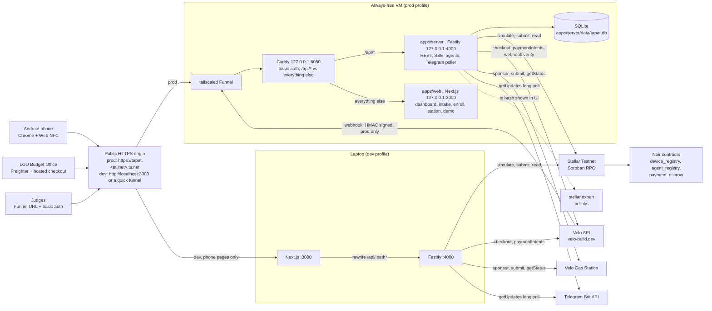
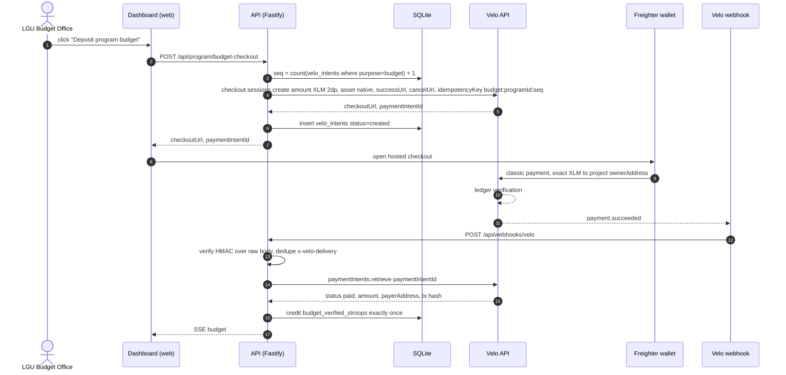
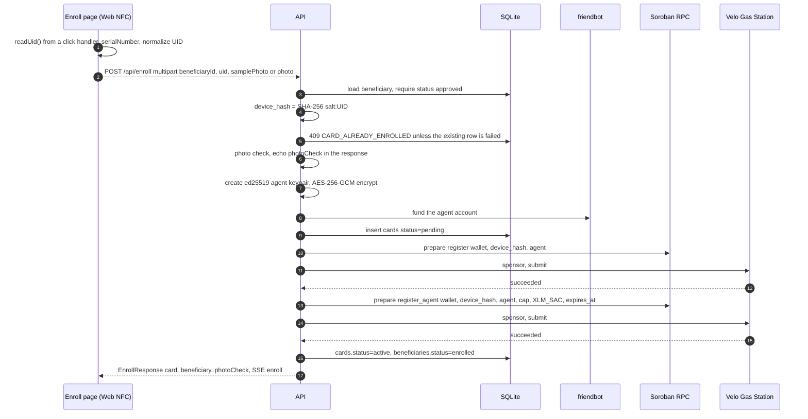
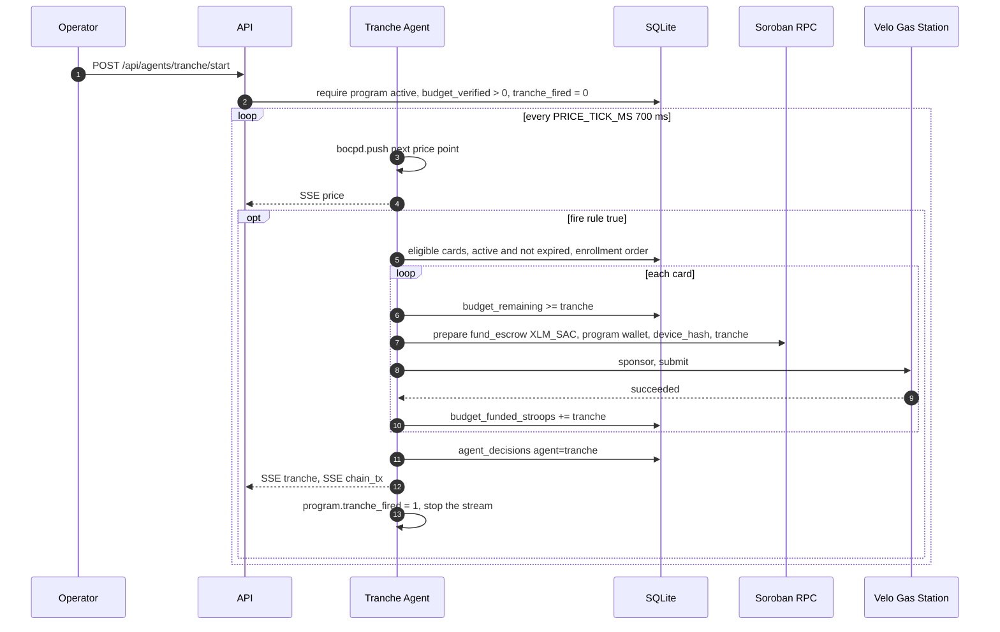
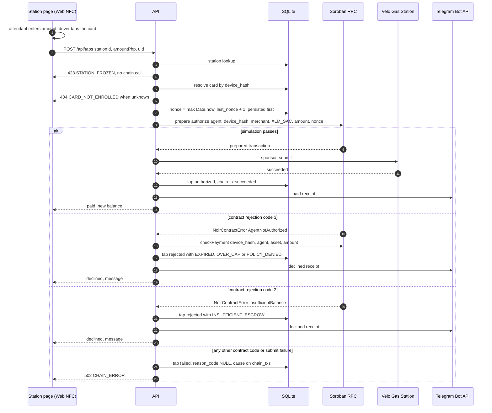
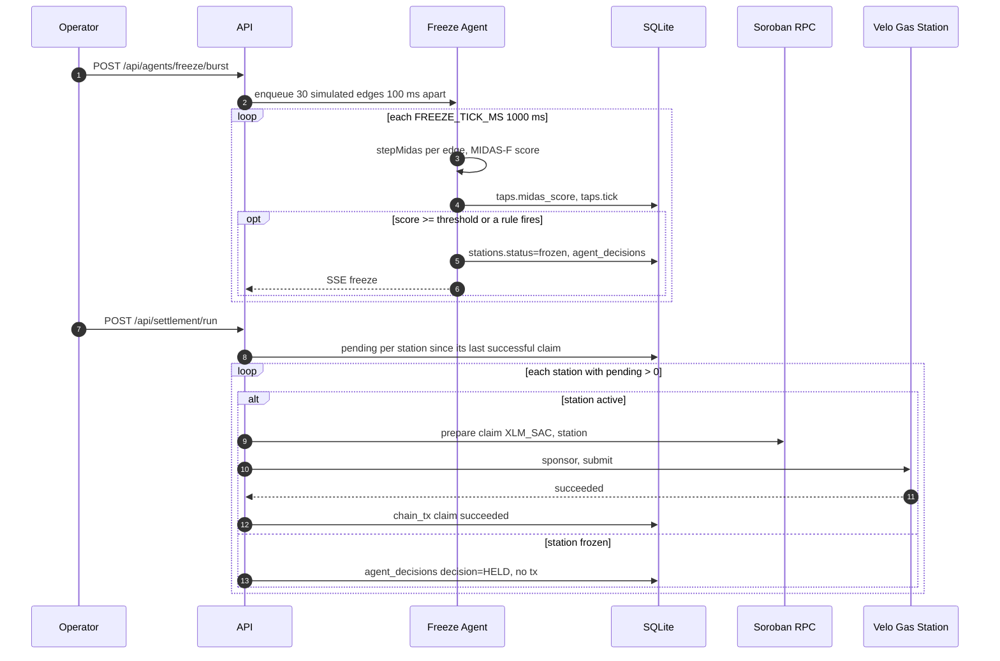
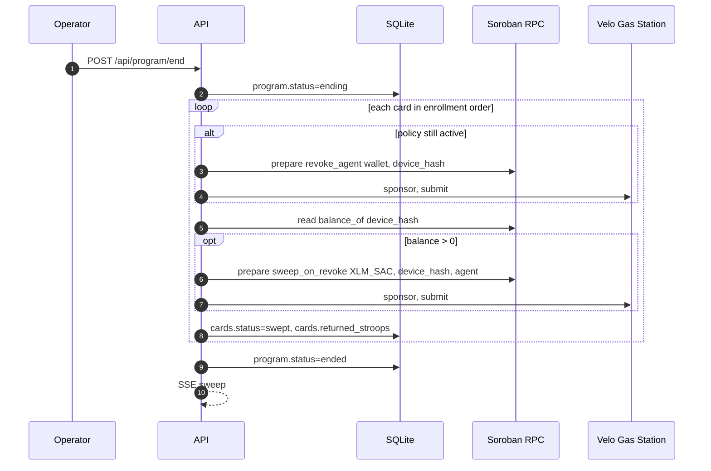

# TAPat System Design Document

The implementable design of TAPat: components, money flow, the chain module, every service behaviour, and the exact contracts between the web app, the API, Noir, and Velo.

Last updated: 2026-11-05

| Read this with | Why |
|---|---|
| [PRD](./PRD.md) | F1–F6 definitions and demo scope |
| [Algorithms](./algorithms.md) | exact math for names, matching, CRC, BOCPD, MIDAS-F |
| [API and data](./api-and-data.md) | SQLite schema, endpoint request/response shapes, env vars, fixtures |
| [Setup](./setup.md) | one-time account, Velo, webhook origin, Telegram setup |
| [Deployment](./deployment.md) | how the two profiles are hosted at `https://tapat.<tailnet>.ts.net`, and the fallback ladder |
| [Build schedule](./build-schedule.md) | who builds which module, in what order |
| [Demo runbook](./demo-runbook.md) | the 3-minute script and fallbacks |
| [Test plan](./test-plan.md) | vectors and live checks |

This document is the authority on **behaviour**. `docs/api-and-data.md` is the authority on **payload shapes** and names. Where this document says "per `docs/api-and-data.md`", that file owns the JSON.

---

## 1. Architecture

### 1.1 Deployment shape

There are two runtimes of the same code, and one live API each.

- **prod** — one always-free Linux VM runs everything under systemd: Next.js and the Fastify API bound to `127.0.0.1`, Caddy on `127.0.0.1:8080` in front (basic auth on every path except `/api/webhooks/velo` and `/api/health`), published by Tailscale Funnel at `https://tapat.<tailnet>.ts.net`. This is the demo and the judges' URL. Caddy routes `/api/*` straight to Fastify, so the Next.js rewrite is not on the request path. Full design, provisioning, and fallbacks: [deployment.md](./deployment.md).
- **dev** — every teammate laptop runs `pnpm dev`: Next.js on `:3000`, the API on `:4000`, the `/api/:path*` rewrite in between, and its own accounts and bot. A quick tunnel may expose the phone pages for a local NFC test; quick tunnels carry no SSE and are never the demo origin.

The API owns the SQLite file and every secret on both. The Android phone (Chrome, Web NFC), the LGU's hosted checkout, and Velo's webhooks reach the **prod** API through the Funnel; on a laptop they reach the dev API through localhost or a quick tunnel.



One HTTPS origin serves both the phone (Web NFC needs a secure context) and Velo's webhook, and in prod it is one origin because Caddy is in front: no CORS, no rewrite, and SSE is flushed immediately. Nothing binds a LAN interface. Nothing else is exposed: Funnel reaches the VM over an outbound connection, so SSH is the only open inbound port.

**Optional, off by default:** `apps/web` may additionally be published on Vercel Hobby at `https://<project>.vercel.app`, in front of the same VM — browser → Vercel → rewrite → Funnel → Caddy → Fastify. The API, its agents, the Telegram poller, and SQLite never leave the VM, and no demo beat, gate, or critical-path task depends on the option ([deployment.md §9](./deployment.md)). Two always-shipped pieces make it switchable with configuration only: `apps/web/middleware.ts` enforces basic auth when `WEB_BASIC_AUTH` is set (no-op otherwise), and the API sends `Cache-Control: no-store` on `/api/*` so Vercel never caches a response.

### 1.2 Component responsibilities

| Component | Owns | Must never |
|---|---|---|
| `apps/web` (Next.js, App Router) | Rendering, Web NFC reads, form input, SSE subscription | Sign a transaction, read a secret, call Soroban/Velo/Telegram directly |
| `apps/server` HTTP layer | REST per `docs/api-and-data.md`, SSE, multipart uploads | Contain algorithm math inline (it lives in `packages/agent/src/algorithms/`) |
| `packages/agent` (`@tapat/agent`: `src/chain/`, `src/algorithms/`) | One calling convention for every contract method, gas sponsorship, key handling, and the pure algorithm functions. TS source, no build step; `apps/server` depends on it with `"workspace:*"` | Read env, touch SQLite or HTTP, persist `chain_txs` or run the reconciler (those stay in `apps/server`); be bypassed by another module (no ad-hoc `NoirAgentClient` or Soroban RPC calls elsewhere) |
| `packages/agent/src/algorithms/` | Pure functions: names, matcher, CRC, BOCPD, CMS, MIDAS-F | Perform I/O, read env, touch SQLite |
| `apps/server/src/velo/` | Checkout sessions, intent polling, webhook verification | Mark a tap paid (Velo cannot do that; see §3.2) |
| `apps/server/src/agents/` | Tranche, Freeze, Settlement, Sweep runners | Hold a design decision that is not written to `agent_decisions` |
| `apps/server/src/bot/` | Telegram long poll, linking, receipts, evidence requests | Send a message that is not in the exact-string table in §7 |
| SQLite `data/tapat.db` | All app state, secret ciphertext, decisions, `chain_txs` | Store a plaintext secret |
| `packages/shared` (`@tapat/shared`) | Types, zod schemas, `money.ts`, constants. Exports TS source (`main: ./src/index.ts`); `next.config.ts` lists it in `transpilePackages`, `apps/server` imports it through `tsx`. Both apps declare `"@tapat/shared": "workspace:*"`. | Import Node-only modules (it is imported by the browser); hold a secret; read `process.env` |

### 1.3 Trust boundaries

| Boundary | Rule |
|---|---|
| Browser ↔ API | The browser holds no secret. It posts card UIDs, amounts, and file uploads; it never posts a signature, a Velo key, an agent secret, or a wallet secret. |
| API ↔ chain | Signers are loaded in `apps/server` (`config.ts`, or decrypted from `cards.agent_secret_enc`) and passed as `Keypair`s into `packages/agent/src/chain/`. Agent secrets are decrypted only for the one `authorize` it is about to sign, and no other module signs. |
| Velo ↔ API | The webhook body is verified with HMAC (`VELO_WEBHOOK_SECRET`) over the **raw** body before any JSON parse is trusted, and every `x-velo-delivery` is deduped. |
| Phone ↔ API | The station phone sees `displayName` (first name + last initial), `uidLast4`, an 8-hex `deviceHashPrefix`, and the tap result. It never receives a full name, a full `deviceHash`, a birthdate, or a Telegram chat id. |
| Telegram ↔ API | Inbound chat ids are matched to `beneficiaries.link_code` / `telegram_chat_id` only. An unknown chat gets no data. |
| Secrets at rest | `.env*` is never committed. `KEY_ENCRYPTION_SECRET` (64 hex chars) is the only key that can decrypt `cards.agent_secret_enc` and `stations.secret_enc`. |

### 1.4 Process model and clocks (D9)

All agents run **inside the API process**. There is no queue, no worker, no cron.

| Loop | Interval | What it does |
|---|---|---|
| Price stream (Tranche Agent) | `PRICE_TICK_MS=700` | Emits one point of `fixtures/prices/doe-diesel-sim.json`, feeds BOCPD, broadcasts SSE `price` |
| Freeze tick (Freeze Agent) | `FREEZE_TICK_MS=1000` | Drains the tap queue, scores each tap with MIDAS-F, evaluates freeze rules, broadcasts SSE `freeze` |
| Budget poller | 3000 ms | `paymentIntents.retrieve` for any unpaid `velo_intents` row younger than 30 min |
| Gas reconciler | 5000 ms, rows younger than 360 s | `chain_txs.status='submission_unknown'`: `gas.getStatus` by Velo identity when there is one, then the chain (`getTransaction` by inner hash) for every row, direct ones included |
| Telegram poller | long poll | `getUpdates`; survives API restarts by persisting `update_id` offset |
| SSE heartbeat | 15000 ms | Comment frame so proxies keep the stream open |

Every agent write is one `agent_decisions` row (`agent`, `decision`, `inputs_json`, `outputs_json`, `tx_ids_json`) plus one SSE event. The dashboard reads decisions from the DB, so a browser refresh never loses history.

---

## 2. Constants, units, accounts, cast

### 2.1 Units (D2)

| Quantity | Value | Used by |
|---|---|---|
| `PHP_PER_XLM` | `10` (demo rate, labelled "demo rate" in the UI) | every PHP ↔ XLM conversion |
| 1 XLM | `10^7` stroops | on-chain amounts (`i128`) |
| ₱1 | `10^6` stroops | `amountPhp → amount_stroops` |

Conversion helpers live in `packages/shared/money.ts` and are the only place conversion happens. They are imported as `import { formatPhp } from '@tapat/shared'` (the package re-exports `money.ts`, `types.ts`, `schemas.ts`, `constants.ts` from `src/index.ts`; see [api-and-data.md §1.3](api-and-data.md)). The exact signatures are fixed in [api-and-data.md §1.1](api-and-data.md); summary:

```ts
export const STROOPS_PER_XLM = 10_000_000n;
export const DEFAULT_PHP_PER_XLM = 10; // demo rate
export function phpToStroops(php: number, phpPerXlm?: number): bigint;                 // round half up
export function stroopsToPhp(stroops: bigint | string, phpPerXlm?: number): number;    // display only
export function formatPhp(stroops: bigint | string, opts?: { phpPerXlm?: number; withSymbol?: boolean }): string; // "₱1,150.00" / "1,150.00"
export function stroopsToXlmString(stroops: bigint | string): string;                 // "1000.00", Velo checkout amount
```

Money is always `bigint` stroops server-side and in `packages/shared`. Floats appear only in `price_php` and algorithm scores.

### 2.2 Program defaults

| Field | Column | Value | Stroops |
|---|---|---|---|
| Per-tap cap | `program.per_tap_cap_stroops` | ₱500.00 | `500000000` |
| Tranche per card | `program.tranche_stroops` | ₱1,500.00 | `1500000000` |
| Budget deposit | request to `POST /api/program/budget-checkout` | ₱10,000.00 (1,000 XLM) | `10000000000` |
| Price threshold | `program.price_threshold_php` | `65.00` ₱/L | — |
| Policy expiry | `program.expires_at_s` | `2026-11-30T23:59:59+08:00` = `1796054399` unix seconds | — |
| Wrongful-denial bound | `program.alpha` | `0.05` | — |
| Ghost-admission bound | `program.beta` | `0.02` | — |

`expires_at_s` is shared by every card policy in the program. One value, one place.

### 2.3 Device hash (D3)

```
uid   = serialNumber from NDEFReadingEvent, colons removed, uppercased   // "04A2B3C4D5E6F7"
pre   = `${program.salt}:${uid}`
device_hash = SHA-256(utf8(pre))            // 32 bytes, BytesN<32> on chain
```

* `program.salt` is 16 random bytes, hex-encoded (32 chars), generated once at program create and stored in `program.salt`.
* `cards.uid_last4` keeps the last four characters of `uid` for human support only; the full UID is never stored.
* A new program = a new salt = the same physical card produces a different `device_hash`, so re-enrollment on a fresh program never trips `AlreadyRegistered`.
* `apps/web/lib/nfc.ts` exports `readUid(opts?: { signal?: AbortSignal; timeoutMs?: number /* default 15000 */ }): Promise<string>`. It must be called from a click handler (Web NFC requires a user gesture), starts `new NDEFReader().scan()`, resolves on the first `reading` event with `serialNumber` colons-removed and uppercased, then aborts the scan. It rejects with an `Error` whose `name` is `NFC_UNSUPPORTED` (no `NDEFReader`, or not HTTPS), `NFC_PERMISSION` (`NotAllowedError`), `NFC_TIMEOUT`, or `NFC_READ_ERROR` (a `readingerror` event). The hash is computed **server-side** so the salt never reaches the browser.
* **The returned value is already normalized** (`04A2B3C4D5E6F7`). Both `/enroll` and `/station/[id]` start a read with a button labelled **Read card**, display only `…` + the last four characters (`…9C7E`), and post the **normalized** string as the `uid` field — never the raw `serialNumber` as Web NFC reports it. The server re-normalizes idempotently, so the two paths agree.

### 2.4 Accounts (D4)

All are testnet G-accounts funded by friendbot.

| Account | ID | Role | Key location | Env var |
|---|---|---|---|---|
| Program Wallet | — | Velo project owner; owner of every card in `device_registry` and `agent_registry`; signer of `fund_escrow`, `revoke_agent`, `sweep_on_revoke`; receives all sweeps | API env + imported into Freighter to create the Velo project | `PROGRAM_WALLET_SECRET` |
| Budget Office | — | Pays the Velo budget checkout | Freighter only, never in the API | none |
| Station A "Petron San Roque" | `A` | Honest merchant; signer of `claim` | `stations.secret_enc` (AES-256-GCM) | `STATION_A_SECRET` at bootstrap |
| Station B "Rotonda Fuels" | `B` | Anomalous merchant; gets frozen | `stations.secret_enc` | `STATION_B_SECRET` at bootstrap |
| Card agents (one per card) | — | Sign `authorize` for exactly one card | `cards.agent_secret_enc`, generated at enrollment | none (per-row) |

Card agent keypairs are created at enrollment, friendbot-funded, and encrypted with `KEY_ENCRYPTION_SECRET` before insert. A card row exists only if its agent key exists.

### 2.5 Demo cast (D5)

| Tag | Name | Medium | Tele­gram | Behaviour in the demo |
|---|---|---|---|---|
| D1 | Juan Dela Cruz | physical NFC card | linked | funds via tranche; taps ₱350 at Station A (paid, receipt); taps ₱800 at A (OVER_CAP) |
| D2 | Pedro Reyes | physical card | not linked | funds via tranche; two taps of ₱480 at Station B before the burst (Read card, or Simulate tap on a laptop — both are a real `authorize`) → ₱960 held |
| D3 | Ramon Bautista | physical sticker | not linked | policy `expires_at_s = seed time + --d3-expiry-offset` (default 600 s, **must be > 0** so `register_agent` accepts it); expired by demo time; Tranche Agent skips it; a ₱200 tap at Station B is rejected EXPIRED |
| D4 | Ana Villanueva | physical sticker | not linked | **not seeded**; approved by intake, enrolled live on stage with a sample photo |
| D5 | Lito Garcia | virtual UID `TAPATVIRTUAL05` | not linked | funds via tranche; simulated taps only; its ₱1,500 returns in the sweep |

Seed enrolls D1, D2, D3, D5. The Tranche Agent funds D1, D2, D5 — "funds three escrows", 3 × ₱1,500 = ₱4,500.

`seed-demo.ts --d3-expiry-offset=<seconds>` sets D3's offset from seed time (default `600`). The value **must be greater than 0**: `register_agent` panics `InvalidPolicy=4` when `expires_at != 0 && expires_at <= ledger now`, so a past or negative offset can never be enrolled. `pnpm demo:e2e` uses `--d3-expiry-offset=30` and waits until D3 is expired before starting the tranche. Scripts are always invoked as `pnpm --filter server tsx scripts/<name>.ts`.

The seed reads D1, D2, D3 and D5 from `fixtures/masterlist/masterlist.csv` (matched by last + first name), inserts them `approved`, and enrolls them through the same service as `POST /api/enroll` with the photo check `officer_confirmed` (the seed is the officer). Which UID each card gets: `--uid-d1=<UID>`, `--uid-d2`, `--uid-d3`, `--uid-d5` name the normalized UID of a physical tag (what **Read card** shows, minus the ellipsis); a driver without a flag gets the virtual UID `TAPATVIRTUAL01`/`02`/`03`/`05`, and any `TAPATVIRTUAL…` UID is stored `virtual=1`. It creates the two stations from `STATION_A_SECRET`/`STATION_B_SECRET` and flips the program `draft` → `active` after the four enrollments. A failed enrollment aborts with the driver named; run `reset-demo.ts` before seeding again.

### 2.6 Honesty labels (D7)

| Data | Label in DB | Label in UI |
|---|---|---|
| Price series `fixtures/prices/doe-diesel-sim.json` | `price_points.simulated = 1` | "simulated DOE series" |
| Burst taps from `fixtures/taps/burst.json` | `taps.simulated = 1` | "simulated" |
| Honest baseline history | replay only, never written to `taps` | not shown as real history |
| OCR rows from `fixtures/masterlist/*.ocr.json` | `beneficiaries.source = 'ocr_precomputed'` | "precomputed OCR" |
| Photo plate/TODA check from `fixtures/enroll/*.json` | request-scoped, echoed in the response | "precomputed vision" |
| OR/CR verification from `fixtures/orcr/*.json` | `agent_decisions.inputs_json.fixture = true` | "precomputed" |

An over-cap or expired tap is always described as: **"rejected by the Noir contract (simulation of `authorize` returned Error #3); no tx submitted"**, with the human reason (`over cap` vs `expired`) taken from the contract's own `checkPayment` predicate re-run as a read.

---

## 3. Money flow (D1)

### 3.1 The eight rules

1. **Budget in, ledger-verified.** The LGU Budget Office wallet pays a Velo checkout intent for the program budget. The Velo project owner is the **Program Wallet**. `payment.succeeded` (webhook, with `paymentIntents.retrieve` polling every 3 s as fallback) credits `program.budget_verified_stroops`, idempotent per `paymentIntentId`. The Tranche Agent may only fund within `budget_verified_stroops - budget_funded_stroops`.
2. **Cards are owned by the Program Wallet.** It is the `wallet` argument in `register` and `register_agent`, so every sweep returns to the LGU. Each card has its own agent keypair (the Noir model), held server-side and encrypted.
3. **Tranche Agent → `fund_escrow`.** Program Wallet signs, one transaction per card.
4. **Tap → `authorize`.** The card's agent signs; `merchant` is the station account.
5. **Settlement → `claim`.** The station account signs, driven by the Settlement runner. A frozen station is skipped, which is how the Freeze Agent holds settlement.
6. **Program end → `revoke_agent` then `sweep_on_revoke`** per card, Program Wallet signs.
7. **Every contract write is fee-sponsored through Velo Gas Station** (`GAS_MODE=velo`). If `sponsor()` fails *before the XDR is dispatched* and `GAS_FALLBACK_DIRECT=true`, the same signed XDR goes directly to Soroban RPC and the tx is recorded with `gas_mode='direct'`. Once sponsorship returned, the hand-off is never repeated: a failed `submit` is recovered by identity, never by resubmitting.
8. **Pitch correction.** Velo cannot sit in the tap path: it marks an intent `paid` only for a classic `payment` operation to the project's fixed `ownerAddress`, and a tap is an escrow authorization, not a payment. The docs describe the hybrid instead: "Velo-verified budget checkout + Gas Station on every Noir call + signed webhooks". The reason is stated in the PRD and in the judge Q&A.

### 3.2 Why Velo is the budget rail and not the tap rail

| Velo fact | Consequence for TAPat |
|---|---|
| `paymentIntents.retrieve(id)` reports `paid` only for a classic `payment` op with exact asset and exact amount to the project `ownerAddress` | A `payment_escrow.authorize()` or `claim()` can never mark an intent paid |
| The receiver address is fixed per Velo project | The project owner is the Program Wallet, i.e. the LGU-side account |
| The only way to submit a payment is the hosted checkout page (wallet connect) | Only the human budget deposit uses checkout; taps are pure Soroban |
| Gas Station sponsors one `invokeHostFunction` op whose tx source signed it | Every Noir call is submitted through the Gas Station; the API never pays fees |
| Webhooks are HMAC-signed with `x-velo-signature` and deduped on `x-velo-delivery` | The webhook plugin is the only path that credits budget |

### 3.3 Budget checkout



Rules:

* `asset: "native"` — the handbook's checkout example (Builder Handbook, Nov 5). One constant, `VELO_CHECKOUT_ASSET`, in `apps/server/src/velo/checkout.ts`. The crediting check still accepts `intent.asset` `'native'` or `'XLM'`, because Velo may echo either spelling.
* `amount` is XLM as a string with exactly two decimals: `stroopsToXlmString(stroops)`.
* `successUrl = ${PUBLIC_BASE_URL}/?budget=success`, `cancelUrl = ${PUBLIC_BASE_URL}/?budget=cancel`.
* `idempotencyKey = budget:${programId}:${seq}` so a double click cannot create two sessions for the same deposit.
* Crediting is one function, `creditBudgetIntent(paymentIntentId)`, used by both the webhook and the poller:

```
BEGIN
  row = SELECT * FROM velo_intents WHERE id = ?
  IF row.purpose <> 'budget' OR row.status = 'paid' THEN RETURN unchanged
  intent = velo.paymentIntents.retrieve(row.id)         -- inside the tx, network call last
  IF intent.status <> 'paid' THEN RETURN unchanged
  IF intent.receiverAddress <> programWallet THEN fail closed, log decision
  IF intent.asset <> 'XLM' AND intent.asset <> 'native' THEN fail closed
  UPDATE program SET budget_verified_stroops = budget_verified_stroops + amount_stroops
  UPDATE velo_intents SET status='paid', tx_hash=?, payer_address=?, paid_at=?
COMMIT
-- then SSE budget with the updated Program object; no agent_decisions row exists for the budget path
```

### 3.4 Enrollment



### 3.5 Tranche funding



### 3.6 Tap



Note that `authorize` moves **no tokens**: it decrements the device's escrow balance and appends a pending payment for the merchant. The driver's money is still in escrow, now owed to the station, until `claim`.

### 3.7 Freeze and settlement



### 3.8 Sweep



The safe order is mandatory: **`revoke_agent` → `sweep_on_revoke` → (`device_registry.revoke`)**. `sweep_on_revoke` panics with `AgentStillActive=7` while the policy is live, so the revoke must land first. `device_registry.revoke` is **not** called on stage; `scripts/reset-demo.ts` calls it, because a demo reset must free the hashes for the next run.

### 3.9 Freeze semantics (D6)

| Fact | Behaviour |
|---|---|
| "Frozen station" means a row in `stations` with `status='frozen'` | New taps at it are refused with `STATION_FROZEN` **before** any nonce is spent or any transaction is built |
| Settlement skips frozen stations | Pending payments stay pending, held by the escrow |
| Noir has no clawback of pending payments | Nothing can cancel a pending payment. The only release is LGU unfreeze → `claim` |
| Unfreeze is manual | `POST /api/stations/:id/unfreeze`, logged as an `agent_decisions` row |
| Freeze is a hold, not a confiscation | The money is owed to the station the moment `authorize` succeeded. TAPat's answer to a bad station is "settle later, after review", not "take it back" |

The docs and the judge Q&A say this plainly. Do not imply the Freeze Agent can reverse a tap.

---

## 4. Chain module

### 4.1 Layout and dependency direction

```
packages/agent/                    @tapat/agent — pure: no env, no SQLite, no HTTP
  src/chain/
    noir.ts      createNoirClient(), signNoirCall(), submitDirect(), getTransactionOutcome()
    gas.ts       submitSponsored(): Velo sponsor → one submit → status recovery
    keys.ts      AES-256-GCM secret storage, agent keypairs, friendbot
  src/algorithms/ names, matcher, crc, bocpd, cms, midas (planned, NM/MT/BOC/MIDAS)
  src/index.ts   the public API below
apps/server/                       the only caller: config, chain_txs, reconciler, services, HTTP
```

Neither module imports the other; both are **pure** — they take the config and the Velo client as arguments and never read `process.env`, open SQLite, or build HTTP themselves (the Noir SDK and the Velo client do the network). `apps/server` is the only caller: `src/config.ts` builds the client with `createNoirClient({ rpcUrl, networkPassphrase, contracts: { deviceRegistry, agentRegistry, paymentEscrow } })`, passes `velo.gas` in, and owns everything stateful — the `chain_txs` rows, the 5 s reconciler and the services (§6). Nothing else in `apps/server` touches `@noirx402/agent-sdk`, and every signature is produced inside `signNoirCall` from a `Keypair` the caller supplies.

The public API (`packages/agent/src/index.ts`):

```ts
createNoirClient(cfg: { rpcUrl: string; networkPassphrase: string; contracts: { deviceRegistry: string; agentRegistry: string; paymentEscrow: string } }): NoirAgentClient
signNoirCall(noir: NoirAgentClient, signer: Keypair, op: NoirOperation, networkPassphrase: string): Promise<string>   // signed XDR
submitDirect(noir: NoirAgentClient, signedXdr: string, op: NoirOperation): Promise<string>                           // tx hash
type OnChainOutcome = 'succeeded' | 'failed' | 'not_found'
getTransactionOutcome(noir: NoirAgentClient, hash: string): Promise<OnChainOutcome>                                  // read; no signer
submitSponsored(gas: Pick<GasApi, 'sponsor' | 'submit' | 'getStatus' | 'waitForResult'>, signedXdr: string, opts: SubmitSponsoredOptions): Promise<GasSubmitResult>   // §4.5
class GasSponsorError extends Error { cause: unknown }             // sponsor() never succeeded; nothing was handed off
class GasHandoffError extends Error { identity: GasExecutionIdentity; cause: unknown }   // submit attempted, status unreadable

generateAgentKeypair(): { publicKey: string; secret: string }                          // §4.7
encryptSecret(plain: string, keyHex: string): string
decryptSecret(blob: string, keyHex: string): string
fundWithFriendbot(publicKey: string, opts?: { attempts?: number; delayMs?: number }): Promise<void>

// SDK pass-throughs: re-exported unchanged so `apps/server` needs no direct SDK dependency
export { Velo, VeloError, VeloProviderError, VeloAuthError, VeloValidationError, type GasApi, type GasSubmitResult, type GasExecutionIdentity } from '@carts1024/velo-sdk'
export { NoirContractError, type NoirOperation, type NoirAgentClient } from '@noirx402/agent-sdk'
```

Every Noir call goes through `@noirx402/agent-sdk@0.3.0` on the three deployed IDs — that is handbook requirement 2 (Builder Handbook, Nov 5): calling the contracts any other way does not count as Noir integration. `@stellar/stellar-sdk` stays only for `Keypair`, `TransactionBuilder.fromXDR` and signing, and as the SDK's peer; invoke, read, ScVal encoding and error parsing are the SDK's job, so there is no local Soroban client left to keep in sync with the contract ABI. `@carts1024/velo-sdk` supplies the `GasApi`/`GasSubmitResult` types the package consumes; `apps/server` keeps its own dependency on it for checkout and webhooks (C5).

Pin `@noirx402/agent-sdk@0.3.0`, `@carts1024/velo-sdk@1.0.0` and `@stellar/stellar-sdk` `^16.4.1` exactly in `packages/agent/package.json`. `apps/server` depends on `@tapat/agent` with `"workspace:*"`.

### 4.2 `noir.ts` — the client and the signing path

```ts
import { NoirAgentClient } from '@noirx402/agent-sdk';

export type NoirClientConfig = Pick<NoirNetworkConfig, 'rpcUrl' | 'networkPassphrase' | 'contracts'>;
// contracts: { deviceRegistry: string; agentRegistry: string; paymentEscrow: string }

export function createNoirClient(cfg: NoirClientConfig): NoirAgentClient;
export async function signNoirCall(
  noir: NoirAgentClient, signer: Keypair, op: NoirOperation, networkPassphrase: string,
): Promise<string>;   // signed XDR
export async function submitDirect(
  noir: NoirAgentClient, signedXdr: string, op: NoirOperation,
): Promise<string>;   // tx hash
export type OnChainOutcome = 'succeeded' | 'failed' | 'not_found';
export async function getTransactionOutcome(
  noir: NoirAgentClient, hash: string,
): Promise<OnChainOutcome>;   // read, no signer
```

**Contract check.** `createNoirClient` compares the SDK's built-in `TESTNET.contracts` (`device_registry`, `agent_registry`, `payment_escrow`) and `TESTNET.networkPassphrase` against the `cfg` passed in, and throws `Error('Noir SDK <name> differs from the configured contract ID')` for a contract mismatch or `Error('Noir SDK network passphrase differs from the configured passphrase')`; otherwise it returns `new NoirAgentClient({ network: 'testnet', rpcUrl })`. `apps/server` calls it once at boot with the `NOIR_*_ID` / `STELLAR_NETWORK_PASSPHRASE` values and **refuses to start** when it throws. The handbook only counts calls to the deployed contract IDs, so a client pointing at other IDs must never start.

**Signing.** `signNoirCall` = `noir.prepare(signer.publicKey(), op)` → `keypairSigner(signer.secret()).signTransaction(xdr, { networkPassphrase })` → the signed XDR string. The output is one `invokeHostFunction` op with source = signer and exactly one signature.

**Errors.** Every contract rejection arrives as the SDK's `NoirContractError { contract, code, errorName, method }` — `contract` is the contract that was invoked, and `errorName` is looked up in **that** contract's error table (e.g. `AgentNotAuthorized`, `InsufficientBalance`). Its `message` is synthesized as `<contract>.<method> failed: <Name> (#<code>)`; the raw RPC diagnostic is not retained. `chain_txs.error` therefore stores that synthesized message plus the code and method. That is the whole of the error parsing; there is no local regex over diagnostic events.

**Reading an outcome.** `getTransactionOutcome(noir, hash)` calls `noir.server.getTransaction(hash)` and folds the RPC status into `'succeeded'` (`SUCCESS`), `'failed'` (`FAILED`) or `'not_found'` (anything else — not indexed yet, or an unknown transaction). It is a read, so it needs no signer, and it throws whatever `getTransaction` throws so the caller can distinguish "the chain says no" from "the read failed". A fee-bump transaction is indexed under **both** its outer and its inner hash (verified live on soroban-testnet, 2026-11-06), so the locally computed inner hash is enough to confirm a sponsored hand-off that Velo has not reported yet.

**The write pipeline lives in `apps/server`** (`src/services/`), because it writes `chain_txs`:

```ts
export type ChainKind =
  | 'register' | 'register_agent' | 'fund' | 'authorize'
  | 'claim' | 'revoke_agent' | 'sweep' | 'revoke_device';

export interface ChainTxResult {
  chainTxId: string;
  status: 'succeeded' | 'failed' | 'submission_unknown';
  gasMode: 'velo' | 'direct';
  innerHash: string | null;   // hash of the Soroban transaction we built
  outerHash: string | null;   // hash of the outer/fee-bump tx when the Gas Station wrapped it
  errorCode: string | null;
  error: string | null;
}
```

`ChainKind` is the `chain_txs.kind` vocabulary (`packages/shared/src/types.ts`, `docs/api-and-data.md`), not the SDK's operation names: `fundEscrow` records `fund` and `sweepOnRevoke` records `sweep`. There is no `ledger` field either — neither `GasSubmitResult` nor `submitDirect` returns one, and `chain_txs` has no column for it.

There is **one** pipeline function, not one per kind:

```ts
export async function runChainTx(deps: ChainDeps, signer: Keypair, op: NoirOperation): Promise<ChainTxResult>;
export async function reconcileOnce(deps: Pick<ChainDeps, 'db' | 'noir' | 'gas' | 'log' | 'now'>): Promise<number>;
export function startReconciler(deps: Pick<ChainDeps, 'db' | 'noir' | 'gas' | 'log' | 'now'>, intervalMs?: number): () => void;
export function recoverInterruptedTxs(deps: Pick<ChainDeps, 'db' | 'log' | 'now'>): { failed: number; unknown: number };
```

`ChainDeps = { db, noir, gas, config, log, gasOptions?, confirm?, now? }`, with `gas: null` under `GAS_MODE=direct`; `log` is `{ warn(obj, msg), error(obj, msg) }`, which `app.log` satisfies; `confirm` overrides the chain-confirmation poll for tests. `runChainTx` looks `op` up in a `const` op table keyed by `NoirOperation['kind']`, so a new SDK operation is a compile error until it is mapped:

| `op.kind` | `kind` | contract config | `method` |
|---|---|---|---|
| `registerDevice` | `register` | `NOIR_DEVICE_REGISTRY_ID` | `register` |
| `revokeDevice` | `revoke_device` | `NOIR_DEVICE_REGISTRY_ID` | `revoke` |
| `registerAgent` | `register_agent` | `NOIR_AGENT_REGISTRY_ID` | `register_agent` |
| `revokeAgent` | `revoke_agent` | `NOIR_AGENT_REGISTRY_ID` | `revoke_agent` |
| `fundEscrow` | `fund` | `NOIR_PAYMENT_ESCROW_ID` | `fund_escrow` |
| `authorize` | `authorize` | `NOIR_PAYMENT_ESCROW_ID` | `authorize` |
| `claim` | `claim` | `NOIR_PAYMENT_ESCROW_ID` | `claim` |
| `sweepOnRevoke` | `sweep` | `NOIR_PAYMENT_ESCROW_ID` | `sweep_on_revoke` |

`defundEscrow` has no row: `runChainTx` throws `Error('defundEscrow is not used by TAPat')` before any insert.

`runChainTx` returns `ChainTxResult` for every outcome it can classify, including `submission_unknown`. It throws only for a `prepare()` rejection (after marking the row `failed`), a programmer fault, or a persistence fault:

* `NoirContractError` from `prepare()` (inside `signNoirCall`): no transaction was submitted; the row is `failed` with `error_code='CONTRACT_<errorName>'` and the error is rethrown.
* Any other `prepare()` throw, or a throw from the post-sign `TransactionBuilder.fromXDR(signedXdr, …).hash()`: row `failed`, `error_code='PREPARE_FAILED'`, rethrown — nothing was handed off.
* A `sponsor()` failure (`GasSponsorError`) is not a throw out of the pipeline: it is persisted as `failed` (or retried on the direct path) per step 4.
* A `GasHandoffError` is persisted as `submission_unknown` per step 4, never rethrown.
* Any other throw out of `submitSponsored`: a programmer fault — row `failed`, `error_code='INTERNAL'`, rethrown. This catch only wraps the sponsor/hand-off call, so it cannot fire after a confirmed send.
* A persistence fault after a confirmed send — e.g. the direct success write, or the sponsored `mapGasResult(result)` write, both outside the classification try/catch — propagates with the effect already applied and the row left `pending`; nothing is relabelled `failed`. **Callers must treat any throw other than a `prepare()` rejection (`NoirContractError` / `PREPARE_FAILED`) as non-retryable.** Boot recovery turns such a `pending` row into `HANDOFF_INTERRUPTED` (§4.8).
* If the final read still sees `pending`, that is a programmer fault and `runChainTx` throws rather than return an unsettled result.

Steps:

1. `id = randomUUID()`; insert `chain_txs` (`kind`, `contract_id`, `method`, `source_public`, `status='pending'`, `gas_mode` per `GAS_MODE`, `created_at`, `updated_at`).
2. `const signedXdr = await signNoirCall(noir, signer, op, config.STELLAR_NETWORK_PASSPHRASE)` — the SDK simulates, attaches the footprint and sets the resource fee; the acting account signs. On throw the two rules above decide the row, then the error is rethrown.
3. `const innerHash = TransactionBuilder.fromXDR(signedXdr, networkPassphrase).hash().toString('hex')` — written to the row before any hand-off; it is the hash the Gas Station reports as `transactionHash`. A throw here is a `PREPARE_FAILED` row, rethrown.
4. `GAS_MODE='direct'` (or `gas === null`) → step 5. Otherwise `submitSponsored(gas, signedXdr, { idempotencyKey: id, ...gasOptions, onReserved, onRetry, onUncertainHandoff })` from `@tapat/agent`:
   * `onReserved(identity)` persists `velo_request_id` and `inner_hash` while the row is still `pending`, before `submit` — so a crash after the hand-off is reconciled by identity, never resubmitted. `onRetry` and `onUncertainHandoff` log through `log.warn`.
   * returns a result → step 6.
   * `GasSponsorError` — `sponsor()` never succeeded, nothing was handed off. A `VeloValidationError` cause is logged with `log.error` first. `GAS_FALLBACK_DIRECT=true` → `log.warn` and step 5 with the **same** `signedXdr`; otherwise row `failed`, `gas_mode='velo'`, `error_code` = `GAS_UNAVAILABLE` for a `VeloProviderError` cause or a non-`VeloError` cause, `VELO_AUTH` for `VeloAuthError`, else the cause's class name (e.g. `VeloValidationError`, `VeloRateLimitError`), with the cause message as `error`.
   * `GasHandoffError` — `submit()` was attempted and the status could not be read back: row `submission_unknown`, `velo_request_id = identity.requestId`, `inner_hash = identity.transactionHash`, `error_code='GAS_HANDOFF_UNKNOWN'`. **Never** falls back, never resubmits; step 7 and the reconciler own it.
5. Direct path: `{ status: 'pending', gas_mode: 'direct' }` is persisted (keeping `innerHash`) **before** `await submitDirect(noir, signedXdr, op)`, so a crash from that point on is recognisable at boot as a hand-off (§4.8). A throw is classified first, by the SDK's message (§4.5 "Direct path"): `DIRECT_FAILED` when the network definitively refused, and `DIRECT_UNKNOWN` (status `submission_unknown`, keeping `innerHash`) for anything unconfirmed or transport-level. Only after that classification does success persist the row: `succeeded`, `gas_mode='direct'`, `inner_hash=<hash>`, `outer_hash=null`.
6. `mapGasResult(result)`: `succeeded` → row `succeeded` with `inner_hash`, `outer_hash` (nullable) and `velo_request_id`; `failed` → `submission_unknown`, `error_code='GAS_FAILED'`; `cancelled` → `submission_unknown`, `error_code='GAS_CANCELLED'` (both carry `Gas Station status <status> (request <requestId>)` as `error`, a hint only); `claimed` / `submitted` / `submission_unknown` → `submission_unknown` with `velo_request_id`. The reconciler does not reuse it: it applies its own Velo-then-chain rule (§4.5).
   * A Velo `failed`/`cancelled` is **not** accepted as proof the network did not apply the transaction: the Gas Station stopping proves nothing, `prepare()` gives the transaction 300 s of validity, and `failed` is the callers' retry signal (AGENTS.md money §4). The row therefore stays `submission_unknown`, keeping the Velo identity, the hashes and the `GAS_FAILED`/`GAS_CANCELLED` code as the hint; step 7's chain read is the first decision and the reconciler is the second. A `not_found` or failed read writes nothing, so the hint remains and the row freezes `submission_unknown` after the window.
7. **Chain confirmation.** A sponsored row still `submission_unknown` after step 6 — a non-terminal Velo status, or the `GAS_FAILED`/`GAS_CANCELLED` hint — is confirmed on chain: `getTransactionOutcome(noir, inner_hash)` every 2 s for up to 30 s (`ChainDeps.confirm` overrides this in tests), because Velo's status lags the chain by minutes. `succeeded` → row `succeeded` (`error_code`/`error` cleared, Velo ids and hashes kept); `failed` → row `failed`, `error_code='CHAIN_FAILED'`; still `not_found` when the window ends, or a read error, → the row stays `submission_unknown` (with its hint) for the reconciler. These writes are guarded (`WHERE id = ? AND status = 'submission_unknown'`), and the in-memory row is updated only when the write landed, so a row another writer settled mid-poll keeps that writer's verdict and is returned as such. A direct row is not confirmed here: `DIRECT_UNKNOWN` already waited out the SDK's own confirmation window, so step 5 hands it to the reconciler unchanged.
8. Every write sets `updated_at = now()`; the returned `ChainTxResult` is built from the final row. Emitting the SSE `chain_tx` event is the SSE task's job — it is not part of this pipeline.

**Boot wiring.** `main()` in `apps/server/src/server.ts` calls `createNoirClient` with the three `NOIR_*_ID`s and `STELLAR_NETWORK_PASSPHRASE` before `listen()`, so a mismatch throws into the existing `main().catch` and the process exits 1 with nothing listening. It builds `new Velo({ apiKey: VELO_GAS_API_KEY, baseUrl: VELO_GAS_BASE_URL, environment: 'testnet', timeoutMs: 30_000 }).gas` only when `GAS_MODE=velo` (else `gas = null`), assembles `ChainDeps` with `log: app.log`, and then, before `listen()`:

* `recoverInterruptedTxs(chain)` repairs rows a previous process left `pending` — no `runChainTx` is in flight at boot, so every one of them is a process that died mid-write (§4.8).
* `startReconciler(chain)` runs unconditionally, not only in `velo` mode: a direct row is confirmed by the chain too, so the reconciler does not need a Velo client.

The `onClose` hook stops the reconciler before `db.close()`. `buildServer()` is unchanged, so the HTTP tests do not need a chain.

`NoirAgentClient.execute()` is not used: it signs and submits itself, and every write must go through `submitSponsored`/`submitDirect` so Velo sponsors it.

Reads are the SDK's own methods (§4.6): they need no signer and never write `chain_txs`.

**Map codes by the contract the SDK reports.** A nested failure is reported under the **invoked** contract, not the frame that panicked: `payment_escrow.sweep_on_revoke` calling `device_registry.get_owner` on an unknown hash returns `payment_escrow` code 2, named `InsufficientBalance` from the escrow table. The raw RPC diagnostic is not retained and the text cannot tell the two apart, so treat a sweep_on_revoke `InsufficientBalance` as ambiguous by design. `chain_txs.error` keeps the SDK's synthesized message plus the code and method for the log, and the UI shows that text on demand.

One case is genuinely nested and must be handled by table knowledge rather than by the code alone: `authorize` on `payment_escrow` reports `AgentNotAuthorized=3` when `agent_registry.check_payment` returns false, and that is the escrow table's own code 3, so no disambiguation is needed.

### 4.3 Argument types

Arguments are the SDK's typed values, not ScVal; nothing in `apps/server` builds `xdr.ScVal` by hand any more.

| Value | Type |
|---|---|
| Amounts (`amount`, `maxAmount`) | `bigint` stroops — `i128` |
| `deviceHash` | 64-hex string — `BytesN<32>` |
| Addresses (`agent`, `merchant`, `token`, `asset`) | `string` (`G...` or `C...`) |
| `expiresAt` | `Date`, or `null` for "never expires" |
| `nonce` | `bigint` |

Amounts are `bigint` end to end. A `number` reaching an amount is a bug.

### 4.4 Noir error tables

`ERROR_TABLES` and `CONTRACT_NAMES` map the three IDs from `docs/api-and-data.md` env vars to the names above. Codes are numbers local to each contract — the same number means different things in different contracts, so the table is chosen by the invoked contract (§4.2).

`payment_escrow`:

| Code | Name | Meaning in TAPat |
|---|---|---|
| 1 | `AlreadyInitialized` | contract already initialised; a deploy/bootstrap bug |
| 2 | `InsufficientBalance` | escrow too small for this amount → API `INSUFFICIENT_ESCROW` |
| 3 | `AgentNotAuthorized` | `check_payment` failed: over cap, expired, wrong agent, wrong asset → API re-runs `checkPayment` to pick `OVER_CAP` / `EXPIRED` / `POLICY_DENIED` (§6.3) |
| 4 | `NotDeviceOwner` | policy owner and device owner disagree; a wiring bug, never a user error |
| 5 | `NothingToClaim` | `claim` with no pending; settlement never calls claim for such a station |
| 6 | `DuplicateAuth` | nonce not strictly increasing; any code other than 3 and 2 makes the tap `failed` with `502 CHAIN_ERROR` (no retry) |
| 7 | `AgentStillActive` | `sweep_on_revoke` while the agent still matches and the policy has not expired |
| 8 | `DeviceNotRegistered` | card hash unknown to `device_registry`; on a tap this is a `failed` tap + `502 CHAIN_ERROR`, not a tap reason |
| 9 | `InvalidAsset` | asset ≠ the escrow token fixed by the first deposit |
| 10 | `InvalidRecipient` | merchant address rejected |
| 11 | `InvalidAmount` | non-positive amount |

`device_registry`:

| Code | Name | Meaning in TAPat |
|---|---|---|
| 1 | `AlreadyInitialized` | deploy/bootstrap bug |
| 2 | `DeviceNotFound` | `revoke` / `get_owner` / `get_device` on an unregistered hash |
| 3 | `NotOwner` | `revoke` called by a wallet that does not own the device |
| 4 | `AlreadyRegistered` | this `device_hash` already has an owner; needs a new program salt or `revoke_device` |

`agent_registry`:

| Code | Name | Meaning in TAPat |
|---|---|---|
| 1 | `AlreadyInitialized` | deploy/bootstrap bug |
| 2 | `AgentNotFound` | `revoke_agent` on a device with no policy; the sweep must not revoke what does not exist |
| 3 | `AlreadyRegistered` | a policy already exists for this device |
| 4 | `InvalidPolicy` | cap, asset, or expiry rejected at `register_agent` — including `expires_at != 0 && expires_at <= ledger now` |
| 5 | `NotOwner` | `register_agent` / `revoke_agent` called by a non-owner |

Collision spot-check: `#2` is `InsufficientBalance` in the escrow, `DeviceNotFound` in the device registry, and `AgentNotFound` in the agent registry; `#4` is `NotDeviceOwner` / `AlreadyRegistered` / `InvalidPolicy` respectively; `#3` is `AgentNotAuthorized` / `NotOwner` / `AlreadyRegistered`. Never infer a meaning from the number alone.

### 4.5 `gas.ts` — Velo sponsorship

```ts
import type { GasApi, GasSubmitResult } from '@carts1024/velo-sdk';

export interface SubmitSponsoredOptions {
  idempotencyKey: string;
  sponsorAttempts?: number;                              // default 4, attempts in total
  retryDelayMs?: number;                                 // default 10_000, linear backoff
  wait?: { timeoutMs?: number; maxAttempts?: number };   // default 90_000 / 20
  onRetry?: (attempt: number, error: unknown) => void;
  onUncertainHandoff?: (error: unknown) => void;
  onReserved?: (identity: GasExecutionIdentity) => void;  // after sponsor, before submit; a throw propagates and submit is not called
}

export async function submitSponsored(
  gas: Pick<GasApi, 'sponsor' | 'submit' | 'getStatus' | 'waitForResult'>,
  signedXdr: string,
  opts: SubmitSponsoredOptions,
): Promise<GasSubmitResult>;
```

`GasSubmitResult` is the type exported by `@carts1024/velo-sdk`; the package returns it **as-is**, may return a non-terminal one, and never throws for a non-success status — the caller decides. `apps/server` maps it onto the `chain_txs` row and returns §4.2's `ChainTxResult`, whose `gasMode` is `'velo' | 'direct'` — a `submission_unknown` row can come from either path, and a direct one carries `innerHash` but no `veloRequestId`.

`submitSponsored` steps:

1. `const sponsored = await gas.sponsor(signedXdr, { idempotencyKey: opts.idempotencyKey })` → `{ requestId, transactionHash }`. A `VeloProviderError` is retried with the **same XDR and the same key**, up to `sponsorAttempts` attempts in total (default 4) with `retryDelayMs` between them (default 10 s, linear); `onRetry(attempt, error)` fires on each retry. **Every** sponsor failure — a non-provider error on the first attempt, or a provider error after the last one — is thrown as `GasSponsorError`, with the SDK error reachable through `.cause`: `sponsor()` never succeeded, so nothing was handed off and the same XDR may still go direct.
2. `onReserved({ requestId, transactionHash })` is called immediately, **before** the hand-off, so the caller can persist the identity first. It is deliberately outside the post-reservation try block: a throw from it propagates unchanged and `submit` is never called.
3. **Exactly one** `gas.submit({ requestId, transactionHash, transactionXdr: signedXdr })`. **Any** failure of that call — thrown, or a lost response — means `getStatus(identity)`; never a second `submit`. `onUncertainHandoff(error)` fires.
4. If the status is `claimed` / `submitted` / `submission_unknown`, call `waitForResult(identity, opts.wait)` (default 90 s / 20 attempts). Should `getStatus` or `waitForResult` themselves throw, the package throws `GasHandoffError(identity, cause)`: `submit` was attempted, Velo may already have the transaction, and the status is unreadable.
5. Return the final `GasSubmitResult`, which may still be non-terminal.

From there the XDR is out of our hands; `apps/server` maps what comes back:

| Velo status | `chain_txs` row |
|---|---|
| `succeeded` | `succeeded` — store `outerHash` (`outerTransactionHash`, **nullable**) and the inner hash (`transactionHash`) |
| `failed` | `submission_unknown`, `error_code = 'GAS_FAILED'` as a hint — the row keeps its Velo identity and both hashes; §4.2 step 7's chain read decides: `succeeded` on chain makes the row `succeeded` (code and error cleared), `failed` on chain makes it `CHAIN_FAILED`, and a `not_found` or failed read writes nothing, so the hint stays for the reconciler |
| `cancelled` | `submission_unknown`, `error_code = 'GAS_CANCELLED'`, same hint and same chain decision as `failed` |
| `claimed`, `submitted`, `submission_unknown` | `submission_unknown`, `velo_request_id = requestId`; then confirmed on chain by inner hash (§4.2 step 7), else the reconciler owns it |

`apps/server` passes its own `wait` (`{ timeoutMs: 10_000, maxAttempts: 5 }`) instead of the package default, because Velo's status lags the chain by minutes: observed on testnet, a transaction was successful on chain within seconds while Velo reported `submitted` for over 90 s and `succeeded` minutes later. Waiting on Velo is therefore only the first look; the chain check right after it is the confirmation.

`GAS_MODE=direct` always takes the direct path.

Exception mapping (the package handles the first row; `apps/server` handles the rest because only it knows about `GAS_FALLBACK_DIRECT`). Every failure from `sponsor()` arrives at `apps/server` as `GasSponsorError`, whose `.cause` is the SDK error below — that is what makes "nothing was handed off" safe to detect:

| Thrown | Meaning | Action |
|---|---|---|
| `GasSponsorError` caused by `VeloProviderError` | Gas Station upstream failure; nothing was handed off | `submitSponsored` retries the same XDR and key up to `sponsorAttempts`; after the last attempt it throws `GasSponsorError`, and `apps/server` takes the direct path if `GAS_FALLBACK_DIRECT=true`, else records `failed` with `errorCode='GAS_UNAVAILABLE'` |
| `GasSponsorError` caused by `VeloAuthError` | Bad or missing `VELO_GAS_API_KEY` | Pre-dispatch, no retry. `apps/server` → direct path if `GAS_FALLBACK_DIRECT=true`; else `failed` with `errorCode='VELO_AUTH'` |
| `GasSponsorError` caused by `VeloValidationError` | Envelope rule violated (wrong op count, wrong source, more than one signature, contract not on the allow-list) | Pre-dispatch, no retry. `apps/server` → direct path if `GAS_FALLBACK_DIRECT=true`; also log loudly, because it means our envelope is wrong |
| `GasSponsorError` caused by `VeloRateLimitError` | Over 50 XLM/day or 300 requests/wallet/hour | Pre-dispatch, no retry. `apps/server` → direct path if `GAS_FALLBACK_DIRECT=true`; else `failed` with the cause's class name as `errorCode` |
| `GasHandoffError` | `submit` was attempted and the status could not be read back (`getStatus` or `waitForResult` threw); the XDR may or may not have been dispatched | `.identity` carries `{ requestId, transactionHash }`, `.cause` the throw. `apps/server` records `submission_unknown` with `error_code='GAS_HANDOFF_UNKNOWN'` and the identity. **Never** a second `submit`; `GAS_FALLBACK_DIRECT` does **not** apply here — a fallback would be a second submission of the same intent |

Any other throw out of `submitSponsored` is a programmer fault (`apps/server` records `error_code='INTERNAL'`); `GAS_FALLBACK_DIRECT=true` is therefore only ever consulted **before** a successful `sponsor()`: once sponsorship returned, the sponsor/submit pair is the only path, and a broken hand-off is recovered by identity, never by sending the XDR again.

Whenever the direct path is used, set `chain_txs.gas_mode='direct'` so the dashboard and CSV show that the demo borrowed the fallback.

Direct path: `submitDirect(noir, signedXdr, op)` sends the same signed XDR straight to `STELLAR_RPC_URL` and returns the hash; on success record it as `inner_hash` with `gas_mode='direct'` and `outer_hash=null`. That success write happens **after** the error classification below, so a persistence fault can never relabel a confirmed send. A throw is classified by the message `@noirx402/agent-sdk@0.3.0` produces, because only two of them mean the network definitely did not apply the transaction:

* `<label> rejected by the network: <name>` (send returned `ERROR`) or `<label> failed on-chain (<hash>)` (the transaction landed and failed) → `failed`, `error_code='DIRECT_FAILED'`.
* Anything else — `<label> not confirmed after 60s (<hash>)`, a transport error from send/get, or an unknown throw — → `submission_unknown`, `error_code='DIRECT_UNKNOWN'`, keeping the locally computed `inner_hash`. The row has no `velo_request_id`, but the reconciler still confirms it on chain: `DIRECT_UNKNOWN` rows are looked up by inner hash like any other `submission_unknown` row, and only freeze if the chain never indexes them inside the window.

There is no `NoirContractError` branch on submit: the pinned SDK's `submit` throws only plain `Error`s — contract rejections come out of `prepare()` (§4.2 step 2).

Reconciler (`reconcileOnce`, in `apps/server`, started at boot in both gas modes and ticking every 5 s):

* Select `chain_txs` where `status='submission_unknown'`, `inner_hash IS NOT NULL` and `updated_at > now - 360000`. `velo_request_id` may be `NULL`, so direct-path rows are included. If `runChainTx` has not settled it, a row must still be inside that window: the SDK sets 300 s of transaction validity at `prepare()`, and 60 s on top covers the ledger closing and RPC indexing it.
* Per row, Velo first **when the row has a Velo identity** (`velo_request_id` non-null) and a client is configured: `velo.gas.getStatus({ requestId, transactionHash: inner_hash })` → map with the table above. `succeeded` settles the row and counts it. `failed`/`cancelled` are not accepted on their own: one `getTransactionOutcome(noir, inner_hash)` read decides (logged with `log.warn` if it throws), so `succeeded` on chain settles the row `succeeded`, `failed` on chain settles it `CHAIN_FAILED`, and `not_found` or a failed read writes **nothing** — the row keeps its `updated_at`, its `submission_unknown` status and its `GAS_FAILED`/`GAS_CANCELLED` hint, and freezes once it leaves the window. Exactly one read, and no second chain read in the same tick.
* Otherwise — no Velo identity, a non-terminal status, or a thrown `getStatus` (logged with `log.warn`) — ask the chain: `getTransactionOutcome(noir, inner_hash)`. `succeeded` → row `succeeded`; `failed` → row `failed`, `error_code='CHAIN_FAILED'`; `not_found` writes **nothing**, so the row keeps its `updated_at` and is re-read on the next tick (or freezes once it falls out of the window).
* Every settling `UPDATE` is guarded by `AND status = 'submission_unknown'` and counts only when one row changed, so a row another writer settled in the meantime is left alone.
* After 360 s with no terminal answer, leave it `submission_unknown` and let the demo continue; the runbook's fallback covers it.
* **Never** call `sponsor()` or `velo.gas.submit()` again for the same row. `submission_unknown` means the transaction may already be on the ledger; resubmitting is how you double-spend.

Envelope rule the Gas Station enforces, and which our builder must therefore satisfy: exactly **one** `invokeHostFunction` operation on a contract, the transaction source is a G-account, and there is exactly **one** signature, from that source. That is why `prepare()` is always called with the signer as source and why every wrapper signs with a single keypair.

### 4.6 `noir.ts`

Every wrapper takes an explicit acting account; none reads env, and each is a thin call over `signNoirCall` → `submitSponsored`/`submitDirect` in `apps/server` (the package itself only builds, signs and reads — §4.1's public API). One row per SDK `NoirOperation` kind, then the reads.

| Wrapper | SDK operation | Contract | Acting account (signer) | `chain_txs.kind` |
|---|---|---|---|---|
| `registerDevice(wallet, deviceHash, agent)` | `registerDevice{ deviceHash, agent }` | `device_registry` | `wallet` (device owner) | `register` |
| `revokeDevice(wallet, deviceHash)` | `revokeDevice{ deviceHash }` | `device_registry` | `wallet` (device owner) | `revoke_device` |
| `registerAgent(wallet, deviceHash, agent, maxAmount, asset, expiresAt)` | `registerAgent{ deviceHash, agent, asset, maxAmount, expiresAt }` | `agent_registry` | `wallet` (device owner) | `register_agent` |
| `revokeAgent(wallet, deviceHash)` | `revokeAgent{ deviceHash }` | `agent_registry` | `wallet` (device owner) | `revoke_agent` |
| `fundEscrow(token, wallet, deviceHash, amount)` | `fundEscrow{ deviceHash, token, amount }` | `payment_escrow` | funder (`wallet`) | `fund` |
| `authorize(agent, deviceHash, merchant, asset, amount, nonce)` | `authorize{ deviceHash, merchant, asset, amount, nonce }` | `payment_escrow` | `agent` (card agent) | `authorize` |
| `claim(token, merchant)` | `claim{ token }` | `payment_escrow` | `merchant` (station) | `claim` |
| `sweepOnRevoke(token, deviceHash, agent)` | `sweepOnRevoke{ deviceHash, token, agent }` | `payment_escrow` | device owner | `sweep` |
| — (not used) | `defundEscrow{ deviceHash, token, amount }` | `payment_escrow` | device owner | — |

`defundEscrow` is listed because it is an SDK operation, but no TAPat beat defunds a live escrow: unspent money leaves at program end via `sweepOnRevoke`. `NoirAgentClient.execute()` and `unlinkDevice()` are not used either — `execute()` submits itself (Velo must sponsor), and `unlinkDevice()`'s built-in revoke→sweep→revoke order is our §3.8 sequence, which F6 has to record step by step.

| Read | SDK method | Returns |
|---|---|---|
| policy of a card | `getPolicy(deviceHash)` | `{ agent, maxAmount: bigint, asset, expiresAt: Date \| null } \| null` |
| device owner | `getDeviceOwner(deviceHash)` | address string |
| device agent | `getDeviceAgent(deviceHash)` | address string |
| devices of a wallet | `listDevices(wallet)` | device hashes |
| escrow balance | `getEscrowBalance(deviceHash)` | `bigint` stroops |
| escrow token | `getEscrowToken(deviceHash)` | token address |
| merchant's unclaimed total | `getPendingBalance(merchant)` | `bigint` stroops |
| tap reason check | `checkPayment({ deviceHash, agent, asset, amount, requireEscrow? })` | `{ ok: true }` or `{ ok: false, reason: 'no_agent' \| 'wrong_agent' \| 'wrong_asset' \| 'invalid_amount' \| 'over_limit' \| 'expired' \| 'insufficient_escrow' }` |

Read-argument note: the escrow reads take **only** the device hash — the escrow token is implied by the deposit, which is why `getEscrowToken(deviceHash)` exists as the way to assert it. `getPendingBalance` takes the **merchant** only, not a device: it is the aggregate a `claim` would pay. `checkPayment` is the contract's own `check_payment` predicate, so it is the only thing allowed to explain a code-3 rejection.

`authorize` check order on chain (useful when reading a rejection): nonce (`DuplicateAuth=6`) → `InvalidRecipient=10` → `DeviceNotRegistered=8` → `check_payment` (`AgentNotAuthorized=3`) → policy owner equals device owner (`NotDeviceOwner=4`) → `InvalidAsset=9` → `InsufficientBalance=2`. The nonce is stored before the later checks run, but a panic reverts the whole transaction, so a rejected tap consumes nothing.

`sweep_on_revoke` returns `0` and transfers nothing when the balance is zero; it does not panic. It raises `AgentStillActive=7` only when the agent still matches and the policy has not expired, which is why an expired-policy card (D3) can be swept **without** `revoke_agent`. Conversely `revoke_agent` on a device with no policy panics `AgentNotFound=2`, so the sweep must only revoke policies that exist.

Semantics to keep in mind while wiring:

* `register` is authorised by `wallet`, and one wallet may register unlimited devices. Anyone can call it — the security is the policy, not the registration.
* `fund_escrow` is authorised by the funder only, and the device must already be registered. **The first deposit fixes the escrow token**, so `XLM_SAC_ID` must be used from the first peso.
* `authorize` is authorised by the agent, moves no tokens, decrements the device escrow, and appends a pending payment for `merchant`. The nonce must be strictly increasing per `(device, agent)` and at least 1.
* `claim` is authorised by the merchant and does one SAC transfer for all pending in that token. Pending payments never expire, and there is no merchant allow-list.
* `defund_escrow` and `sweep_on_revoke` always pay the device **owner** (the Program Wallet).
* `max_amount = 0` means uncapped; `expires_at = 0` means never expires. TAPat always sets both explicitly, and a non-zero expiry must be strictly in the future at `register_agent` time or the call panics `InvalidPolicy=4`. The expiry check in `check_payment` is **strict**: the policy is dead once `ledger_timestamp > expires_at` (see §6.3).

Events: `("fund", device)`, `("authorize", device, merchant)`, `("claim", merchant)`, `("defund", device)`, `("sweep", device)`. We do not decode contract events for correctness; `chain_txs` is our record. Events are only used for the explorer story.

### 4.7 `keys.ts`

```ts
export function generateAgentKeypair(): { publicKey: string; secret: string };
export function encryptSecret(plain: string, keyHex: string): string;   // "v1:<iv>:<tag>:<ct>", base64url parts
export function decryptSecret(blob: string, keyHex: string): string;
export async function fundWithFriendbot(publicKey: string, opts?: { attempts?: number; delayMs?: number }): Promise<void>;
```

* `keyHex` is **required**: the package reads no env, so the caller passes `KEY_ENCRYPTION_SECRET` in. Anything other than 64 lowercase hex chars throws `KEY_ENCRYPTION_SECRET must be 64 lowercase hex chars`.
* AES-256-GCM, 12-byte random IV, 16-byte auth tag, key = `Buffer.from(keyHex, 'hex')`. Decryption uses `createDecipheriv(..., { authTagLength: 16 })` and rejects a blob whose IV does not decode to exactly 12 bytes or whose tag does not decode to exactly 16 bytes — as it rejects any blob that is not `v1:<iv>:<tag>:<ct>` — with `Unrecognised secret blob format`; a wrong key or a tampered ciphertext throws from `decipher.final()`. The `v1` prefix is a format version only: it carries no key id, so rotating `KEY_ENCRYPTION_SECRET` makes every existing blob undecryptable (there is no key-version fallback). Decryption failure is fatal for that operation and surfaces as `500 INTERNAL` with a logged cause — never a silent fallback.
* `fundWithFriendbot` calls `https://friendbot.stellar.org?addr=<publicKey>`, retries `attempts` times (default 3) with a fixed `delayMs` between attempts (default 2000, no sleep after the last), and treats an already-funded account as success only on HTTP 400 whose body matches `/already funded/i` (live body: `{"detail":"account already funded to starting balance","status":400}`). When every attempt fails it throws `friendbot failed for <publicKey>: <HTTP <status> or the transport message>`.
* Station secrets are encrypted at bootstrap (`apps/server/scripts/bootstrap-accounts.ts`). At use time `apps/server` decrypts one (`src/velo/` for checkout, or a card's agent secret for one `authorize`) and passes the resulting `Keypair` into `packages/agent/src/chain/`; the package never sees the ciphertext or the env var.

### 4.8 `chain_txs` lifecycle

```
pending -> succeeded                       (sponsored success, or direct success after its classification)
pending -> failed                          (prepare/simulation rejection; sponsor failure before the hand-off with no fallback; direct-path proven refusal)
pending -> submission_unknown              (a hand-off whose status could not be read, or a Velo failed/cancelled/non-terminal status)
pending -> failed | submission_unknown     (boot: a row a previous process left pending — see below)
submission_unknown -> succeeded | failed   (chain confirmation in runChainTx, then the reconciler: Velo status, else the chain by inner hash, within 6 min)
submission_unknown -> submission_unknown   (after 6 min, frozen for the demo, surfaced in the UI)
```

A Velo `failed`/`cancelled` is never a `pending -> failed` transition: the Gas Station stopping does not prove the network did not apply the transaction, `prepare()` gives it 300 s of validity, and `failed` is the callers' retry signal, so the row persists `submission_unknown` with `error_code='GAS_FAILED'`/`'GAS_CANCELLED'` as a hint and only a chain verdict can make it `failed` (`CHAIN_FAILED`). The only writers of `failed` after a hand-off are therefore a chain `FAILED` read (`CHAIN_FAILED`) and the direct path's proven refusals (`DIRECT_FAILED`).

`recoverInterruptedTxs` runs once at API boot, before the listener: no `runChainTx` is in flight yet, so every `pending` row belongs to a process that died mid-write. Two persisted markers make the split unambiguous: the inner hash is written before any hand-off, and `gas_mode='direct'` is written before the direct send (the sponsored path writes `velo_request_id` before `submit`). `sponsor()` itself never submits, so a `velo` row with no reservation cannot have been handed off:

| Row at boot | Transition | `error_code` | `error` |
|---|---|---|---|
| `pending`, `inner_hash IS NULL` | → `failed` | `PREPARE_INTERRUPTED` | `Process exited before the transaction was handed off` |
| `pending`, `gas_mode='velo'`, `velo_request_id IS NULL` | → `failed` | `PREPARE_INTERRUPTED` | `Process exited before the transaction was handed off` |
| every other `pending` row (a `direct` row with an inner hash, or a `velo` row with a reservation) | → `submission_unknown` | `HANDOFF_INTERRUPTED` | `Process exited during the hand-off; the transaction may be on chain` |

A `PREPARE_INTERRUPTED` row never left the process, so the service that owns it may retry; a `HANDOFF_INTERRUPTED` row may be on the ledger, so it is handed to the reconciler and never resubmitted. The reconciler's 360 s window still applies: a row older than that freezes rather than being re-read.

`status='succeeded'` is the only status the dashboard counts. `submission_unknown` rows are shown as "unknown — reconciling" and never retried by hand.

---

## 5. Nonce discipline

```
nextNonce(card) = max( Date.now(), card.last_nonce + 1 )
```

1. Read `cards.last_nonce`.
2. Compute `nonce`, then `UPDATE cards SET last_nonce = ?` **before** building the transaction. Persisting first is what makes the sequence safe across a crash: a gap is legal, a repeat is not.
3. Build and submit `authorize(..., nonce)`.
4. On failure, **keep** the bumped `last_nonce`. `Date.now()` moves forward by itself, so monotonicity still holds.
5. On `DuplicateAuth` (code 6) the stored nonce was already used on chain (e.g. after a DB restore). There is **no automatic retry**: the tap is recorded `failed` with `502 CHAIN_ERROR` and the cause stays on `chain_txs.error_code` (decision: any contract code other than 3 and 2 is an unmapped failure). The next tap computes a fresh, larger nonce, so the sequence recovers by itself.
6. Never derive the nonce from a counter that can reset. `Date.now()` in milliseconds is the floor; it is far above any nonce the demo will use.

Nonces are per `(device, agent)` on chain, and each card has exactly one agent, so a single column is sufficient.

---

## 6. Service behaviours

### 6.0 Conventions

* All amounts are `bigint` stroops; all timestamps are unix milliseconds except the on-chain `*_at_s` seconds fields.
* Errors use `{ error: { code, message } }`. The code inventory is the closed set in `docs/api-and-data.md` §5.3, and nothing else: `VALIDATION_ERROR` (400), `NOT_FOUND` (404), `CARD_NOT_ENROLLED` (404), `WEBHOOK_SIGNATURE_INVALID` (400), `CARD_ALREADY_ENROLLED` (409), `INVALID_STATE` (409), `OCR_UNAVAILABLE` (422), `PHOTO_CONFIRMATION_REQUIRED` (422), `PHOTO_MISMATCH` (422), `STATION_FROZEN` (423), `CHAIN_ERROR` (502), `INTERNAL` (500).
* `EXPIRED`, `OVER_CAP`, `POLICY_DENIED`, `INSUFFICIENT_ESCROW` are **tap reason codes**, never HTTP errors: a declined tap is HTTP 200 with the recorded tap row (`status='rejected'`, `reason_code` set to one of those four) and a human `message`. `BUDGET_EXHAUSTED` is a tranche decision value, and `HELD` is a settlement decision value; neither is ever an HTTP error. A failure with no contract decision (submit / gas / any contract code other than 3 and 2) is `502 CHAIN_ERROR` with the tap row `failed` and `reason_code = null`.
* Every service writes exactly one `agent_decisions` row per decision, with the numbers it used. `agent` is one of the five values allowed by the table CHECK — `intake`, `tranche`, `freeze`, `settlement`, `sweep` — and `decision` uses only these strings, which `docs/api-and-data.md` §2.2 fixes:

| Agent | `decision` values |
|---|---|
| `intake` | `APPROVED`, `REJECTED`, `UNCERTAIN`, `EVIDENCE_REQUESTED`, `EVIDENCE_VERIFIED`, `EVIDENCE_UNMATCHED` |
| `tranche` | `FUNDED`, `BUDGET_EXHAUSTED` |
| `freeze` | `BASELINE_SET`, `FROZEN`, `UNFROZEN` |
| `settlement` | `CLAIMED`, `HELD`, `NOTHING_PENDING` |
| `sweep` | `SWEPT`, `SKIPPED`, `PROGRAM_ENDED` |

Per-card tranche detail never gets its own decision row: it lives in the one `FUNDED`/`BUDGET_EXHAUSTED` row's `outputs_json.funded` and `outputs_json.skipped` (a skipped card carries `reason` = `EXPIRED` | `BUDGET_EXHAUSTED`). A `sweep`-agent `SKIPPED` decision carries its reason in `outputs_json.reason` (`EMPTY_ESCROW`, `EXPIRED_POLICY`, `NO_POLICY`). Failed chain attempts are never a decision value: they appear in `chain_txs.status='failed'` and in `outputs_json.error` of the decision that attempted them.

Budget crediting is **not** an `agent_decisions` row — the budget path has no agent, and the table CHECK does not allow one. Its record is the `velo_intents` row (`status='paid'`, `tx_hash`, `payer_address`, `paid_at`) plus the SSE `budget` event.

* Endpoint ↔ module map (paths and payloads per `docs/api-and-data.md`):

| Behaviour | Endpoint(s) |
|---|---|
| Intake | `POST /api/intake/upload`, `GET /api/intake/calibration`, `POST /api/beneficiaries/:id/request-evidence` |
| Enrollment | `POST /api/enroll` |
| Tap | `POST /api/taps` |
| Tranche | `POST /api/agents/tranche/start`, `GET /api/agents/tranche/state` |
| Freeze | `POST /api/agents/freeze/burst`, `POST /api/stations/:id/unfreeze`, `GET /api/stations` |
| Settlement | `POST /api/settlement/run` |
| Sweep | `POST /api/program/end` |
| Budget | `POST /api/program/budget-checkout`, `POST /api/webhooks/velo` |
| Dashboard | `GET /api/dashboard`, `GET /api/export/coa.csv` |
| Everything live | `GET /api/stream` |
| Health | `GET /api/health` |

### 6.1 Intake (F1)

**Input** — `POST /api/intake/upload`, multipart field `file`.

* `.png|.jpg|.jpeg` → the image path.
* `.csv` → the CSV path.
* Rows in both paths are the eight columns `last_name, first_name, middle_name, suffix, birthdate, plate, toda, barangay`.

**Image path**

1. `sha256(bytes)` as lowercase hex.
2. Look for `fixtures/masterlist/*.ocr.json` whose `sha256` equals the digest.
3. Match → use that file's `rows` verbatim with `source='ocr_precomputed'`.
4. No match → `422 OCR_UNAVAILABLE`, message exactly: `OCR model not bundled in demo build; upload CSV`.

**CSV path**

1. Require the header to equal the eight columns (any order, matched by name). Missing or extra columns → `400 VALIDATION_ERROR` with a message naming the expected columns; no partial insert.
2. Rows → `source='csv'`.

**Common pipeline**

1. Insert or update one `beneficiaries` row per file row, in file order. Upsert key: the full normalized identity `(program_id, normalized last_name, normalized first_name, normalized middle_name, suffix, birthdate, normalizePlate(plate))` — a re-upload of an identical row refreshes the record instead of duplicating it, while a ghost variant (different spelling of the same person) stays a separate row and is caught by the matcher. A row whose current status is `enrolled` keeps `enrolled`; its score and reason are still refreshed. Consequence for fixtures: the 2 handwritten corrections on `scanned-list.png` must not touch the seeded rows D1, D2, D3, D5.
2. For each row: `link_code` (8 lowercase base32 characters, unique) is assigned on insert if absent.
3. Normalize names, compute pair probabilities over the file order, apply hard rules, compute genuineness scores, apply CRC thresholds (all math per `docs/algorithms.md`).
4. Write `status` ∈ `approved | rejected | uncertain`, `score`, `rule_code`, `decision_reason`.
5. For each `uncertain` row: if `telegram_chat_id` is set → send the evidence request (§7) and set `status='evidence_requested'`; the row's `telegramDeepLink` (`https://t.me/${TELEGRAM_BOT_USERNAME}?start=${link_code}`) is what the UI renders for unlinked rows.
6. One `agent_decisions` row per record with a non-`approved` outcome (`agent='intake'`, `decision` = `REJECTED` or `UNCERTAIN`, `inputs_json` carrying `score`, `lambdaLo`, `lambdaHi`, `alpha`, `beta`, `n`, and the closest earlier match). Calibration is a pure recomputation and writes no decision row.
7. SSE `intake` carrying that `AgentDecision` (payload shapes per `docs/api-and-data.md` §5.4).

**Output** — `IntakeResponse`: the affected `Beneficiary` rows plus `summary` counts and the calibration block (per `docs/api-and-data.md` #6). `summary` is `{ total, approved, rejected, uncertain, enrolled }` and the buckets are disjoint (they sum to `total`): the demo fixture is 12 rows = 8 genuine + 1 ghost + 1 underage + 2 uncertain, and because the demo uploads it after the seed, D1/D2/D3/D5 land in `enrolled` → `{ total: 12, approved: 4, rejected: 2, uncertain: 2, enrolled: 4 }`. `/intake` renders one row per bucket, so the officer sees "4 approved, 4 already enrolled, 2 rejected, 2 uncertain" — never "8 approved". After D4 enrolls live the program reads `approved 3, enrolled 5`.

**Errors** — `400 VALIDATION_ERROR` (bad CSV header, missing field, bad MIME), `404 NOT_FOUND` (no program), `409 INVALID_STATE` if `program.status` is `ended`, `422 OCR_UNAVAILABLE`.

`GET /api/intake/calibration` re-reads `fixtures/calibration/labeled.json`, recomputes, and returns `CalibrationResponse`: `alpha`, `beta`, `lambdaLo`, `lambdaHi`, `n`, `wrongfulDenialRate`, `ghostAdmissionRate`, `feasible` (the `CrcThresholds` fields from [algorithms.md](./algorithms.md) §5.1). It is a pure recomputation — it never mutates thresholds.

### 6.2 Enrollment (F2)

**Input** — `POST /api/enroll`, multipart: `beneficiaryId`, `uid` (the normalized UID from the **Read card** control, §2.3), and either `samplePhoto` (a filename under `fixtures/enroll/`) or `photo` (an uploaded file) plus `officerConfirmed`. The form hard-codes exactly one `samplePhoto` value, `d4-photo.jpg`, beside an "Upload photo (officer confirms)" option — there is no free-text filename field.

**Steps**

1. Load the beneficiary; require `program.status ∈ {draft, active}` and `status='approved'`. Otherwise `409 INVALID_STATE` with message `beneficiary <id> is <status>; only approved beneficiaries can be enrolled`.
2. `device_hash = SHA-256(${program.salt}:${uid})`. After normalization (colons removed, uppercased) the UID must match `^[0-9A-Z]{4,32}$`, which also admits virtual UIDs such as `TAPATVIRTUAL05`; otherwise `400 VALIDATION_ERROR`.
3. Duplicate check: a `cards` row with this `device_hash` in `pending`/`active`/`revoked`/`swept` → `409 CARD_ALREADY_ENROLLED`. A `failed` row is **not** a duplicate: it is resumed in step 5, because `cards.device_hash` is `UNIQUE` and a second row can never exist.
4. Photo check:
   * `samplePhoto` → load `fixtures/enroll/<name>.json`, take `{plate, toda}`, compare with the record using `normalizePlate` (uppercase, spaces and dashes removed) and a normalized TODA string. Mismatch → `422 PHOTO_MISMATCH` with both values in the message. The check result is echoed in `EnrollResponse.photoCheck` (`source`, `plate`, `toda`, `matched`), which is how the UI labels the check "precomputed".
   * `photo` → no vision model in this build. Require `officerConfirmed=true`, else `422 PHOTO_CONFIRMATION_REQUIRED`.
   * Neither field → `422 PHOTO_CONFIRMATION_REQUIRED`.
5. Resume support (retry, never a second row): if a `cards` row for this `device_hash` exists with `status='failed'`, reuse **the same row and the same keypair** and resume from the step that failed. Detect how far it got with `device_registry.get_owner(deviceHash)`: it already returns the Program Wallet → `register` succeeded, so skip to `register_agent`; then `getPolicy(deviceHash)` decides whether the policy landed too (card can go straight to `active`).
6. New card: generate an ed25519 agent keypair, `fundWithFriendbot(agentPublic)`, `encryptSecret(secret)`.
7. Insert `cards` (`status='pending'`, `virtual=0`, `uid_last4`, `max_amount_stroops=program.per_tap_cap_stroops`, `expires_at_s=program.expires_at_s`).
8. `registerDevice(programWallet, deviceHash, agentPublic)` → `chain_txs` `kind='register'`.
9. `registerAgent(programWallet, deviceHash, agentPublic, cap, XLM_SAC_ID, expires_at_s)` → `kind='register_agent'`. The API refuses to enrol with `409 INVALID_STATE` when `program.expires_at_s != 0 && program.expires_at_s <= now`, because `register_agent` would panic `InvalidPolicy=4` and burn a sponsored transaction.
10. `cards.status='active'`, `beneficiaries.status='enrolled'`, decision `agent='intake'`, `decision='APPROVED'` with the card id, SSE `enroll` carrying the `Card`.

**Errors** — `400 VALIDATION_ERROR` (bad fields, UID format), `404 NOT_FOUND` (beneficiary or program), `409 CARD_ALREADY_ENROLLED`, `409 INVALID_STATE` (beneficiary not `approved`, program expired), `422 PHOTO_CONFIRMATION_REQUIRED`, `422 PHOTO_MISMATCH`, `502 CHAIN_ERROR`.
**Chain failure** — `cards.status='failed'`, `cards.error` set, nothing else changes. Re-posting the same `uid` resumes the same row (step 5); the row is never duplicated and the keypair is never rotated.

A virtual card (D5 at seed time) skips steps 6–9 only when `SEED` explicitly inserts it with `virtual=1` **and** still calls `register`/`register_agent` — the virtual flag only means "no NFC hardware"; on-chain the card is identical.

### 6.3 Tap (F4)

**Input** — `POST /api/taps`: `{ stationId, amountPhp, uid }` or `{ stationId, amountPhp, cardId, simulated: true }`.

**Steps**

1. Station lookup. `stations.status='frozen'` → **refuse before signing**: insert `taps` with `status='refused'`, `reason_code='STATION_FROZEN'`; return `423 STATION_FROZEN`. No nonce is spent, no transaction is built.
2. Resolve the card by `device_hash` (uid path) or `id` (simulated path). The server normalizes the UID again, so the raw `04:a2:…` serial and an already-normalized UID both work. Unknown → `404 CARD_NOT_ENROLLED` (also insert a `refused` tap row with that reason so the activity feed shows the attempt). Card `status` not `active` → same `404`.
3. Reject a non-positive amount with `400 VALIDATION_ERROR` (message `amount must be positive`) before anything else. There is **no local cap or expiry check**: the cap and expiry are enforced by the contract, and the demo's story is that the *contract* refuses (the SDK's simulation of `authorize` returns `AgentNotAuthorized = 3` and no tx is submitted). A local pre-check would move that refusal out of the chain and break D7.
4. `nonce = nextNonce(card)` (§5), persisted first.
5. Decrypt the agent secret, `authorize(agent, deviceHash, stationPublic, XLM_SAC_ID, amountStroops, nonce)`. Zero the secret buffer after signing.
6. Outcome mapping:

| Outcome | `taps.status` | `taps.reason_code` | HTTP |
|---|---|---|---|
| `ChainTxResult` succeeded | `authorized` | `NULL` | 200 |
| `NoirContractError` code 3 | `rejected` | `checkPayment` reason: `expired` → `EXPIRED`; `over_limit` → `OVER_CAP`; `no_agent`/`wrong_agent`/`wrong_asset`/`invalid_amount` → `POLICY_DENIED` | 200 |
| `NoirContractError` code 2 | `rejected` | `INSUFFICIENT_ESCROW` | 200 |
| Any other contract code (6 `DuplicateAuth`, 8 `DeviceNotRegistered`, 9, 10, …) | `failed` | `NULL` — the contract name is stored in `chain_txs.error_code`/`error` | `502 CHAIN_ERROR` |
| Gas `failed` / direct submit failure | `failed` | `NULL` — the cause is on `chain_txs.error_code` and `status` | `502 CHAIN_ERROR` |
| Gas `submission_unknown` | `failed` | `NULL` — the reconciler owns the tx; never resubmitted | `502 CHAIN_ERROR` |

The order matters when several conditions could apply: on chain the checks run nonce → recipient → device → policy → owner → asset → balance (§4.6), so a duplicate nonce masks an over-cap amount. `checkPayment` is called only for code 3 and is what separates `EXPIRED` from `OVER_CAP` and `POLICY_DENIED`.
7. For code 3, `noir.checkPayment({ deviceHash, agent, asset: XLM_SAC_ID, amount: amountStroops, requireEscrow: false })` is the source of the human reason: the contract's own predicate, re-run as a read, reports exactly which clause failed. The machine reason lives in `taps.reason_code`; the human sentence is `TapResponse.message`, composed at response time (e.g. `Declined: ₱800.00 is over the ₱500.00 per-tap cap — rejected by the Noir contract (simulation of `authorize` returned Error #3); no tx submitted.`) (the Telegram decline uses the shorter `TAP_REASON_LABELS` label instead). `taps` has no free-text column.

   The activity feed renders `TAP_REASON_LABELS[reasonCode]` from `packages/shared/constants.ts` next to the tx link; that label, not a Telegram message, is the Telegram-down fallback.

8. Store `taps` (`amount_stroops`, `nonce`, `status`, `reason_code`, `chain_tx_id`, `simulated`, `tick` assigned by the Freeze Agent, `midas_score` set later).
9. Hand the tap to the Freeze Agent queue.
10. Telegram receipt for `authorized` or a decline for `rejected`, when `beneficiaries.telegram_chat_id` is set.
11. SSE `tap` with the `Tap`.

**Station page (Web NFC)** — a **Read card** button calls `readUid()` (§2.3) and shows `…{uidLast4}`; the UID stays selected for the following charges until another read or **Clear**. Below it, always visible and collapsed, sits the **Simulate tap** picker built from `Dashboard.cards` filtered to `status='active'` (non-active cards are hidden: a `swept`/`revoked`/`failed` card can no longer authorize), labelled `displayName` + `uidLast4` and marked `simulated`. An `active` card with `expired: true` — D3 — stays listed with an `expired` tag, because the demo must tap it to produce the on-chain `EXPIRED` rejection. The picker auto-expands whenever `readUid()` rejects. A simulated tap still executes a real `authorize` with real money.

**Output** — `TapResponse`: the `Tap` (including `cardRef` when it is a simulated edge), `message`, and the card's remaining balance (`getEscrowBalance`) for `authorized`.

**Invariant** — a rejected or refused tap never creates a `chain_txs` row with `status='succeeded'`, and never changes escrow.

### 6.4 Tranche Agent (F3)

**Start** — `POST /api/agents/tranche/start`.

1. Require `program.status` `draft` or `active` (the same states enroll and taps accept; `ending`/`ended` → `409 INVALID_STATE`) and `program.budget_verified_stroops > 0` → else `409 INVALID_STATE` ("no verified budget; run the budget checkout first").
2. Require `program.tranche_fired = 0` → else `409 INVALID_STATE` ("tranche already fired; run reset-demo.ts to replay"). This is how "fires at most once per program" is enforced; a call while a run is in flight also gets `409 INVALID_STATE` ("tranche already running").
3. Reset the price cursor (delete prior `price_points` for the program) and return `202` `TrancheStartResponse` (`started`, `points`, `tickMs`, per `docs/api-and-data.md` #11). The stream is in-process only; it restarts from `idx 0` on API restart.

**On every `PRICE_TICK_MS` (700 ms)**

1. Read the next point of `fixtures/prices/doe-diesel-sim.json`; write a `price_points` row.
2. Feed `Bocpd.push` incrementally; store the resulting `cp_recent` and `map_r` on that row.
3. SSE `price` with the `PricePoint` (`{ programId, idx, pricePhp, simulated, cpRecent, mapR }`).
4. Evaluate the fire rule (per `docs/algorithms.md`). No fire writes no decision — per-tick rows would be noise; the dashboard derives "waiting" from the stream.
5. On fire:
   1. Eligible cards = `cards.status='active'` AND `cards.expires_at_s > now`, ordered by `cards.created_at` (enrollment order). A skipped card is an entry in `outputs_json.skipped` with `reason='EXPIRED'` — it never gets its own decision row.
   2. `amount = min(tranche_stroops, budget_remaining)`. The card that finds `budget_remaining < tranche_stroops` takes the remainder; once `budget_remaining` is `0`, every later card is a `skipped` entry with `reason='BUDGET_EXHAUSTED'`.
   3. For each eligible card sequentially: `fundEscrow(XLM_SAC_ID, programWallet, deviceHash, amount)`; on success `program.budget_funded_stroops += amount`. A failed funding does not abort the loop: that card keeps its `funded` entry with the failed `chainTxId`, and the cause is on `chain_txs`.
   4. One `agent_decisions` row (`agent='tranche'`, `decision='BUDGET_EXHAUSTED'` when funding stopped because the budget ran out — even if some cards were funded first — otherwise `FUNDED`) with `inputs_json = { pricePhp, segmentMeanPhp, thresholdPhp, cpRecent, mapR, budgetBeforeStroops }` and `outputs_json = { budgetAfterStroops, funded: [{ cardId, deviceHashPrefix, amountStroops, chainTxId }], skipped: [{ cardId, reason }] }`, plus `tx_ids_json` = the fund tx ids.
   5. `program.tranche_fired = 1` is written **before** the first `fund_escrow` (so a crash mid-funding can never fund a second tranche); after the decision row: stop the stream; SSE `tranche` with the `AgentDecision`, then SSE `budget` with the updated `Program`.

**State** — `GET /api/agents/tranche/state` returns `TrancheState` ([api-and-data.md](api-and-data.md) #12): `running`, `fired`, `idx`, `total`, `lastPricePhp`, `cpRecent`, `mapR`, `thresholdPhp`, both budget totals, `points: PricePoint[]` (the whole series so `/demo` can redraw after a reload), and `funds[]` with `status: ChainTxStatus | 'skipped'`.

Demo numbers: 3 cards × ₱1,500 = ₱4,500 funded from a ₱10,000 verified budget; D3 skipped as expired.

### 6.5 Freeze Agent (F5)

**Warm-up (once per program)**

1. Load `fixtures/taps/honest-history.json` (60 ticks, generated by `gen-taps.ts` seed 7).
2. Replay it through `stepMidas` and through the station counters to set baselines. Replayed edges are **not** written to `taps`.
3. `baselineMeanPer10(station) = (edges at that station / 60) * 10`, kept in memory and written once to `agent_decisions` (`agent='freeze'`, `decision='BASELINE_SET'`, `inputs_json={seeds, ticks}`, `outputs_json={perStation}`).

**Each `FREEZE_TICK_MS` (1000 ms)**

1. `tick = floor((now - freezeStart) / FREEZE_TICK_MS)`.
2. Drain queued taps (real and simulated, in arrival order).
3. For each tap: `stepMidas(state, { tick, cardId, stationId, amountStroops })` → score; write `taps.midas_score` and `taps.tick`, then **re-emit SSE `tap` with the same `id`** so clients upsert the scored row (the first `tap` event fired at tap time, before scoring).
4. Freeze when **either**:
   * `score >= midas.json.threshold`, or
   * `NEAR_CAP_STREAK`: the last 3 consecutive `authorized` taps at that station each have `amount_stroops >= 0.9 * program.per_tap_cap_stroops`, or
   * `VOLUME_SPIKE`: taps at that station with `tick > currentTick - 10` exceed `3 * baselineMeanPer10(station)`.
5. Freeze action: `stations.status='frozen'`, `frozen_at=now`, `frozen_reason` = `MIDAS_F` | `NEAR_CAP_STREAK` | `VOLUME_SPIKE`; one `agent_decisions` row (`agent='freeze'`, `decision='FROZEN'`) with the score, threshold, rule, window counts; SSE `freeze` with that `AgentDecision` plus flat sibling keys `stationId` and `stationStatus`.
6. Once frozen, the station is not frozen again and its taps still get scored (for the story) but produce no new decision.

**Unfreeze** — `POST /api/stations/:id/unfreeze`: `status='active'`, `frozen_reason=NULL`, `frozen_at=NULL`, decision `UNFROZEN`, SSE `freeze`. The control exists only on `/demo`, never on the station page. Pending payments stay pending until the next `POST /api/settlement/run`.

**`GET /api/stations`** returns `Station[]` ([api-and-data.md](api-and-data.md) #16): `status`, `frozenReason`, `frozenAt`, `pendingStroops`, and `spentStroops`. There is no `tapsLast60s` field — per-tick counts live in `taps.tick` and the dashboard's `recentTaps`.

### 6.6 Burst (demo driver)

`POST /api/agents/freeze/burst`.

1. Require **at least one `authorized` tap at Station B**, from **Read card** or **Simulate tap** alike — a Simulate-tap tap is a real on-chain `authorize`, so `simulated` does not matter — else `409 INVALID_STATE` ("Tap D2 at Station B first"). An already-frozen Station B is also `409 INVALID_STATE` ("station already frozen").
2. Load `fixtures/taps/burst.json`: 30 edges, 20 virtual cards, Station B, over 3 ticks.
3. Emit them into the Freeze Agent queue 100 ms apart. Each edge also inserts a `taps` row with `simulated=1`, `status='refused'`, `reason_code='SIMULATED_EDGE'`, `card_id=NULL`, `card_ref=<edge.cardId>` (e.g. `burst01`), `chain_tx_id=NULL`. No `authorize` call, no nonce, no escrow movement — a simulated edge is a scoring input, never money. The MIDAS-F edge key for such a row is `${card_ref}|${station_id}`.
4. Return `202 { accepted: true, edges: 30, tickMs: 100 }` ([api-and-data.md](api-and-data.md) #14).

The `refused` status is what keeps simulated edges out of settlement, which sums only `status='authorized'` rows. A tap made through the **Simulate tap** picker (`simulated=1`, real `cardId`) is still a real `authorize` with real money and is settled like any other; `simulated` only labels how the card was read. The ₱960 held in the demo therefore comes only from the two D2 taps (each a real `authorize`, whether the UID came from **Read card** or **Simulate tap**), and the burst cannot invent pending money for Station B.

### 6.7 Settlement

`POST /api/settlement/run`.

1. For each station, in `id` order:
   `pendingStroops = SUM(taps.amount_stroops) WHERE station_id=? AND status='authorized' AND created_at > lastClaimAt(station)`.
   `lastClaimAt(station) = COALESCE((SELECT MAX(updated_at) FROM chain_txs WHERE kind='claim' AND status='succeeded' AND source_public = stations.public_key), 0)`.
   The boundary is **`updated_at`**, not `created_at`: `created_at` is our submit time, so a tap authorized between submit and on-chain execution would be counted as pending although the contract already claimed it. `updated_at` is written when the claim is marked `succeeded`, i.e. after the SAC transfer.
2. `pendingStroops = 0` → decision `NOTHING_PENDING`, no transaction.
3. Frozen → `agent_decisions` (`agent='settlement'`, `decision='HELD'`, `outputs_json={amountStroops}`); SSE `settlement`; **no transaction**.
4. Active → `claim(XLM_SAC_ID, station.publicKey)` signed by the station's decrypted secret. Success → decision `CLAIMED` with the tx id in `tx_ids_json`. Failure → no decision value of its own: `chain_txs.status='failed'` plus `outputs_json.error` on the `CLAIMED` attempt that failed (or, when the whole call failed before submission, the same `outputs_json.error` with `claimed:false`).
5. Return `SettlementResponse` (#17). A failed claim is `502 CHAIN_ERROR` after the other stations have run; the station's decision keeps `outputs_json.error`.

Errors: `404 NOT_FOUND` (no program), `502 CHAIN_ERROR` (a claim failed; the remaining stations still run).

`claim` transfers everything pending for that merchant in one SAC transfer, which is why "pending since the last successful claim" is the correct local model. `noir.getPendingBalance(station.publicKey)` (the escrow's `pending_balance(merchant)`) is the chain-side total for that merchant: `smoke-testnet.ts` asserts it drops to zero after a successful claim, and the dashboard may display it as a cross-check. It is never the settlement trigger.

### 6.8 Sweep (F6)

`POST /api/program/end`.

1. Require `program.status='active'` → `program.status='ending'`.
2. Cards in enrollment order with `status='active'`:
   1. `policy = getPolicy(deviceHash)`. If a policy exists and is still live (`expires_at == 0 || now <= expires_at`) → `revokeAgent(programWallet, deviceHash)`. If the policy is expired, or no policy exists, skip the revoke and note `reason='EXPIRED_POLICY'` / `'NO_POLICY'` — an expired policy already allows a sweep, and `revoke_agent` on a missing policy panics `AgentNotFound=2`. The revoke result (tx id or `skipped`) goes into the card's `outputs_json.revoke`.
   2. `balanceBefore = getEscrowBalance(deviceHash)`.
   3. `balanceBefore = 0` → `cards.status='swept'`, `returned_stroops=0`, decision `SKIPPED` with `reason='EMPTY_ESCROW'`, **no sweep transaction**. `sweep_on_revoke` would return `0` without panicking, so this is an optimisation that saves a sponsored transaction and a useless line in the audit trail, not a correctness guard.
   4. Else `sweepOnRevoke(XLM_SAC_ID, deviceHash, agentPublic)`; on success `cards.status='swept'`, `returned_stroops = balanceBefore`, decision `SWEPT`. On failure the card stays `active`, `outputs_json.error` records the code and the SDK's synthesized message from `chain_txs.error` (a nested `device_registry` panic surfaces as the escrow table's own name, so the text does not identify the nested frame), and the loop continues with the next card.
3. `program.status='ended'`; one `agent_decisions` row (`agent='sweep'`, `decision='PROGRAM_ENDED'`) with the returned total; SSE `sweep`.
4. `device_registry.revoke` is **not** called here. `scripts/reset-demo.ts` calls `revokeDevice` for every card of the previous program so the same physical cards can enroll again. Run it as `pnpm --filter server tsx scripts/reset-demo.ts`. It first reads each registered card's escrow and **refuses while any balance is above zero** (revoking the device would strand those funds: run End program first); it deletes every row only after every revoke succeeded, and skips a card whose device is not registered to the Program Wallet.

Errors: `404 NOT_FOUND`, `409 INVALID_STATE` (`status='draft'`), `502 CHAIN_ERROR` (a sweep failed; that card keeps its `status` and `reason`, the rest still run).

Sweep always pays the device owner (Program Wallet = LGU side), which is the whole point of D1.2.

### 6.9 Budget

`POST /api/program/budget-checkout`.

1. Require `program.status` not `ending`/`ended` (`draft` and `active` both accept a deposit, as in api-and-data §5.2 #4).
2. `seq = (SELECT COUNT(*) FROM velo_intents WHERE purpose='budget') + 1`.
3. `idempotencyKey = budget:${programId}:${seq}`.
4. `velo.checkout.sessions.create({ amount: stroopsToXlmString(depositStroops), asset: VELO_CHECKOUT_ASSET, description, successUrl, cancelUrl }, { idempotencyKey })`.
5. Insert `velo_intents` (`id=paymentIntentId`, `purpose='budget'`, `amount` as XLM string, `asset`, `status='created'`, `checkout_url`, `created_at`).
6. Return `BudgetCheckoutResponse` (`checkoutUrl`, `paymentIntentId`).

Errors: `400 VALIDATION_ERROR`, `404 NOT_FOUND` (no program), `409 INVALID_STATE` (program `ending`/`ended`), `502 CHAIN_ERROR` (Velo SDK threw before an intent existed).

The dashboard badge reads `Dashboard.budget` and renders one of three states: `none` → a **Fund budget** button; `waiting` → "Waiting for Velo…" plus an **Open checkout** link to that row's `checkoutUrl`; `verified` → "Velo verified ✓ ₱{verified}" with the remaining amount. The button navigates the same tab to `checkoutUrl`; `/?budget=success` shows "Payment sent — waiting for Velo verification" and refetches, `/?budget=cancel` shows "Checkout cancelled".

Webhook — `POST /api/webhooks/velo` is an **encapsulated Fastify plugin** with an `application/json` parser that keeps the body as a `Buffer` so the raw bytes are available. Order: verify HMAC (`Velo.webhooks.verify({ payload: rawBody, signature: headers['x-velo-signature'], secret: VELO_WEBHOOK_SECRET })`) → insert `webhook_deliveries` (`delivery_id = x-velo-delivery`); a duplicate delivery id short-circuits with `200` → then dispatch:

| Type | Handling |
|---|---|
| `payment.succeeded` | `creditBudgetIntent(id)` |
| `payment.failed`, `payment.created` | store only |
| `contract.event` | store only (explorer/telemetry story) |
| anything else | store only, never 500 |

A missing `x-velo-delivery` header is `400 VALIDATION_ERROR`; any signature failure is `400 WEBHOOK_SIGNATURE_INVALID`, nothing stored — a bad signature is a bad request (the Velo SDK's own examples answer 400), and Velo then retries rather than treating the endpoint as broken. A recorded delivery is always acknowledged with `200 {"received":true}` and the handler never returns 5xx to Velo.

Poller — every 3 s, `velo_intents` rows with `status != 'paid'` and `created_at > now - 30 min` → `paymentIntents.retrieve` → `creditBudgetIntent`. The poller is what makes the demo survive a missing webhook.

### 6.10 Dashboard

`GET /api/dashboard`. Definitions are SQL over our tables plus chain reads; no new columns.

| Number | Definition |
|---|---|
| `fundedStroops` | `program.budget_funded_stroops` (incremented by the Tranche Agent per successful `fund_escrow`, so it equals Σ successful fund txs) |
| `budget` | `{ state, verifiedStroops, fundedStroops, remainingStroops, checkoutUrl, paymentIntentId }` — `state` is `none` (no intent), `waiting` (the latest budget `velo_intents` row is unpaid; `checkoutUrl` is that row's) or `verified`; `remainingStroops = budget_verified_stroops - budget_funded_stroops` |
| `spentStroops` | Σ over stations of Σ `taps.amount_stroops` with `status='authorized'`, `created_at <= lastClaimAt(station)` |
| `heldStroops` | Σ `taps.amount_stroops` with `status='authorized'`, `created_at > lastClaimAt(station)`, station `frozen` |
| `pendingStroops` | same but station `active` |
| `escrowRemainingStroops` | Σ `noir.getEscrowBalance(device_hash)` over cards with `status='active'`; cached 5 s. This must stay a **chain read**: with every other term DB-derived from the same rows, the invariant would stop being an independent cross-check. |
| `returnedStroops` | Σ `cards.returned_stroops` |
| `invariantOk` | `funded === spent + held + pending + escrowRemaining + returned` → `true` / `false`; the UI renders OK or MISMATCH with the escrow-remaining number beside the five money tiles |

Feed and card fields, all per `docs/api-and-data.md` #18 (the SDD does not restate their shapes): `cards: CardSummary[]`, `stations: Station[]`, `recentTaps`, `recentDecisions`, `midasThreshold` (from `config/midas.json`) and the disjoint `counts` (`approved` excludes `enrolled`; after the scripted demo `approved` is 3 and `enrolled` is 5, because the 4 seeded genuine rows plus D4 are `enrolled`). Charts load `TrancheState.points` plus SSE `price`, and `recentTaps` plus SSE `tap` (upsert by `id`, which is why scored taps are re-emitted).

Which page renders which slice of `Dashboard`:

| Page | Renders |
|---|---|
| `/` | budget badge, five money tiles + invariant line, **station strip** from `stations` (name, `active`/`frozen` badge, `frozenReason`, spent, pending, held), the card list from `cards` (`displayName`, `uidLast4`, `deviceHashPrefix`, `expired`, `escrowStroops` — never a full name or full hash), and **one merged activity feed**: `recentTaps` + `recentDecisions` sorted by `createdAt` desc, capped at 50 |
| `/demo` | the five agent buttons, the price chart + tranche decision panel, the **edge chart** (`recentTaps` points vs the `midasThreshold` line, hard-coded `simulated` label where `simulated` is true), the same **station strip**, and the settlement result panel rendering the last `SettlementResponse` per station ("A — claimed ₱350 · tx…", "B — HELD ₱960 · station frozen") |

`Dashboard.stations` is therefore rendered on both `/` and `/demo`; the frozen badge and the settlement panel are the two observation points the runbook and test plan point at. Every page reaches the API only through `apps/web/lib/api.ts` (typed with `@tapat/shared`); SSE reaches the page only through `useStream(onEvent)` in `apps/web/lib/sse.ts`.

Every page reads `GET /api/program` for `{ program, phpPerXlm }`; when `program` is `null` it renders "No active program — run seed-demo.ts" and offers no money action.

`lastClaimAt(station)` is the `MAX(updated_at)` of that station's successful claims, as defined in §6.7. `noir.getPendingBalance(station.publicKey)` is the escrow's own `pending_balance(merchant)` total — a read-only cross-check shown next to `held + pending`, and asserted by `smoke-testnet.ts`. It never feeds settlement or the dashboard totals.

The invariant holds per card: each peso is either claimed, pending (held or releasable), still escrowed, or swept back. Show it on the dashboard — it is the answer to "how do we know the numbers are real".

Demo totals: funded ₱4,500, spent ₱350, held ₱960, pending ₱0, escrow remaining ₱0, returned ₱3,190 → `350 + 960 + 3190 = 4500`, `invariantOk: true`.

`GET /api/export/coa.csv` — columns exactly `timestamp,event,card_hash_prefix,station,amount_php,amount_xlm,tx_hash,agent_decision_id`; `card_hash_prefix` = first 8 hex characters of `device_hash`; PHP and XLM both formatted with 2 decimals; one row per money event (`fund`, `tap_authorized`, `tap_rejected`, `settlement_claimed`, `settlement_held`, `sweep`, `budget_credited`) sourced from `taps`, `chain_txs`, `velo_intents`, and `agent_decisions`.

---

## 7. Telegram bot

Long polling `getUpdates` inside the API; no webhook, no public bot endpoint.

**Linking** — `/start <link_code>`. Match `beneficiaries.link_code`; store `telegram_chat_id`; reply with the driver's first name and the program name. An unknown code gets a short "ask the TODA officer for your link" reply and no data.

**Receipts and requests** — exact strings. `{amt}` and `{bal}` come from `formatPhp(stroops, { withSymbol: false })` (thousands separators, 2 decimals, no currency sign).

| Trigger | Text |
|---|---|
| Authorized tap | `TAPat ⛽ Paid ₱{amt} at {station}` + newline + `Balance: ₱{bal}` + newline + `Tx: https://stellar.expert/explorer/testnet/tx/{hash}` |
| Rejected or refused tap | `TAPat ⛽ Declined ₱{amt} at {station}: {reason}` |
| Uncertain beneficiary with a linked chat | `Hi {first}! Para matapos ang verification mo sa TAPat fuel aid, i-send ang litrato ng OR/CR mo bilang FILE dito.` |
| OR/CR matches the fixture | `Verified ✅ Pwede ka nang mag-enroll sa TODA.` |
| OR/CR does not match | `Natanggap namin. Ire-review ng LGU officer.` |

`{bal}` is `noir.getEscrowBalance(device_hash)` after the tap — the money still available to that card, not including pending.

`{reason}` is `TAP_REASON_LABELS[reasonCode]`, the same record the dashboard feed renders, exported from `packages/shared/constants.ts` (`Record<TapReasonCode, string>`). The bot never composes its own wording (the label is the whole `{reason}` clause), while `tap.message` is a longer server-composed sentence for the station page. Labels: `EXPIRED` → `card expired`; `OVER_CAP` → `over the ₱500.00 per-tap cap`; `POLICY_DENIED` → `not permitted by the card policy`; `INSUFFICIENT_ESCROW` → `no fuel credit left on the card`; `STATION_FROZEN` → `station paused by the Freeze Agent`; `CARD_NOT_ENROLLED` → `card not enrolled`; `SIMULATED_EDGE` → `simulated edge (no card)`.

**Evidence handling** — a document or photo message from a chat whose beneficiary is `evidence_requested`:

1. `sha256(file bytes)`; compare with `fixtures/orcr/*.json` entries (`sha256`, `plate`, `toda`, `name`).
2. Match and plate equals the beneficiary's plate (normalized) → `status='approved'`, reply `Verified ✅ ...`, decision `EVIDENCE_VERIFIED`.
3. Match but plate differs, or no match → reply `Natanggap namin. Ire-review ng LGU officer.`, status unchanged, decision `EVIDENCE_UNMATCHED`.
4. Never store the image; only the digest and the outcome.

**`POST /api/beneficiaries/:id/request-evidence`** is the evidence request and the one-tap appeal in one endpoint: allowed from `uncertain` (evidence request) and from `rejected` (appeal, including a hard-rule rejection), and both move the beneficiary to `evidence_requested`. `approved`, `enrolled`, and `evidence_requested` are refused with `409 INVALID_STATE`. A Telegram send failure is not an error: the response is still 200 with `telegramSent: false` and the `deepLink`, so the officer can hand over the phone.

---

## 8. Realtime (SSE)

`GET /api/stream` → `Content-Type: text/event-stream`, `Cache-Control: no-cache`, `Connection: keep-alive`, no compression (compression buffers events).

Frame shape — one JSON object per `data:` line, the **camelCase REST shape**, never a DB row:

```
event: tap
data: {"id":"tap_7c1e","cardId":"card_D1","cardRef":null,"stationId":"A","amountStroops":"350000000","nonce":"1793808200000","status":"authorized","reasonCode":null,"chainTxId":"ctx_7c1e","simulated":false,"midasScore":0.12,"tick":61,"createdAt":1793808201234}

```

| Event | `data` payload |
|---|---|
| `price` | `PricePoint` — `{ programId, idx, pricePhp, simulated, cpRecent, mapR }` |
| `tranche` | `AgentDecision` (agent `tranche`) |
| `enroll` | `Card` |
| `tap` | `Tap` — emitted once at tap time and **again after the Freeze Agent scores it**, same `id`, with `midasScore`/`tick` filled; clients upsert by `id` |
| `freeze` | `AgentDecision` (agent `freeze`) plus flat sibling keys `stationId` and `stationStatus` (`'active'` \| `'frozen'`) |
| `settlement` | `AgentDecision` (agent `settlement`) |
| `sweep` | `AgentDecision` (agent `sweep`) |
| `budget` | `Program` (the credited program) |
| `chain_tx` | `ChainTx` |
| `intake` | `AgentDecision` (agent `intake`) |

The event set is closed; payload shapes are owned by [api-and-data.md](api-and-data.md) §3/§5.4 and echoed here only so the wiring is unambiguous.

* Heartbeat comment `: ping` every 15 s.
* No replay. A reconnect gets only new events; the dashboard re-reads `GET /api/dashboard` and `TrancheState.points` on `open`.
* The bus is an in-process `EventEmitter` with a 500-event ring buffer for debugging only.
* The client is fixed: `apps/web/lib/sse.ts` exports `useStream(onEvent)` and hardcodes `new EventSource('/api/stream')` (relative, so it is same-origin in both profiles: through the Next.js rewrite on a laptop, and through Caddy's `/api/*` route in prod, which flushes `text/event-stream` immediately). There is no env var and no switch. The one alternative is manual and local only: opening `/?sse=direct` on a laptop points the dashboard at `http://localhost:4000/api/stream`, which is why the API registers `@fastify/cors` with `origin: 'http://localhost:3000'` (GET only is enough). The phone pages do not subscribe to SSE.

---

## 9. Security notes

1. **Secrets are server-only.** `VELO_API_KEY`, `VELO_GAS_API_KEY`, `VELO_WEBHOOK_SECRET`, `TELEGRAM_BOT_TOKEN`, `PROGRAM_WALLET_SECRET`, `STATION_*_SECRET`, `KEY_ENCRYPTION_SECRET` exist only in `apps/server/.env`. `apps/web/.env.example` is committed and holds `API_ORIGIN` (required) plus the commented, optional `WEB_BASIC_AUTH` (a `user:password` credential, never a key); each developer copies it to `apps/web/.env.local` (Next.js convention), which is git-ignored.
2. **Config fails closed.** A zod config loader validates every variable at boot; the process exits printing the missing names. It also asserts `KEY_ENCRYPTION_SECRET` is 64 hex characters and that the three contract IDs are 56-character `C...` addresses.
3. **Webhooks.** HMAC over the raw body, checked before parsing; dedupe on `x-velo-delivery` primary key. A replayed delivery is a no-op, and budget is credited exactly once even if both the webhook and the poller fire.
4. **Custodial keys (stated limitation).** The demo custodies the Program Wallet, both station secrets, and every card agent secret. Production requires the owner's device or a wallet to sign, plus an HSM or KMS for operator keys.
5. **Public URL, basic auth.** The prod origin is public on purpose (Web NFC, Velo webhooks, judges), so Caddy requires HTTP basic auth on every path except `/api/webhooks/velo` (HMAC-verified) and `/api/health`. The credentials live in `/etc/caddy/tapat-users` on the VM only and are shared with the team, and with judges in the submission. The API, Next.js, and Caddy all bind `127.0.0.1`, and only Funnel (outbound) publishes — SSH is the only inbound port. [deployment.md §8](deployment.md). If the **optional** Vercel frontend is on, `apps/web/middleware.ts` enforces the same credential from `WEB_BASIC_AUTH` on every path except `/api/webhooks/velo` and `/api/health` (constant-time compare, `401` + `WWW-Authenticate: Basic realm="TAPat"`); unset, it is a no-op, so the Funnel path is unchanged. [deployment.md §9](deployment.md).
6. **One live API per profile.** The prod `.env` runs on the VM and nowhere else: a second poller returns `409 Conflict` on `getUpdates` and two signers race on Stellar sequence numbers. Teammates run the **dev** profile. Never start a laptop API with the prod `.env` while `tapat-api` is running. [deployment.md §4](deployment.md).
7. **NFC UIDs are clonable.** A cloned card can spend only that card's escrow, and the policy cap bounds each tap. The damage ceiling is the card's remaining escrow — a design point, not an accident.
8. **No merchant allow-list on Noir.** Any account can be a merchant. TAPat compensates with one station table, `POST /api/taps` as the only path that names a merchant, and the Freeze Agent.
9. **Privacy.** A station page receives `displayName` (first name + last initial), `uidLast4`, the 8-hex `deviceHashPrefix`, and the tap result — never a full name, a full `deviceHash`, a birthdate, a plate number, or a Telegram chat id. OCR and matching run on the LGU machine.
10. **Logging.** Log `chain_txs.id`, method names, and error codes. Never log a secret, a signature, or an agent secret. Redact `*_SECRET`, `*_KEY`, `*_TOKEN` patterns in the logger's serializer.
11. **Demo scope.** Testnet only. `friendbot` funds the accounts. No mainnet keys exist in the repo.

---

## Appendix A — Noir contract reference

Testnet IDs (verbatim; also in `docs/api-and-data.md` as `NOIR_*_ID`):

| Contract | ID |
|---|---|
| `device_registry` | `CAC4KOLHDLDYDWBOKXNKRN5KVHO56PLOIFXDLTBUWGVN6GVDEB7FQHU5` |
| `agent_registry` | `CCMZDSPTLX7IIJWCYEUM5DJUHOSOYSTHGK777S2TXZWEMC5ZZGPJ3EBV` |
| `payment_escrow` | `CC7EAW5FNJEDBS7THM5IT6XIOHO4AOYMLXT3KSZ3HWUIKEACTW7E5BFS` |
| Native XLM SAC (`XLM_SAC_ID`) | `CDLZFC3SYJYDZT7K67VZ75HPJVIEUVNIXF47ZG2FB2RMQQVU2HHGCYSC` |

| Method | Auth | Behaviour |
|---|---|---|
| `device_registry.register(wallet, device_hash, agent)` | `wallet` | Records the hash's owner and agent. Any wallet may call it and may register unlimited devices. |
| `device_registry.revoke(wallet, device_hash)` | `wallet` | Frees the hash. Used only by `reset-demo.ts`. |
| `agent_registry.register_agent(wallet, device_hash, agent, max_amount, asset, expires_at)` | device owner (`wallet`) | Writes the policy. `max_amount=0` uncapped, `expires_at=0` never expires; otherwise `expires_at` must be strictly greater than ledger time or it panics `InvalidPolicy=4`. Panics `AlreadyRegistered=3` if a policy already exists. |
| `agent_registry.revoke_agent(wallet, device_hash)` | device owner | Removes the policy; prerequisite for a sweep. Panics `AgentNotFound=2` when no policy exists. |
| `agent_registry.get_policy(device_hash)` | none (read) | `{owner, agent, max_amount, asset, expires_at}` |
| `agent_registry.is_auth(device_hash, agent)` | none (read) | Whether the agent currently holds a live policy for the device |
| `agent_registry.check_payment(...)` | none (read) | The predicate `payment_escrow.authorize` calls: agent match, asset match, amount > 0, amount ≤ cap, `ledger_ts > expires_at` is not yet true |
| `payment_escrow.fund_escrow(token, wallet, device_hash, amount)` | funder only | Deposits for a registered device. The first deposit fixes the token. |
| `payment_escrow.authorize(agent, device_hash, merchant, asset, amount, nonce)` | `agent` | Moves **no tokens**: decrements the device escrow, appends a pending payment for `merchant`. Nonce strictly increasing per `(device, agent)`, ≥ 1. Check order: nonce → recipient → device → policy → owner match → asset → balance. |
| `payment_escrow.claim(token, merchant)` | `merchant` | One SAC transfer to the merchant for all pending in that token. Pending never expires. |
| `payment_escrow.defund_escrow(...)` | owner | Withdraws unused escrow to the owner. |
| `payment_escrow.sweep_on_revoke(token, device_hash, agent)` | owner | Returns the device's remaining escrow to the owner, and returns `0` without transferring when the balance is zero. Panics `AgentStillActive=7` only while the agent still matches and the policy is unexpired. |
| `payment_escrow.balance_of(device_hash)` | none (read) | Remaining escrow for the device |
| `payment_escrow.pending_balance(merchant)` | none (read) | The merchant's total unclaimed pending |
| `payment_escrow.escrow_token(device_hash)` | none (read) | The token fixed by the first deposit |
| `device_registry.get_owner(device_hash)` | none (read) | Panics `DeviceNotFound=2` for an unregistered hash |
| `device_registry.get_device(device_hash)` | none (read) | The device record (owner, agent) |

Error codes, events, and the mandated safe order are in §4.4 and §3.8.

SDK: `@noirx402/agent-sdk@0.3.0` (pinned exactly in `packages/agent/package.json`, the only way TAPat reaches Noir — Builder Handbook, Nov 5), engines `^22.23.4 || ^24.22.1 || >=26.12.1`, peer `@stellar/stellar-sdk ^16.0.1`. Its built-in `TESTNET` IDs are exactly the three above, and `createNoirClient` throws if they ever diverge from the configured IDs / passphrase, so `apps/server` refuses to boot.

## Appendix B — Velo integration reference

| Capability | Call | Notes |
|---|---|---|
| Checkout session | `velo.checkout.sessions.create({amount, asset, description, successUrl, cancelUrl}, {idempotencyKey})` → `{checkoutUrl, paymentIntentId}` | Amount is XLM with 2 decimals; `asset` `"native"` |
| Intent status | `velo.paymentIntents.retrieve(id)` → `status`, `receiverAddress`, `payerAddress` | `paid` only for a classic `payment` to the project `ownerAddress`, exact asset, exact amount |
| Gas sponsorship | `velo.gas.sponsor(signedXdr, {idempotencyKey, correlationId})` → `{requestId, transactionHash}` | One `invokeHostFunction` op, G-account source, one signature. Retried only on `VeloProviderError`, with the same XDR and key |
| Gas submission | `velo.gas.submit({requestId, transactionHash, transactionXdr})` | Called exactly once; a failure here is a hand-off we must recover by identity, never repeat |
| Gas status | `velo.gas.getStatus(identity)` | Only `succeeded` is success; `claimed`/`submitted`/`submission_unknown` are still running; `failed`/`cancelled` are terminal. The only path after a failed submit |
| Webhook verify | `Velo.webhooks.verify({payload, signature, secret})` | Raw body; header `x-velo-signature`; dedupe `x-velo-delivery`; a failed verify answers `400 WEBHOOK_SIGNATURE_INVALID` |

SDK: `@carts1024/velo-sdk@1.0.0` (pinned exactly in `packages/agent/package.json`; `apps/server` adds its own copy when C5 lands: 1.0.0 is the current `latest` and is what the handbook's "use the latest" means now, so there is no reason to chase `@alpha`), ESM-only, server-only, testnet-only. Every machine and the VM run Node 22 at ≥ 22.23.4 (the Noir SDK's engine floor; Velo needs only ≥ 22.6, so the higher floor wins) — the check is `node --version` printing v22.23.4 or a later v22. Gas Station base URL `VELO_GAS_BASE_URL=https://www.velo-build.dev`, key prefix `tg_test_`. The Gas Station allow-list (`allowedContractIds`, max 20, set by the project owner from linked contracts) must contain the three Noir contract IDs; the account needs a funded managed relayer per the dashboard.
